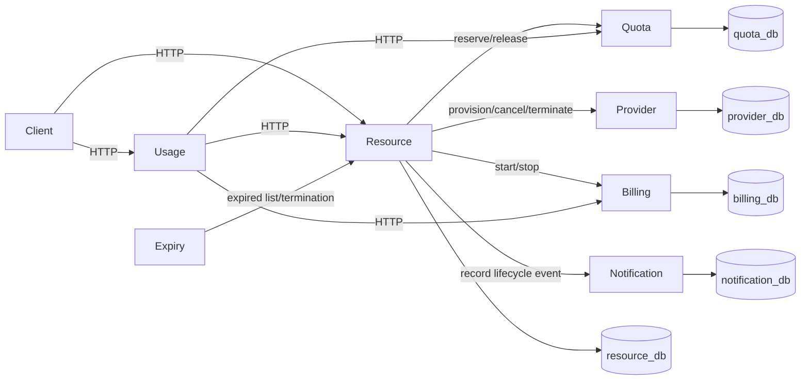
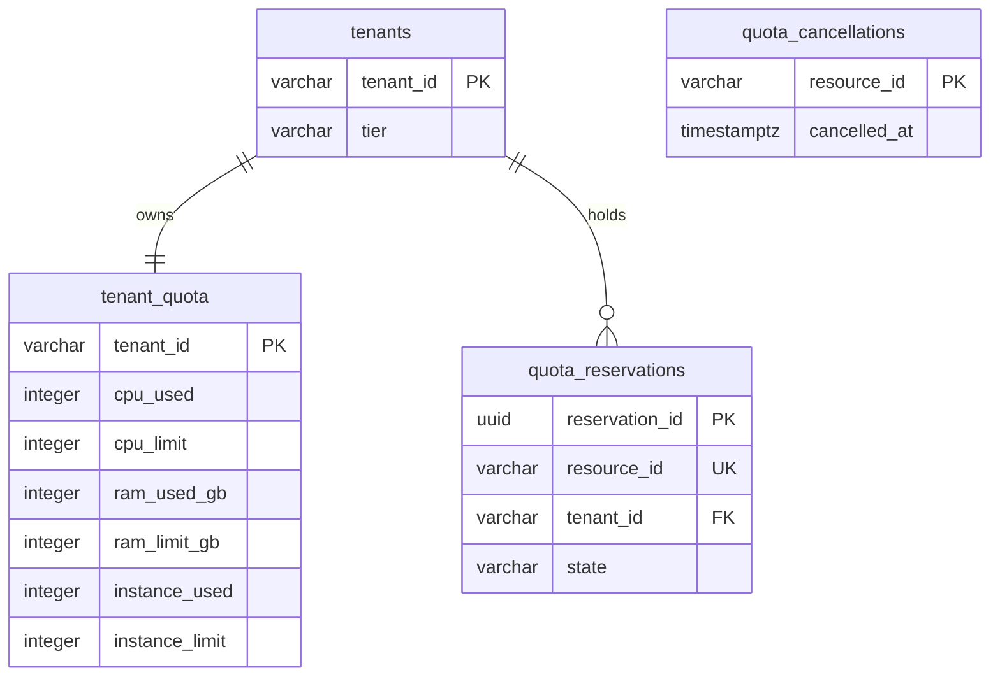
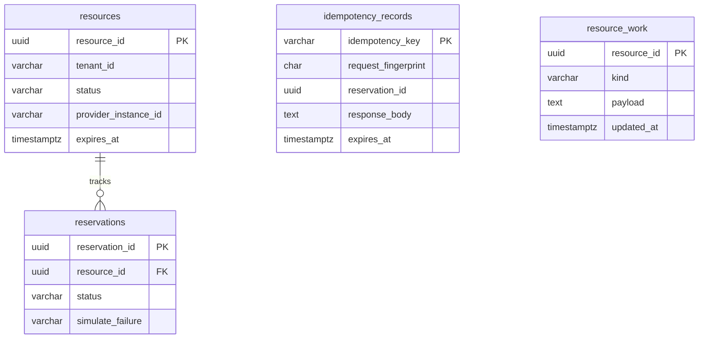
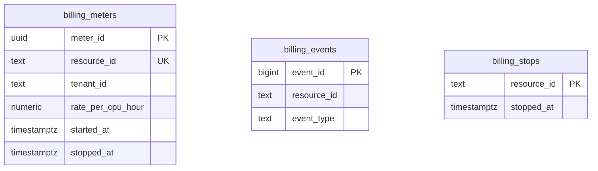
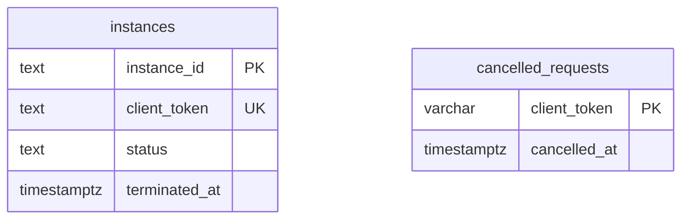
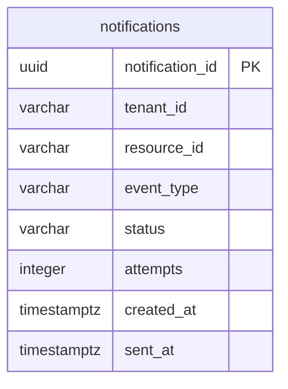

# Cloud Resource Manager: Design and Development

Course: SEZG583 Scalable Services, Assignment 1.

## 1. Problem and scope

The system provisions simulated compute resources for tenants with fixed subscription quotas.
A request must stay within CPU, RAM and instance limits. Retries must preserve the original
operation, and failed provisioning must release its allocation and stop uncertain remote effects.

Supported resource types are VM, CONTAINER and CLUSTER. Tiers are immutable after creation:

| Tier | CPU | RAM GB | Instances | Restriction |
|---|---:|---:|---:|---|
| FREE | 2 | 4 | 1 | No CLUSTER |
| STANDARD | 20 | 64 | 10 | None |
| ENTERPRISE | 200 | 512 | 100 | None |

| Rule | Enforcement | Verification |
|---|---|---|
| BR1: quota cannot be exceeded | Conditional SQL update and database checks | Quota concurrency tests; Challenge 1 |
| BR2: provisioning is idempotent | Unique key, request fingerprint and stored response | Resource concurrency tests; Challenge 2 |
| BR3: changed payload is rejected | SHA-256 fingerprint comparison | Payload-mismatch tests |
| BR4: lifecycle transitions are explicit | ResourceLifecycle and atomic termination guard | Lifecycle and HTTP tests |
| BR5: stopped billing does not accrue | Serialized meter stop and persisted timestamp | StoppedCostTest and PostgreSQL tests |
| BR6: compensation releases quota | Durable cleanup and idempotent peer operations | RecoveryIT; Challenge 3C; process test |
| BR7: release applies once | Conditional reservation-state update | Concurrent release tests |
| BR8: FREE cannot provision CLUSTER | Tier policy before reservation | Tier policy and HTTP tests |

Authentication, real infrastructure, payment collection, a graphical interface and cloud
deployment are outside this assignment. Tenant identity is supplied explicitly in requests.

## 2. Service decomposition

| Service | Owner | Responsibility | Database |
|---|---|---|---|
| Quota, 8081 | Prajwal | Tenants, tier policy, quota admission and release | quota_db |
| Resource, 8082 | Prajwal | Resource lifecycle, idempotency and orchestration | resource_db |
| Billing, 8083 | Karan | Meter start/stop, cost and monthly aggregation | billing_db |
| Notification, 8084 | Siddharth | Lifecycle history and simulated delivery retries | notification_db |
| Provider, 8085 | Vinayak | Idempotent infrastructure simulation | provider_db |
| Usage Aggregator, 8086 | Siddharth | Compose quota, active resources and cost | None |
| Expiry Worker, 8087 | Siddharth | Request termination of expired resources | None |

Quota keeps policy, counters and its reservation ledger in one local consistency boundary.
Resource owns workflow state while calling other services through their APIs. Billing owns
money and elapsed-time calculations. Notification failures do not invalidate provisioning.
Provider is the independently slow or unreliable dependency required by the assignment.
Usage and Expiry own no copied business data.

A shared database would simplify transactions but remove service isolation. A separate Tenant
service would add a network call to quota admission. A reporting database would require
replication and a staleness policy; direct composition is sufficient for this workload.

## 3. Architecture

### Components



### Provisioning

```mermaid
sequenceDiagram
    participant C as Client
    participant R as Resource
    participant Q as Quota
    participant P as Provider
    participant B as Billing
    participant N as Notification
    C->>R: POST resources, Idempotency-Key
    R->>R: Claim key; persist quota recovery intent
    R->>Q: Reserve quota
    Q-->>R: Reservation
    R->>R: Commit resource, reservation and pending work
    R-->>C: 202, reservation URL
    R->>P: Provision with stable clientToken
    P-->>R: Instance ID
    R->>B: Start meter by resourceId
    B-->>R: Meter
    R->>R: Commit ACTIVE and COMPLETED together
    R->>N: ACTIVE notification
    C->>R: Poll reservation
    R-->>C: COMPLETED
```

### Billing failure and compensation

```mermaid
sequenceDiagram
    participant R as Resource
    participant B as Billing
    participant P as Provider
    participant Q as Quota
    participant N as Notification
    R->>B: Start meter, always-fail
    B-->>R: 503; retries exhausted
    R->>R: Persist COMPENSATE work
    R->>B: Stop any possibly committed meter
    R->>P: Cancel provisioning by clientToken
    Note over R,P: Both independent cleanup steps are attempted
    alt Cleanup confirmed
        R->>Q: Release allocation
        R->>R: Commit FAILED and remove work
        R->>N: FAILED notification
    else Peer unavailable
        R->>R: Retain work and instance identity
        Note over R: Retry after recovery or restart
    end
```

Termination atomically changes ACTIVE to TERMINATED and records teardown in the same local
transaction. HTTP 202 acknowledges the desired state; cleanup may still be pending. Durable
work remains until Provider termination, Billing stop and Quota release succeed. Notification
is best effort. Expiry uses this same termination API.

## 4. Data design

Each service has its own database, role and Flyway migration history. Foreign IDs are ordinary
values; there are no cross-database joins or foreign keys in service code.

### Quota



The conditional update enforces all dimensions together. Reservation identity is serialized so
concurrent retries add usage once. Cancellation tombstones prevent delayed reserves from
recreating allocations after recovery released them.

### Resource



The work record can precede a Resource row so a local commit failure cannot lose a remote quota
allocation. Committed work survives executor rejection or process exit. Database advisory locks
prevent competing workers from processing one resource simultaneously. Coordination connections
are separate from the application pool so waiting HTTP work does not consume its pooled slots.

### Billing



Rates use NUMERIC(10,4). Cost uses BigDecimal and whole elapsed seconds. Monthly cost intersects
the meter interval with the requested UTC calendar month. Serialized start/stop operations
produce one START and one STOP event. A stop tombstone blocks a late start after cancellation.

### Provider



Provisioning preserves the client token across retries. Cancellation by token also covers a
request whose instance ID was never received. A cancelled request cannot create a late instance.

### Notification



A transaction records the event and delivery result. Pending records are retried with row locks
and a bounded attempt count. Delivery is simulated and at least once. Usage and Expiry have no
databases or ER diagrams.

## 5. API design

| Service | APIs |
|---|---|
| Quota | POST/GET tenants; GET tenant quota; POST quota reservations; POST reservation release |
| Resource | POST/GET resources; GET reservation; POST termination; GET expired candidates |
| Billing | POST/GET meters; POST meter stop; GET tenant monthly cost |
| Notification | POST lifecycle event; GET tenant history |
| Provider | POST instances; DELETE instance; DELETE provisioning request by token |
| Usage | GET usage for tenant |
| Expiry | Scheduled HTTP client; no business endpoint |

Business paths use `/api/v1`. Health is `/health`; generated OpenAPI is `/v3/api-docs.yaml`.

Example provisioning request:

```http
POST /api/v1/resources
Idempotency-Key: example-operation
Content-Type: application/json

{"tenantId":"tnt-demo","type":"VM","cpu":2,"ramGb":4,"durationSeconds":60}
```

A successful admission returns 202 with `reservationId`, `resourceId` and `statusUrl`.
Polling returns PENDING, COMPLETED or FAILED. Changed payloads on an existing key return 422.
Invalid input returns 400, missing resources return 404, state conflicts return 409, and
unavailable dependencies return 503. Errors use Problem Details with `code`, `correlationId`
and `timestamp`; field validation identifies the affected input.

OpenAPI files: [Quota](services/quota/openapi.yaml), [Resource](services/resource/openapi.yaml),
[Billing](services/billing-service/openapi.yaml), [Provider](services/provider/openapi.yaml),
[Notification](services/notification-service/openapi.yaml), [Usage](services/usage-aggregator/openapi.yaml),
[Expiry](services/expiry-worker/openapi.yaml).

## 6. Engineering challenges

| Challenge | Problem and design | Alternative and trade-off | Evidence |
|---|---|---|---|
| 1: concurrency | Several requests compete for tenant capacity; a conditional SQL update is the admission decision | Read-then-write permits races; serializing all tenants would reduce concurrency unnecessarily | [Challenge 1](evidence/challenge-1-quota-concurrency/output.txt), Quota PostgreSQL tests |
| 2: idempotency | Requests retry after uncertain responses; a unique key, normalized fingerprint and stored response preserve one operation | Client-side deduplication cannot protect the server; permanent key retention has unbounded storage cost | [Challenge 2](evidence/challenge-2-idempotency/output.txt), Resource concurrent HTTP tests |
| 3C: saga compensation | Remote steps can commit independently; persistent work retries idempotent cleanup and cancellation | Distributed transactions would require participation from every service; log-only cleanup loses recovery after restart | [Challenge 3C](evidence/challenge-3c-saga-compensation/output.txt), RecoveryIT, seven-service restart test |

Idempotency defaults to 24-hour retention with an hourly deletion sweep. Retries have bounded
timeouts and backoff; persistent cleanup continues across separate retry passes when a peer
remains unavailable. A circuit breaker is not required by the selected challenge.

## 7. Testing

Tests cover domain policy, HTTP errors, PostgreSQL constraints, simultaneous reservations and
meter operations, request replay, compensation, notification retry, usage degradation and
scheduled expiry. Dedicated test databases keep test data separate from application data.
Quota and Resource accept external PostgreSQL test URLs as an alternative to Testcontainers.
Provider tests start isolated PostgreSQL. Notification's `postgres` profile uses its test database.

The process test runs seven separate jars against five PostgreSQL databases without HTTP stubs.
It checks manual and scheduled termination, real Billing failure, quota refund, notification
history, peer outages and Resource restart during unfinished teardown.

Current commands, counts and captured output are in [integration evidence](evidence/integration/README.md).
Challenge scripts and their dated captures are linked from the evidence index.

## 8. Design decisions and trade-offs

| Decision | Rationale | Cost or limit |
|---|---|---|
| Synchronous quota, asynchronous provisioning | Reject insufficient capacity before accepting work; avoid waiting for the slow Provider | Clients poll a reservation URL |
| Orchestration rather than choreography | One service owns lifecycle and cleanup order | Resource coordinates the transaction and must persist recovery intent |
| Database per service | Independent ownership and role-enforced separation | Cross-service consistency is eventual |
| SQL guards and idempotent operations | Enforce concurrent capacity and retry safety at the data owner | PostgreSQL-specific queries require real database tests |
| Durable work in Resource | Recover accepted and cleanup work without a workflow platform | Polling and retained pending rows while peers are unavailable |
| At-least-once notifications | Keep delivery failure outside provisioning correctness | Repeated POST can record another notification; there is no event deduplication key |

## 9. Limitations and future work

This is a local assignment implementation. There is no authentication, real provider integration,
cloud deployment, invoicing or automated operations platform. Usage combines independent reads
rather than a consistent cross-service snapshot. Notification delivery can be repeated.
Cancellation records retain operation identities and must not be removed while delayed requests
can still arrive. Cleanup remains pending during an unavailable peer; operators can inspect the
Resource work table and correlated logs.

Deployment, authentication and operational retention policies belong to a later production scope.

## 10. Submission materials

The Google Drive link for the demo video and submission documents has not been supplied.
The assignment requires an 8–10 minute team video showing the main flow, a failure case and
challenge demonstrations. Recording and uploading the video remain team deliverables.

## Appendix: contributions and AI use

Service ownership is recorded in [units.md](aidlc-docs/inception/units.md). Prajwal owns Quota and
Resource; Karan owns Billing; Vinayak owns Provider; Siddharth owns Notification, Usage and Expiry.
The local integration work adds boundary fixes, failure recovery and regression verification
across those services. Individual reflections and final contribution claims must be confirmed
by the corresponding team members.

OpenAI Codex assisted with implementation, review, documentation and tests. The team remains
responsible for understanding the code and explaining it in the demonstration.
