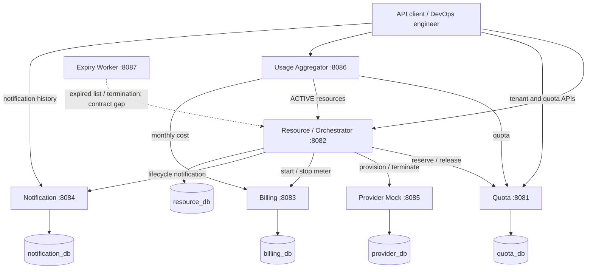
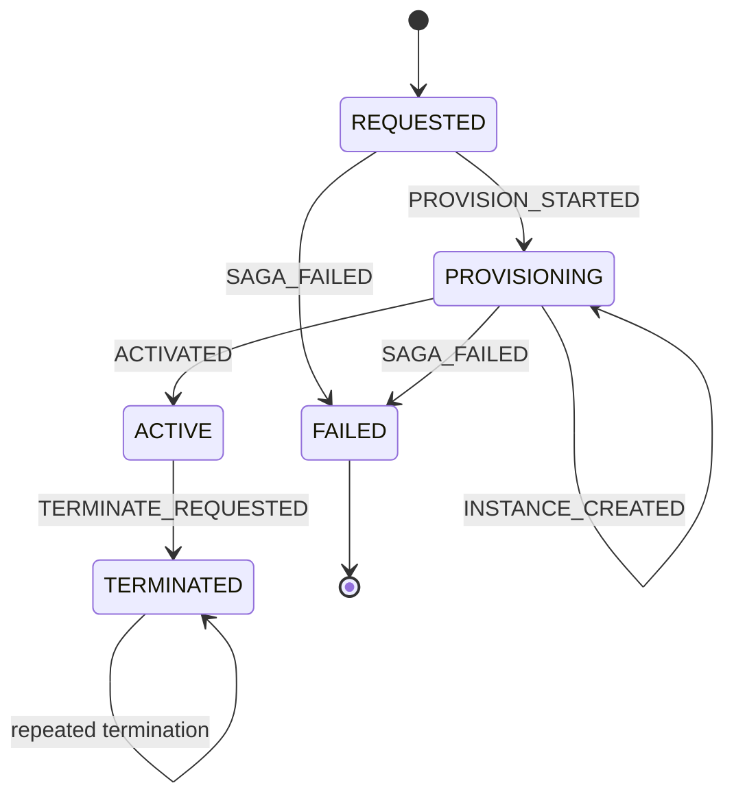
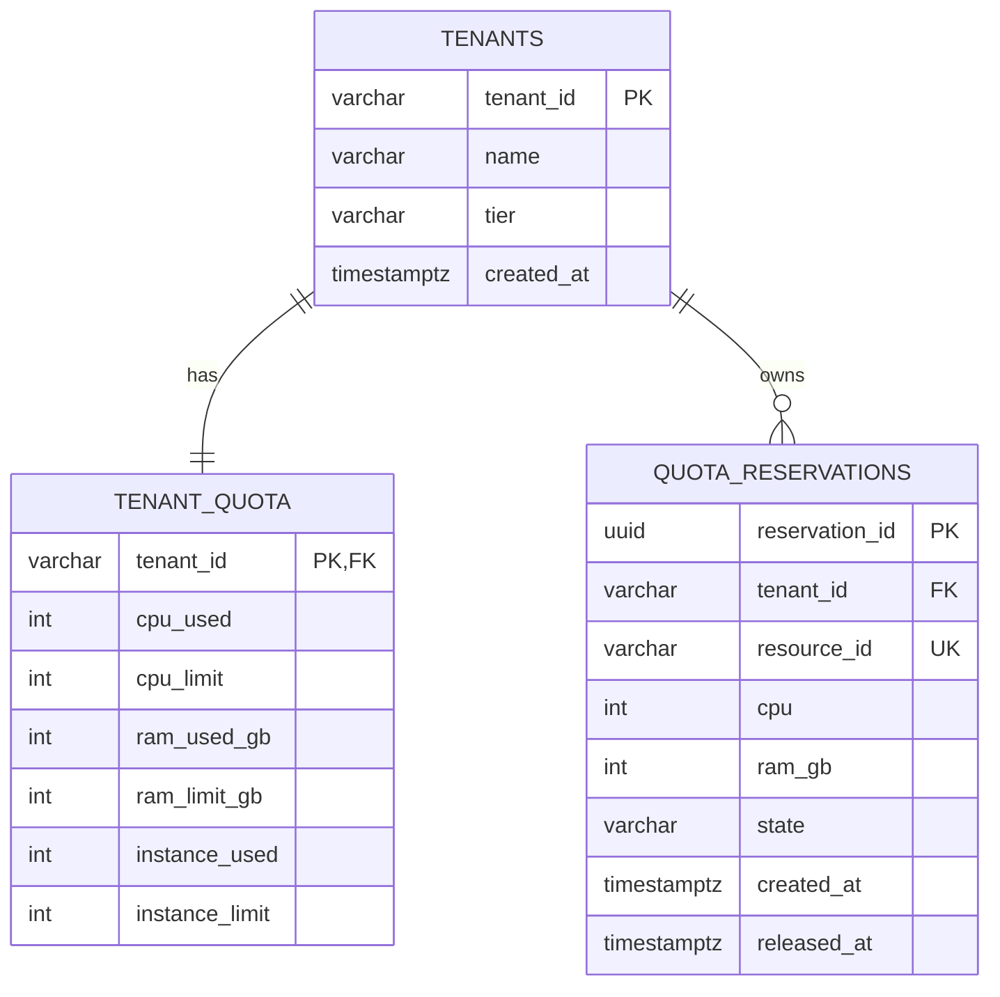
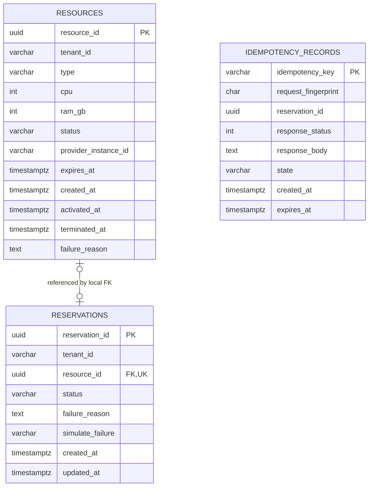
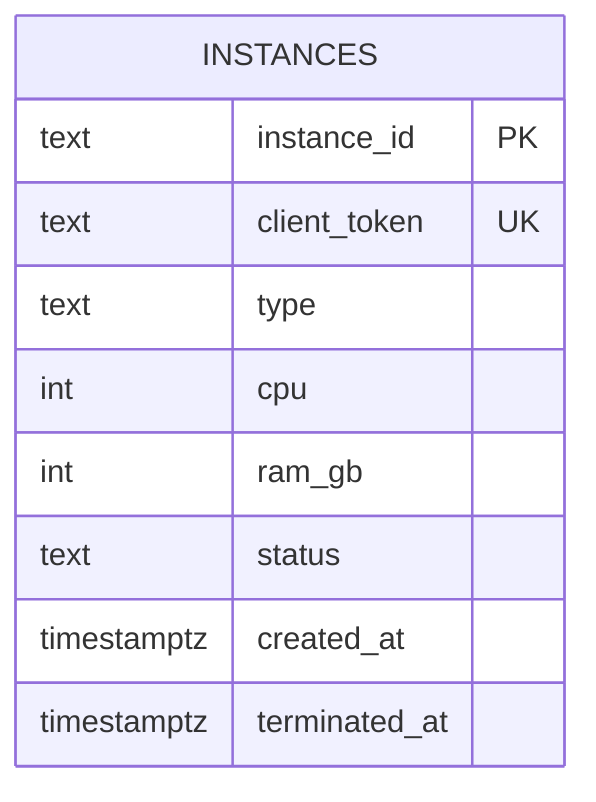
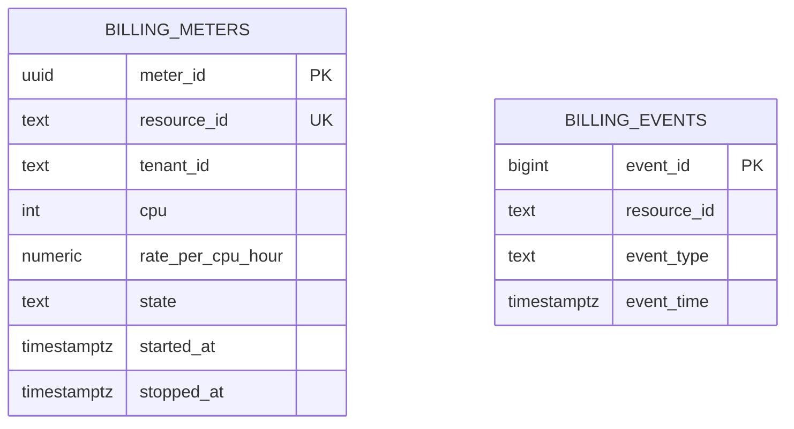
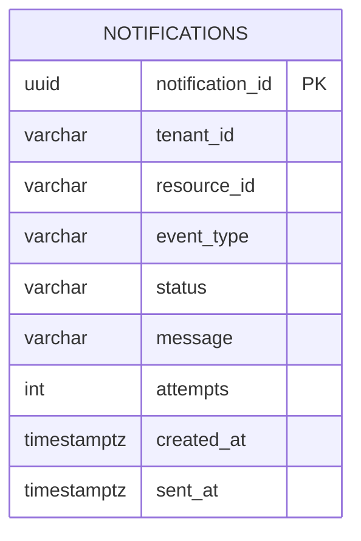

# Cloud Resource Manager: Design and Development Report

**Repository:** https://github.com/prajwalbhat39/microservice-cloud-resource-manager  
**Course:** SEZG583 Scalable Services, Assignment 1  
**Report date:** 24 October 2026  
**Implementation baseline examined:** `fd51ccf` (21 October 2026)

## Report basis

This report describes the implementation present in the repository, not merely its proposed architecture. It uses application code, Flyway migrations, API contracts, test source, and captured execution evidence. Some earlier service READMEs describe unfinished stubs even though the corresponding business logic now exists; executable code takes precedence.

**Evidence convention:** "recorded" means an existing captured run, "source-verified" means established by code inspection, and "proposed" means future work. No new application launch or test execution was performed while preparing this documentation. Integration limitations are stated explicitly; passing isolated service tests is not treated as proof that all seven real services work together.

Diagrams use Mermaid notation. They can be viewed in a Mermaid-capable Markdown renderer and rendered before exporting a submission PDF. This file is the report source, not a page-count-validated PDF.

---

## 1. Problem and scope

### 1.1 Problem overview

Organizations need to provision compute resources without exceeding subscription limits, creating duplicate infrastructure on retries, or continuing to charge for resources after termination. These concerns become harder when quota, infrastructure provisioning, billing, and notifications are independently deployed services: one service can commit while another fails.

Cloud Resource Manager provides an API-based management layer over simulated compute infrastructure. A tenant can request a VM, container, or cluster; obtain an asynchronous reservation; inspect resource state; terminate resources; and retrieve usage and cost information.

The primary user is a DevOps engineer or IT manager. The project deliberately concentrates on distributed-system correctness rather than a user interface:

1. **Contended capacity:** simultaneous requests compete for the same tenant quota.
2. **Unsafe repetition:** retransmitting a provisioning request must not create additional infrastructure.
3. **Partial failure:** provisioning must undo completed work if a later required step fails.

### 1.2 Functional scope

| Area | Implemented responsibility |
|---|---|
| Tenant management | Create and retrieve tenants with immutable subscription tiers |
| Quota | Reserve CPU, RAM, and instance capacity together; report headroom; release recorded allocations |
| Resource management | Accept requests, expose reservation polling, manage lifecycle, list and terminate resources |
| Provider simulation | Persist mock instances; simulate latency and failure; deduplicate by client token |
| Billing | Start/stop resource meters; compute elapsed-time cost and tenant monthly cost |
| Notifications | Persist lifecycle notifications and simulate delivery with bounded retry |
| Usage reporting | Compose quota, ACTIVE resources, and current UTC-month cost |
| Expiry | Periodically request termination of expired resources; actual integration has the contract gap described in Section 9 |

### 1.3 Assumptions and domain policies

| Assumption/policy | Consequence |
|---|---|
| Tenant identity is explicitly supplied by API clients | No authenticated identity or authorization boundary is implemented |
| Compute types are VM, CONTAINER, and CLUSTER | Each request consumes one instance slot, regardless of type |
| Quota has three independent dimensions | All three must fit; partial reservations are prohibited |
| Tier is fixed at tenant creation | No upgrade, downgrade, or quota-adjustment API |
| Each stateful service owns a PostgreSQL database | No shared-table transactions or cross-service foreign keys |
| Resource acceptance is not completion | Clients poll the returned reservation URL after HTTP 202 |
| Duration is optional | If absent, there is no automatic expiry; accepted durations are 30 to 2,592,000 seconds |
| Expiry is calculated at request creation | Provisioning time consumes part of the requested duration |
| Infrastructure and notification delivery are simulations | No real cloud account, payment processor, email, or SMS provider is contacted |
| Prices use decimal arithmetic | The orchestrator sends USD 0.12 per CPU-hour by default; actual Billing configuration also defaults to 0.12 |
| Idempotency is retained for a bounded period | Default retention is 24 hours, with deletion by an hourly sweep; it is not a permanent deduplication guarantee |

The Billing README mentions a 0.13 default, but [the executable configuration](https://github.com/prajwalbhat39/microservice-cloud-resource-manager/blob/main/services/billing-service/src/main/resources/application.yml) uses 0.12. This report follows the configuration.

**Tier limits**

| Tier | CPU cores | RAM (GB) | Instances | Additional policy |
|---|---:|---:|---:|---|
| FREE | 2 | 4 | 1 | CLUSTER is forbidden |
| STANDARD | 20 | 64 | 10 | All supported types |
| ENTERPRISE | 200 | 512 | 100 | All supported types |

### 1.4 Business rules and traceability

| Rule | Definition | Implementation | Test evidence/source |
|---|---|---|---|
| BR1 | Usage never exceeds any tier limit, including concurrent requests | [Atomic conditional quota UPDATE](https://github.com/prajwalbhat39/microservice-cloud-resource-manager/blob/main/services/quota/src/main/java/com/crm/quota/persistence/repository/TenantQuotaRepository.java) and database CHECK constraints | [Br1ConcurrencyIT](https://github.com/prajwalbhat39/microservice-cloud-resource-manager/blob/main/services/quota/src/test/java/com/crm/quota/Br1ConcurrencyIT.java); recorded 20-way race |
| BR2 | Same provisioning key and payload return the original result without additional effects | [IdempotencyService](https://github.com/prajwalbhat39/microservice-cloud-resource-manager/blob/main/services/resource/src/main/java/com/crm/resource/domain/service/IdempotencyService.java), primary-key insert gate, stored response | [IdempotencyServiceTest](https://github.com/prajwalbhat39/microservice-cloud-resource-manager/blob/main/services/resource/src/test/java/com/crm/resource/domain/service/IdempotencyServiceTest.java), [IdempotencyConcurrencyIT](https://github.com/prajwalbhat39/microservice-cloud-resource-manager/blob/main/services/resource/src/test/java/com/crm/resource/IdempotencyConcurrencyIT.java) |
| BR3 | Reusing a key for a different payload returns 422 | [SHA-256 request fingerprint](https://github.com/prajwalbhat39/microservice-cloud-resource-manager/blob/main/services/resource/src/main/java/com/crm/resource/domain/RequestFingerprint.java) and stored fingerprint comparison | [RequestFingerprintTest](https://github.com/prajwalbhat39/microservice-cloud-resource-manager/blob/main/services/resource/src/test/java/com/crm/resource/domain/RequestFingerprintTest.java), [IdempotencyPayloadMismatchIT](https://github.com/prajwalbhat39/microservice-cloud-resource-manager/blob/main/services/resource/src/test/java/com/crm/resource/IdempotencyPayloadMismatchIT.java) |
| BR4 | Only explicit lifecycle transitions are allowed; ACTIVE is reachable only from PROVISIONING | [ResourceLifecycle](https://github.com/prajwalbhat39/microservice-cloud-resource-manager/blob/main/services/resource/src/main/java/com/crm/resource/domain/ResourceLifecycle.java) | [ResourceLifecycleTest](https://github.com/prajwalbhat39/microservice-cloud-resource-manager/blob/main/services/resource/src/test/java/com/crm/resource/domain/ResourceLifecycleTest.java) |
| BR5 | Stopping a meter fixes its stop time and prevents further cost accrual | [BillingServiceImpl](https://github.com/prajwalbhat39/microservice-cloud-resource-manager/blob/main/services/billing-service/src/main/java/com/crm/billing/service/BillingServiceImpl.java) | [BillingServiceImplTest](https://github.com/prajwalbhat39/microservice-cloud-resource-manager/blob/main/services/billing-service/src/test/java/com/crm/billing/service/BillingServiceImplTest.java), including the BR5 test; no captured result examined |
| BR6 | A failed provisioning saga compensates completed work and releases reserved quota | [ProvisioningSaga](https://github.com/prajwalbhat39/microservice-cloud-resource-manager/blob/main/services/resource/src/main/java/com/crm/resource/domain/service/ProvisioningSaga.java) | [ProvisioningSagaCompensationTest](https://github.com/prajwalbhat39/microservice-cloud-resource-manager/blob/main/services/resource/src/test/java/com/crm/resource/domain/service/ProvisioningSagaCompensationTest.java); recorded billing-failure scenario |
| BR7 | Repeated/concurrent termination must not release the same quota twice | [TerminationService](https://github.com/prajwalbhat39/microservice-cloud-resource-manager/blob/main/services/resource/src/main/java/com/crm/resource/domain/service/TerminationService.java), atomic ledger state flip in [QuotaService](https://github.com/prajwalbhat39/microservice-cloud-resource-manager/blob/main/services/quota/src/main/java/com/crm/quota/domain/service/QuotaService.java) | [TerminationIdempotencyIT](https://github.com/prajwalbhat39/microservice-cloud-resource-manager/blob/main/services/resource/src/test/java/com/crm/resource/TerminationIdempotencyIT.java), [Br7ReleaseExactlyOnceIT](https://github.com/prajwalbhat39/microservice-cloud-resource-manager/blob/main/services/quota/src/test/java/com/crm/quota/Br7ReleaseExactlyOnceIT.java) |
| BR8 | FREE tenants cannot provision CLUSTER resources | [TierPolicy](https://github.com/prajwalbhat39/microservice-cloud-resource-manager/blob/main/services/quota/src/main/java/com/crm/quota/domain/TierPolicy.java) | [TierPolicyTest](https://github.com/prajwalbhat39/microservice-cloud-resource-manager/blob/main/services/quota/src/test/java/com/crm/quota/domain/TierPolicyTest.java) |

BR5's meter invariant is distinct from reliable orchestration of termination: a successfully stopped meter stays stopped, but the current background teardown can fail before successfully stopping it. Similarly, BR6 is demonstrated for the recorded compensation scenario, not guaranteed under every compensation failure or process crash.

### 1.5 Out of scope

Authentication/authorization, a graphical interface, real infrastructure provisioning, real payment collection, real message delivery, tier changes, resource resize, pause/resume, taxation, invoicing, and currency conversion are excluded. Docker/Minikube deployment belongs to the subsequent assignment, not an established capability of this snapshot. Multi-region deployment and production operational guarantees are also outside the demonstrated scope.

---

## 2. Service decomposition

### 2.1 Responsibility and ownership table

The implementation contains four principal business services, one simulated infrastructure service, and two stateless supporting services.

| Service | Default port | Responsibility and owned state | Principal collaborators |
|---|---:|---|---|
| [Quota](https://github.com/prajwalbhat39/microservice-cloud-resource-manager/tree/main/services/quota/) | 8081 | Tenant identity/tier, limits, usage, quota reservation ledger | Resource; Usage |
| [Resource / Orchestrator](https://github.com/prajwalbhat39/microservice-cloud-resource-manager/tree/main/services/resource/) | 8082 | Resource lifecycle, asynchronous reservations, idempotency records, provisioning and teardown coordination | Quota, Provider, Billing, Notification; queried by Usage and Expiry |
| [Billing](https://github.com/prajwalbhat39/microservice-cloud-resource-manager/tree/main/services/billing-service/) | 8083 | Meter lifecycle, decimal cost computation, START/STOP audit events | Resource; Usage |
| [Notification](https://github.com/prajwalbhat39/microservice-cloud-resource-manager/tree/main/services/notification-service/) | 8084 | Lifecycle message history, delivery attempts, retry status | Resource |
| [Provider Mock](https://github.com/prajwalbhat39/microservice-cloud-resource-manager/tree/main/services/provider/) | 8085 | Mock instance identity/state, token deduplication, configurable delay/failure | Resource |
| [Usage Aggregator](https://github.com/prajwalbhat39/microservice-cloud-resource-manager/tree/main/services/usage-aggregator/) | 8086 | Read-only composition; owns no persistent business data | Quota, Resource, Billing |
| [Expiry Worker](https://github.com/prajwalbhat39/microservice-cloud-resource-manager/tree/main/services/expiry-worker/) | 8087 | Scheduling and termination requests; owns no persistent business data | Resource |

### 2.2 Why these boundaries

**Quota is a consistency boundary.** Tenant tier, capacity counters, and reservation ledger must participate in one local transaction. Keeping them together lets PostgreSQL decide admission atomically.

**Resource is a workflow boundary.** Clients need a single resource identity and coherent lifecycle even though several services participate. The orchestrator owns that identity and coordinates the workflow without owning other services' tables.

**Billing is a financial-policy boundary.** Metering, rounding, elapsed time, and monthly overlap calculation form a cohesive domain. Callers request meter operations rather than calculating charges themselves.

**Notification is a delivery boundary.** Delivery failure must not invalidate successfully provisioned infrastructure. Its persisted retry state is independent of resource state.

**Provider Mock is an external-dependency boundary.** It reproduces slow/unreliable infrastructure behind a replaceable REST contract. Its own database makes duplicate prevention survive process restart.

**Usage and Expiry are intentionally stateless.** They compose or initiate operations through owner APIs. Adding private copies of quota or resource tables would introduce unnecessary synchronization and ownership ambiguity.

### 2.3 Alternatives evaluated

These alternatives explain the observed design; they are not claims that every option was historically prototyped.

| Alternative | Reason not selected / trade-off |
|---|---|
| One application and one database | Simplifies transactions, but does not exercise independent service ownership, remote failure, or compensation |
| Separate Tenant service from Quota | Adds a remote dependency to quota policy; tenant tier and limits are closely coupled in this scope |
| Combine Resource and Provider | Removes the independent unreliable dependency and conflates workflow state with infrastructure state |
| Embed notification delivery in Resource | Couples provisioning availability to a noncritical delivery subsystem |
| Reporting database for Usage | Requires replication and staleness policy; direct composition is sufficient for this small workload |
| Persist all Expiry candidates locally | Duplicates resource truth; the Resource API already owns the authoritative expiry and transition |

### 2.4 Independent build and configuration

Each service has its own Maven project and wrapper. All target Java 21 and Spring Boot 3.x, but framework versions differ: the core services use 3.5.0, Billing uses 3.3.5, and supporting services use 3.5.16.

The [root aggregator](https://github.com/prajwalbhat39/microservice-cloud-resource-manager/blob/main/pom.xml) currently includes only Quota, Resource, and Provider. It does **not** build all seven services. Database connections and peer URLs are largely environment-driven. The Resource defaults still target stubs on port 8090 for Provider, Billing, and Notification; an all-real-service run requires:

```powershell
$env:PROVIDER_SERVICE_URL = 'http://localhost:8085'
$env:BILLING_SERVICE_URL = 'http://localhost:8083'
$env:NOTIFICATION_SERVICE_URL = 'http://localhost:8084'
```

Set these in the process environment used to start Resource. They do not reconfigure an already-running process.

---

## 3. Architecture

### 3.1 Component diagram

All inter-service arrows represent REST over HTTP. Database arrows represent access by the owning service only.



There is no message broker, API gateway, shared application database, or distributed transaction coordinator. The asynchronous boundary is an in-process Spring executor, not durable message delivery.

### 3.2 Main transaction: provision a resource

The required business steps are quota reservation, provider provisioning, billing start, and resource activation/reservation completion. Notification follows as a nonblocking business concern. The orchestrator participates in addition to its downstream services.

The diagram shows logical ordering; after-commit dispatch can start the background task before the client has physically received the 202 response.

```mermaid
sequenceDiagram
    autonumber
    actor C as Client
    participant R as Resource API / Saga
    participant D as resource_db
    participant Q as Quota
    participant P as Provider Mock
    participant B as Billing
    participant N as Notification
    C->>R: POST /resources + Idempotency-Key
    R->>D: Claim key with fingerprint (local transaction)
    R->>Q: Reserve quota for resourceId
    Q-->>R: 200 RESERVED (atomic admission)
    R->>D: Resource REQUESTED, reservation PENDING, cached 202
    R->>D: Commit and dispatch after commit
    R-->>C: 202 + reservationId + Location
    R->>D: Resource PROVISIONING
    R->>P: Provision with stable clientToken
    P-->>R: 201 instanceId
    R->>D: Store provider_instance_id
    R->>B: Start meter
    alt Happy path
        B-->>R: 201 new meter / 200 replay
        R->>D: Resource ACTIVE; reservation COMPLETED
        R->>N: POST ACTIVE notification
        N-->>R: 202 persisted; delivery outcome
        C->>R: GET reservation
        R-->>C: 200 COMPLETED + resourceId + instanceId
    else Billing unavailable after configured attempts
        B-->>R: 503 / transport failure
        R->>P: DELETE created instance (undo step 2)
        P-->>R: 200 TERMINATED
        R->>Q: Release quota (undo step 1)
        Q-->>R: 200 RELEASED
        R->>D: Clear instance reference; resource and reservation FAILED
        R->>N: POST FAILED notification (best effort)
        C->>R: GET reservation
        R-->>C: 200 FAILED + failureReason
    end
```

If quota is rejected, Resource returns the corresponding 404/422 synchronously and creates no resource or reservation. That business rejection is stored against the idempotency key. Infrastructure failure instead rolls back the local transaction; this does not constitute a rollback of any remote commit.

**Failure-path qualification:** the captured compensation demonstration used a real Resource service, real Quota service, real PostgreSQL, and stubbed Provider/Billing/Notification. The diagram expresses the workflow; it is not evidence of an all-real-services failure test.

### 3.3 Failure sequence: Billing failure and saga compensation

This standalone failure diagram makes the required failure path explicit. Step 1 (quota reservation) and step 2 (provider provisioning) succeed, but step 3 (billing start) returns 503 on all three attempts. Step 4 (activation) is never executed. The orchestrator then compensates the completed steps in reverse order: terminate the provider instance, then release quota.

```mermaid
sequenceDiagram
    autonumber
    actor C as Client
    participant R as Resource API / Saga
    participant D as resource_db
    participant Q as Quota
    participant P as Provider Mock
    participant B as Billing
    participant N as Notification
    C->>R: POST /api/v1/resources + Idempotency-Key
    R->>D: Claim key and store request fingerprint
    R->>Q: Step 1 - POST /api/v1/quota/reservations
    Q-->>R: 200 RESERVED
    R->>D: Save REQUESTED resource, PENDING reservation, cached 202
    R->>D: Commit; dispatch saga after commit
    R-->>C: 202 Accepted + reservation Location
    R->>D: Transition resource to PROVISIONING
    R->>P: Step 2 - POST /api/v1/provider/instances (stable token)
    P-->>R: 201 Created + instanceId
    R->>D: Store provider_instance_id
    loop Three total billing attempts
        R->>B: Step 3 - POST /api/v1/billing/meters
        B-->>R: 503 Service Unavailable
        Note over R,B: Backoff with jitter between attempts only
    end
    Note over R,D: Retries exhausted; step 4 (activation) is skipped
    Note over R,B: Meter never started; no billing stop is needed
    R->>P: Compensate step 2 - DELETE /api/v1/provider/instances/{id}
    P-->>R: 200 TERMINATED
    R->>D: Clear provider_instance_id
    R->>Q: Compensate step 1 - POST /api/v1/quota/reservations/{resourceId}/release
    Q-->>R: 200 RELEASED; restore reserved capacity once
    R->>D: Resource FAILED; reservation FAILED; save BILLING_UNAVAILABLE reason
    R->>N: POST /api/v1/notifications (FAILED; best effort)
    N-->>R: 202 Accepted in the demonstrated scenario
    C->>R: GET /api/v1/reservations/{reservationId}
    R-->>C: 200 OK; status FAILED + failureReason
```

**Outcome:** in the recorded scenario, the created provider instance is terminated, quota is returned in full, and the resource and reservation are FAILED. The client sees the failure through polling; the earlier 202 only acknowledged acceptance. A failed notification does not restart compensation.

**Evidence and scope:** the [downstream call journal](https://github.com/prajwalbhat39/microservice-cloud-resource-manager/blob/main/evidence/challenge-3c-saga-compensation/peer-calls.txt) records the three Billing 503 responses and subsequent provider DELETE; the [final database state](https://github.com/prajwalbhat39/microservice-cloud-resource-manager/blob/main/evidence/challenge-3c-saga-compensation/db-after.txt) records quota release and FAILED outcomes. Provider, Billing, and Notification were stubbed in this run. This diagram assumes the compensating calls succeed, as in that demonstration; compensation outages and the real Billing failure-injection mismatch remain limitations described in Sections 6 and 9.

### 3.4 Lifecycle and termination



Termination uses an atomic `ACTIVE -> TERMINATED` update to select one winner. After commit, teardown calls Provider termination, Billing stop, Quota release, and Notification in that order. Failed steps are logged and subsequent steps continue. The status changes before cleanup completes, so `TERMINATED` currently describes the accepted desired state rather than verified completion of every remote effect.

### 3.5 Runtime and observability

Core clients have connect/read timeouts and bounded retry with exponential backoff and jitter. Defaults are three attempts, 200 ms initial backoff, multiplier 2, configured pre-jitter cap 2,000 ms, and jitter ratio 0.5. Because jitter is applied after capping, the final delay can exceed that pre-jitter cap. HTTP 503 and supported transport failures are retryable; ordinary business rejections are not.

Correlation IDs travel in `X-Correlation-Id`. Resource preserves context across its executor boundary using an MDC task decorator and an explicit task field. Core/supporting configurations provide structured logging, although observability is not fully uniform across every module. Health should be interpreted per service: Usage and Expiry report their own health independently of peer availability, while Billing's custom `/health` is only a static UP response.

---

## 4. Data design

### 4.1 Database-per-service and ownership

| Owner | Database | Tables / information owned | External references |
|---|---|---|---|
| Quota | `quota_db` | `tenants`, `tenant_quota`, `quota_reservations` | Resource ID in reservation ledger |
| Resource | `resource_db` | `resources`, `reservations`, `idempotency_records` | Tenant ID; Provider instance ID |
| Provider | `provider_db` | `instances` | Resource-derived client token |
| Billing | `billing_db` | `billing_meters`, `billing_events` | Tenant ID; Resource ID |
| Notification | `notification_db` | `notifications` | Tenant ID; Resource ID |
| Usage | None | Transient composed response | IDs supplied in REST requests |
| Expiry | None | Transient candidate list and scheduler state | Resource IDs from Resource API |

Each stateful service has a separate configured database/user. Separate logical databases can share one local PostgreSQL server without becoming shared tables.

### 4.2 Quota ER diagram



[Quota migration](https://github.com/prajwalbhat39/microservice-cloud-resource-manager/blob/main/services/quota/src/main/resources/db/migration/V1__baseline.sql): usage is constrained to be nonnegative and no greater than its limits. Ledger state is RESERVED or RELEASED, with matching release timestamp constraints. A unique resource ID prevents multiple ledger rows for the same resource. A tenant/state index supports ledger inspection.

### 4.3 Resource ER diagram



[Resource migration](https://github.com/prajwalbhat39/microservice-cloud-resource-manager/blob/main/services/resource/src/main/resources/db/migration/V1__baseline.sql): the application normally creates one reservation per accepted resource; the SQL FK is nullable, hence the optional schema cardinality above. Reservation state is PENDING, COMPLETED, or FAILED.

The idempotency reservation ID is a logical link, deliberately **not** a foreign key: the key is inserted before its reservation, and a cached quota rejection has no reservation row at all. A completed idempotency record requires stored response status/body. The fingerprint is 64 lowercase hexadecimal characters.

Indexes cover tenant/status listing, ACTIVE rows with expiry, and idempotency retention cleanup. There is no saga-step table: lifecycle, reservation outcome, and failure reason record the observable workflow state.

### 4.4 Provider ER diagram



[Provider migration](https://github.com/prajwalbhat39/microservice-cloud-resource-manager/blob/main/services/provider/src/main/resources/db/migration/V1__baseline.sql): a unique token is the durable deduplication key. An ACTIVE row has no termination timestamp; a TERMINATED row has one. Termination retains the token so the same token cannot resurrect the instance.

### 4.5 Billing ER diagram



[Billing migration](https://github.com/prajwalbhat39/microservice-cloud-resource-manager/blob/main/services/billing-service/src/main/resources/db/migration/V1__baseline.sql): meter and audit events are associated logically through `resource_id`; the migration declares no FK between these tables. The rate uses `NUMERIC(10,4)`. START/STOP events are recorded locally with meter operations.

Cost uses `BigDecimal`:

`cost = cpu * ratePerCpuHour * wholeActiveSeconds / 3600`

The implementation rounds to six decimal places using HALF_UP. Monthly cost sums meter overlap with a UTC calendar-month window. Stopped meters use their persisted stop time rather than the current time.

### 4.6 Notification ER diagram



[Notification migration](https://github.com/prajwalbhat39/microservice-cloud-resource-manager/blob/main/services/notification-service/src/main/resources/db/migration/V1__baseline.sql): event types are ACTIVE, FAILED, and TERMINATED; delivery states are PENDING, SENT, and FAILED. Checks enforce nonblank identifiers/message, nonnegative attempts, and agreement between SENT and `sent_at`. Tenant/history and pending-delivery indexes support reads and retry.

Usage and Expiry have no ER diagrams because they have no persistent entities or database.

### 4.7 Cross-service references and consistency

Remote entities are referenced only by opaque identifiers, never database joins. For example, Billing stores `tenant_id` and `resource_id` without reading either owning database. Provider receives a stable resource-derived client token; Resource stores the returned instance ID.

Two different reservation concepts must not be confused: Quota's reservation is its capacity ledger entry, while Resource's reservation is the client polling handle. The shared resource ID connects the business flow.

Local transactions protect each service's data. Cross-service consistency is achieved through API operations, idempotency, and compensation; it is eventual, not atomic. Read composition can combine values observed at different instants. No implemented reconciliation process repairs every possible orphan or divergent reference.

---

## 5. API design

### 5.1 Endpoint catalogue

All business paths below start with `/api/v1`. Operability/documentation paths intentionally do not.

| Service | Method and path | Purpose | Principal success |
|---|---|---|---|
| Quota | POST `/api/v1/tenants` | Create tenant/tier quota | 201 |
| Quota | GET `/api/v1/tenants/{tenantId}` | Tenant details | 200 |
| Quota | GET `/api/v1/tenants/{tenantId}/quota` | Usage and remaining capacity | 200 |
| Quota | POST `/api/v1/quota/reservations` | Atomically reserve capacity | 200, including replay |
| Quota | POST `/api/v1/quota/reservations/{resourceId}/release` | Release recorded allocation | 200, including no-op replay |
| Resource | POST `/api/v1/resources` | Provision; mandatory `Idempotency-Key` | 202 |
| Resource | GET `/api/v1/reservations/{reservationId}` | Poll workflow outcome | 200 |
| Resource | GET `/api/v1/resources/{resourceId}` | Read resource | 200 |
| Resource | GET `/api/v1/resources?tenantId=...&status=...` | List/filter; `{items,count}` envelope | 200 |
| Resource | POST `/api/v1/resources/{resourceId}/termination` | Request termination; no body/key needed | 202, including repeat |
| Resource | GET `/api/v1/resources/expired` | Internal expired ACTIVE candidates; current response is an array | 200 |
| Provider | POST `/api/v1/provider/instances` | Create/replay by `clientToken` | 201, including replay |
| Provider | DELETE `/api/v1/provider/instances/{id}` | Terminate instance | 200, including repeat |
| Billing | POST `/api/v1/billing/meters` | Start meter by resource ID | 201 new; 200 existing |
| Billing | POST `/api/v1/billing/meters/{resourceId}/stop` | Stop meter | 200 |
| Billing | GET `/api/v1/billing/meters/{resourceId}` | Meter and current cost | 200 |
| Billing | GET `/api/v1/billing/tenants/{tenantId}/cost?period=YYYY-MM` | Calendar-month cost | 200 |
| Notification | POST `/api/v1/notifications` | Persist and attempt lifecycle delivery | 202 |
| Notification | GET `/api/v1/notifications?tenantId=...` | History array | 200 |
| Usage | GET `/api/v1/usage/{tenantId}` | Compose current usage and monthly cost | 200, including degraded composition |
| All services | GET `/health` | Service health, with differing dependency semantics | 200; dependency-aware implementations can return 503 |
| All services | GET `/v3/api-docs.yaml` | Generated OpenAPI | 200 when running |

Expiry has no business mutation endpoint; its scheduler calls Resource. Common error statuses are 400 invalid input, 404 missing entity, 409 state conflict, 422 business-rule rejection, 503 unavailable dependency, and 500 unexpected failure.

### 5.2 Representative requests and responses

Examples below are illustrative wire contracts, not newly captured execution output. UUIDs and timestamps are examples.

**A. Create a tenant**

```http
POST http://localhost:8081/api/v1/tenants
Content-Type: application/json
X-Correlation-Id: report-demo-001

{"tenantId":"tnt-report-demo","name":"Report Demo","tier":"STANDARD"}
```

```http
HTTP/1.1 201 Created
Content-Type: application/json

{"tenantId":"tnt-report-demo","name":"Report Demo","tier":"STANDARD","limits":{"cpu":20,"ramGb":64,"instances":10},"createdAt":null}
```

The recorded creation output has `createdAt:null`; this example retains that observed behavior rather than inventing a populated timestamp. The database separately supplies its creation-time default.

**B. Request provisioning**

```http
POST http://localhost:8082/api/v1/resources
Content-Type: application/json
Idempotency-Key: report-provision-001
X-Correlation-Id: report-demo-001

{"tenantId":"tnt-report-demo","type":"VM","cpu":4,"ramGb":8,"durationSeconds":3600}
```

```http
HTTP/1.1 202 Accepted
Location: /api/v1/reservations/11111111-1111-4111-8111-111111111111
Content-Type: application/json

{
  "reservationId":"11111111-1111-4111-8111-111111111111",
  "resourceId":"22222222-2222-4222-8222-222222222222",
  "status":"PENDING",
  "statusUrl":"/api/v1/reservations/11111111-1111-4111-8111-111111111111"
}
```

Same-key/same-payload replay returns the stored status/body and adds `Idempotency-Replayed: true`. It remains the original PENDING receipt even if the workflow has subsequently completed; polling is the authoritative progress check.

**C. Poll completion**

```http
GET http://localhost:8082/api/v1/reservations/11111111-1111-4111-8111-111111111111
```

```json
{
  "reservationId":"11111111-1111-4111-8111-111111111111",
  "status":"COMPLETED",
  "resourceId":"22222222-2222-4222-8222-222222222222",
  "instanceId":"i-mock-33333333-3333-4333-8333-333333333333",
  "failureReason":null,
  "createdAt":"2026-10-24T10:00:00Z",
  "updatedAt":"2026-10-24T10:00:03Z"
}
```

A failed saga is also read with HTTP 200, but the reservation body has `status:"FAILED"` and a failure reason. HTTP success means the status lookup succeeded, not that provisioning succeeded.

**D. Provider and Billing contracts**

```http
POST http://localhost:8085/api/v1/provider/instances
Content-Type: application/json
X-Simulate-Failure: always-succeed

{"clientToken":"22222222-2222-4222-8222-222222222222","type":"VM","cpu":4,"ramGb":8}
```

```json
{"instanceId":"i-mock-33333333-3333-4333-8333-333333333333","status":"ACTIVE"}
```

Provider returns 201 on both creation and replay. Its existing token wins even if a later valid payload differs; payload mismatch enforcement belongs to Resource's idempotency contract, not Provider's.

```http
POST http://localhost:8083/api/v1/billing/meters
Content-Type: application/json

{"resourceId":"22222222-2222-4222-8222-222222222222","tenantId":"tnt-report-demo","cpu":4,"ratePerCpuHour":"0.1200"}
```

```json
{
  "meterId":"44444444-4444-4444-8444-444444444444",
  "resourceId":"22222222-2222-4222-8222-222222222222",
  "tenantId":"tnt-report-demo",
  "cpu":4,
  "ratePerCpuHour":0.1200,
  "state":"ACTIVE",
  "startedAt":"2026-10-24T10:00:03Z",
  "stoppedAt":null,
  "currentCost":0.000000
}
```

The orchestrator sends the decimal rate as a string; Billing deserializes it as `BigDecimal`. Billing responses use decimal JSON numbers, not a guaranteed string representation. At four CPU cores for exactly one hour at 0.12, cost is 0.480000.

**E. Notification**

```http
POST http://localhost:8084/api/v1/notifications
Content-Type: application/json

{"tenantId":"tnt-report-demo","resourceId":"22222222-2222-4222-8222-222222222222","eventType":"ACTIVE","message":"Resource is ready"}
```

```http
HTTP/1.1 202 Accepted
Content-Type: application/json

{
  "notificationId":"55555555-5555-4555-8555-555555555555",
  "tenantId":"tnt-report-demo",
  "resourceId":"22222222-2222-4222-8222-222222222222",
  "eventType":"ACTIVE",
  "status":"SENT",
  "message":"Resource is ready",
  "attempts":1,
  "createdAt":"2026-10-24T10:00:03Z",
  "sentAt":"2026-10-24T10:00:03Z"
}
```

An accepted notification can instead be PENDING or FAILED depending on delivery outcome. HTTP 202 confirms persistence, not guaranteed eventual delivery.

**F. Termination**

```http
POST http://localhost:8082/api/v1/resources/22222222-2222-4222-8222-222222222222/termination
```

```json
{
  "resourceId":"22222222-2222-4222-8222-222222222222",
  "status":"TERMINATED",
  "terminatedAt":"2026-10-24T11:00:00Z",
  "alreadyTerminated":false
}
```

The status is HTTP 202. A repeat returns `alreadyTerminated:true`; it does not restart failed teardown.

**G. Degraded usage**

```http
GET http://localhost:8086/api/v1/usage/tnt-report-demo
```

```json
{
  "quota":{
    "tenantId":"tnt-report-demo",
    "tier":"STANDARD",
    "cpu":{"limit":20,"used":4,"remaining":16},
    "ramGb":{"limit":64,"used":8,"remaining":56},
    "instances":{"limit":10,"used":1,"remaining":9}
  },
  "resources":[],
  "availability":{"quota":true,"resources":true,"billing":false}
}
```

This illustrative, non-atomic read can reflect different observation times. Unavailable `cost` is omitted, not replaced with zero. An available empty resource array remains present. The availability key corresponding to `cost` is `billing`. The aggregator does not establish authoritative tenant existence; even upstream 404 degrades that section.

### 5.3 Error model and validation

The common design is RFC 9457 Problem Details with `application/problem+json`. Core extensions are machine-readable `code`, `correlationId`, and UTC `timestamp`; domain-specific extensions include `exhausted` and lifecycle conflict details.

Example same-key/different-payload error:

```http
HTTP/1.1 422 Unprocessable Entity
Content-Type: application/problem+json

{
  "type":"https://crm.example/errors/idempotency-payload-mismatch",
  "title":"Idempotency payload mismatch",
  "status":422,
  "detail":"Idempotency-Key report-provision-001 was already used with a different request body",
  "instance":"/api/v1/resources",
  "code":"IDEMPOTENCY_PAYLOAD_MISMATCH",
  "correlationId":"report-demo-002",
  "timestamp":"2026-10-24T10:00:05Z"
}
```

Resource validates nonblank tenant/type, CPU 1-256, RAM 1-2048 GB, and optional duration bounds. Notification validates bounded identifiers, event type, and message length. Billing validates positive CPU, nonnegative supplied rate, and required monthly period.

Important consistency qualifications:

- Billing uses `NOT_FOUND` and `DOWNSTREAM_UNAVAILABLE` in its own error handler, rather than exactly the full core vocabulary.
- Billing validation combines field messages into `detail`; other handlers can expose structured field errors.
- Cached business-error replay preserves the original body correlation ID/timestamp; the current HTTP exchange can have a different correlation header.
- Not every unexpected malformed-input case has been demonstrated to produce an identical error shape across all services.

### 5.4 OpenAPI locations

| Service | Committed specification | Live generated specification |
|---|---|---|
| Quota | No snapshot present in examined tree | `http://localhost:8081/v3/api-docs.yaml` |
| Resource | No snapshot present in examined tree | `http://localhost:8082/v3/api-docs.yaml` |
| Billing | [openapi.yaml](https://github.com/prajwalbhat39/microservice-cloud-resource-manager/blob/main/services/billing-service/openapi.yaml) | `http://localhost:8083/v3/api-docs.yaml` |
| Notification | [openapi.yaml](https://github.com/prajwalbhat39/microservice-cloud-resource-manager/blob/main/services/notification-service/openapi.yaml) | `http://localhost:8084/v3/api-docs.yaml` |
| Provider | [openapi.yaml](https://github.com/prajwalbhat39/microservice-cloud-resource-manager/blob/main/services/provider/openapi.yaml) | `http://localhost:8085/v3/api-docs.yaml` |
| Usage | [openapi.yaml](https://github.com/prajwalbhat39/microservice-cloud-resource-manager/blob/main/services/usage-aggregator/openapi.yaml) | `http://localhost:8086/v3/api-docs.yaml` |
| Expiry | [openapi.yaml](https://github.com/prajwalbhat39/microservice-cloud-resource-manager/blob/main/services/expiry-worker/openapi.yaml) | `http://localhost:8087/v3/api-docs.yaml` |

Live URLs require running services; they were not probed during report preparation. Missing snapshots are a documentation/deliverable gap, not links to nonexistent files.

---

## 6. Engineering challenges

### 6.1 Challenge 1: preventing concurrent quota over-allocation

**Problem.** Multiple requests can read the same remaining quota and independently decide that capacity exists. Ordinary Java check-then-update logic permits lost updates or admissions beyond capacity.

**Design choice.** PostgreSQL performs admission and increment in one conditional statement:

```sql
UPDATE tenant_quota
SET cpu_used = cpu_used + :cpu,
    ram_used_gb = ram_used_gb + :ram,
    instance_used = instance_used + 1
WHERE tenant_id = :tenantId
  AND cpu_used + :cpu <= cpu_limit
  AND ram_used_gb + :ram <= ram_limit_gb
  AND instance_used + 1 <= instance_limit;
```

One affected row means admission; zero means insufficient capacity. The counter update and ledger insert share a local transaction. CHECK constraints provide a second line of defense.

**Alternatives considered.** Pessimistic row locking would work but adds an explicit read/lock/update protocol. Optimistic versioning requires conflict retry. An application mutex protects only one process. The selected atomic update keeps the safety predicate in the authoritative database.

**Evidence.** [Recorded output](https://github.com/prajwalbhat39/microservice-cloud-resource-manager/blob/main/evidence/challenge-1-quota-concurrency/output.txt) shows 20 simultaneous requests for 4 CPU/8 GB against STANDARD limits: exactly 5 HTTP 200, 15 HTTP 422, no other statuses. Requests left within 17 ms. [Final database state](https://github.com/prajwalbhat39/microservice-cloud-resource-manager/blob/main/evidence/challenge-1-quota-concurrency/db-after.txt) is 20 CPU, 40 GB, five instances, and five RESERVED ledger rows.

**Limitations.** A tenant row is a serialization hotspot; correctness does not imply unlimited throughput. The evidence is a 20-request correctness race, not a sustained-load benchmark. Concurrent duplicate reservations by resource ID also need careful treatment: a unique ledger row prevents duplicate persistence, but the current read/update/insert path is not proof that every racing duplicate gets a clean replay response.

### 6.2 Challenge 2: retry-safe resource provisioning

**Problem.** Clients retry after response loss. Sequential and simultaneous retries must not repeat quota reservation or create multiple resources.

**Design choice.** A required key claims a PostgreSQL primary key using conflict-safe insertion. SHA-256 fingerprints canonicalize CPU, duration, RAM, trimmed tenant ID, and normalized type. The first request stores the response; duplicates compare fingerprints and either replay or reject.

| Stored situation | Outcome |
|---|---|
| Key absent | First caller proceeds |
| Matching fingerprint, completed receipt | Stored HTTP status/body replayed |
| Matching fingerprint, in-progress record | Same reservation handle, without repeating work |
| Different fingerprint | 422 `IDEMPOTENCY_PAYLOAD_MISMATCH` |

Provider separately deduplicates a stable token with `INSERT ... ON CONFLICT DO NOTHING`. This protects remote provisioning when its response is lost.

**Alternatives considered.** An in-memory cache loses state on restart and cannot coordinate multiple instances. Generating a new token for every provider retry defeats deduplication. Comparing raw JSON bytes incorrectly distinguishes semantically equivalent normalized requests.

**Evidence.** [Recorded output](https://github.com/prajwalbhat39/microservice-cloud-resource-manager/blob/main/evidence/challenge-2-idempotency/output.txt) demonstrates byte-identical sequential replay, 422 on changed CPU, and ten concurrent same-key calls returning one resource ID. Nine calls are marked replayed. Two distinct test keys produced exactly two resources, two reservations, two idempotency records, and only 6 CPU/12 GB/two instances of quota.

**Limitations.** Keys are globally scoped within the Resource database, not tenant-namespaced. Retention deletion permits eventual reuse. Quota reservation and the local Resource commit are not atomic together: a remote success followed by timeout or local rollback can leave quota held without a corresponding committed resource. The current design lacks durable reconciliation for this uncertainty.

### 6.3 Challenge 3C: saga compensation

**Problem.** After quota reservation and provider creation, a Billing failure must not leave capacity or infrastructure allocated to a failed request.

**Design choice.** Resource centrally orchestrates forward calls. It tracks known progress using `instanceId` and `meterStarted`, and compensates in reverse order: stop a started meter, terminate a known instance, then release quota. It records failure state and attempts a FAILED notification.

**Alternatives considered.** A distributed ACID transaction would couple databases and the provider interface. Choreography introduces event transport and distributed coordination, while this project's communication constraint is REST-only. Omitting compensation leaves orphaned state.

**Evidence.** The [script](https://github.com/prajwalbhat39/microservice-cloud-resource-manager/blob/main/evidence/challenge-3c-saga-compensation/run.ps1), [output](https://github.com/prajwalbhat39/microservice-cloud-resource-manager/blob/main/evidence/challenge-3c-saga-compensation/output.txt), [peer journal](https://github.com/prajwalbhat39/microservice-cloud-resource-manager/blob/main/evidence/challenge-3c-saga-compensation/peer-calls.txt), and [saga logs](https://github.com/prajwalbhat39/microservice-cloud-resource-manager/blob/main/evidence/challenge-3c-saga-compensation/saga-logs.txt) show failure at Billing after Provider success. Quota changes 4 CPU -> 8 CPU -> 4 CPU; the doomed resource and reservation end FAILED; the quota ledger becomes RELEASED. The failure reason is `BILLING_UNAVAILABLE: billing meter start failed after 3 attempts (503)`.

**Limitations.** As [the setup notes](https://github.com/prajwalbhat39/microservice-cloud-resource-manager/blob/main/evidence/challenge-3c-saga-compensation/NOTE.md) explain, downstream Provider/Billing/Notification were stubs in that run. Compensation failures are logged, not durably retried. A response lost after a remote commit can leave a completed step unknown to the local flags. Clearing an instance reference is not universal proof that remote deletion succeeded. Therefore the evidence proves this controlled compensation path, not an unconditional no-orphan guarantee.

### 6.4 Unreliable dependency and bounded execution

**Problem.** Provider latency and failure can consume request threads, increase client retries, and create uncertain remote outcomes.

**Design choice.** Reserve quota synchronously, then execute the slower saga after local commit. The Provider simulates an inclusive 1-3 second delay and 20% failure by default; forced success/failure and slow modes make tests deterministic. Clients use explicit timeouts and bounded retries. Provider replay bypasses fresh delay/failure simulation.

**Alternatives considered.** An entirely synchronous chain is simpler but prolongs client requests. Unbounded retries prevent predictable completion. A circuit breaker or durable work queue could improve resilience but is not implemented.

**Evidence.** [Provider simulator tests](https://github.com/prajwalbhat39/microservice-cloud-resource-manager/blob/main/services/provider/src/test/java/com/crm/provider/domain/service/ProviderSimulatorTest.java) cover delay/failure boundaries, forced modes, and interruption; [ProviderApiIT](https://github.com/prajwalbhat39/microservice-cloud-resource-manager/blob/main/services/provider/src/test/java/com/crm/provider/ProviderApiIT.java) covers HTTP contracts and a 16-way token race. Existing local Maven reports show 35 Provider tests passing.

**Limitations.** Executor work is in memory and can be lost on process crash. Queue saturation and restart recovery are not demonstrated. The provider simulation is not a complete model of a real cloud API.

### 6.5 Delivery retry and partial reporting

**Problem.** Notification failure should not undo a running resource; one reporting dependency should not hide every other available section.

**Design choice.** Notification persists delivery status and attempts; row locking guards retries of the same record. Default delivery is three total attempts with a 30-second retry interval. Usage calls three peers sequentially with timeouts, omits failed sections, and returns explicit availability flags.

**Alternatives considered.** Failing the whole usage response discards useful data. Returning zero for missing cost misrepresents unknown data. Exactly-once notification would require a stable event ID and additional deduplication.

**Evidence.** [Supporting-service results](https://github.com/prajwalbhat39/microservice-cloud-resource-manager/blob/main/evidence/u4/tests.txt) cover notification retries/history, partial and total usage outage, malformed responses, timeouts, and correlation propagation. [Outage evidence](https://github.com/prajwalbhat39/microservice-cloud-resource-manager/blob/main/evidence/u4/db-outage.txt) records Notification database failure and recovery.

**Limitations.** Notification delivery is at least once; repeated POSTs create new events, and exhausted messages do not retry forever. If Resource never successfully records the event, Notification cannot recover it. Usage calls are sequential and non-atomic, and coarse JSON validation is not full downstream schema validation.

### 6.6 Expiry and repeated cleanup

**Problem.** Manual termination and concurrent expiry sweeps can race, risking duplicate refunds.

**Design choice.** Expiry delegates to the same Resource termination API. Resource's atomic transition chooses one caller; Quota's atomic RESERVED -> RELEASED ledger transition chooses one refund.

**Alternatives considered.** Direct database mutation from the worker violates ownership. A worker-local processed list cannot coordinate other worker instances or manual requests.

**Evidence.** [TerminationIdempotencyIT](https://github.com/prajwalbhat39/microservice-cloud-resource-manager/blob/main/services/resource/src/test/java/com/crm/resource/TerminationIdempotencyIT.java) and [Br7ReleaseExactlyOnceIT](https://github.com/prajwalbhat39/microservice-cloud-resource-manager/blob/main/services/quota/src/test/java/com/crm/quota/Br7ReleaseExactlyOnceIT.java) validate the guards; [ExpirySweepTest](https://github.com/prajwalbhat39/microservice-cloud-resource-manager/blob/main/services/expiry-worker/src/test/java/com/crm/expiry/ExpirySweepTest.java) validates the worker against its assumed peer response.

**Limitations.** The actual Resource endpoint returns an array, whereas the worker expects `{ "items": [...] }`. The component tests therefore do not establish real expiry integration. Even after aligning the contract, marking TERMINATED before teardown prevents later sweeps from repairing failed cleanup.

---

## 7. Testing: strategy and results

### 7.1 Strategy

| Layer | Purpose | Tools / method |
|---|---|---|
| Domain unit tests | Fingerprint rules, lifecycle graph, tier policy, simulator boundaries | JUnit 5, AssertJ, mocks and controlled clocks |
| Client/workflow tests | Retry behavior, compensation ordering, downstream contract interactions | WireMock and service-level tests |
| Real-database integration | Prove constraints and races rather than mock their outcome | PostgreSQL/Testcontainers for core; embedded PostgreSQL for Provider |
| Billing persistence/web tests | Meter lifecycle, decimal arithmetic, monthly windows, status/validation | H2-backed `@DataJpaTest` and MVC tests |
| Supporting-service HTTP tests | Composition, delivery persistence, malformed responses, outages | Spring HTTP server, WireMock, dedicated PostgreSQL profile |
| Scripted scenarios | Capture concurrent acceptance counts, replay, compensation, DB state | PowerShell scripts plus HTTP and SQL observations |

Database-backed tests are essential for BR1 and BR7: mocked repositories cannot establish atomicity or row-level race behavior. Fixed/adjustable clocks avoid sleeping in cost tests.

### 7.2 Available results and their provenance

| Service/group | Results available | Provenance and qualification |
|---|---|---|
| Quota | 6 unit + 7 integration = 13; zero failures/errors/skips | Committed [Maven output](https://github.com/prajwalbhat39/microservice-cloud-resource-manager/blob/main/evidence/unit-and-integration-tests/quota-tests.txt), captured 20 October 2026 UTC |
| Resource | 33 unit + 12 integration = 45; zero failures/errors/skips | Committed [Maven output](https://github.com/prajwalbhat39/microservice-cloud-resource-manager/blob/main/evidence/unit-and-integration-tests/resource-tests.txt), same evidence batch |
| Notification | 4 unit + 6 PostgreSQL integration = 10; zero failures/errors/skips | Committed [supporting-service output](https://github.com/prajwalbhat39/microservice-cloud-resource-manager/blob/main/evidence/u4/tests.txt), captured 18 October 2026 UTC |
| Usage | 6 tests; zero failures/errors/skips | Same supporting-service output; peers simulated |
| Expiry | 6 tests; zero failures/errors/skips | Same supporting-service output; Resource simulated |
| Provider | 19 unit + 16 HTTP/PostgreSQL integration = 35; zero failures/errors/skips | Existing local generated Surefire/Failsafe reports examined; these are not tracked repository evidence |
| Billing | 6 persistence/service test methods + 3 MVC test methods present | Source inspected; no captured execution result examined, so not counted as passing |

**Committed evidence subtotal:** 80 passing test executions across Quota, Resource, Notification, Usage, and Expiry. This is a sum of separate historical runs, not one fresh full-system run. Provider adds 35 locally reported passes with different provenance. No numerical coverage percentage, throughput target, or all-services pass claim is supported.

Billing's service tests are database-slice tests, not pure unit tests. The assignment's preference for a DB-free BR5 unit test should therefore be addressed even though a BR5 test exists.

### 7.3 Scenario outcomes

| Scenario | Expected invariant | Recorded outcome |
|---|---|---|
| 20-way quota contention, 4 CPU/request, 20 CPU capacity | Exactly five admissions | 5 accepted, 15 rejected; final 20 CPU, 40 GB, five instances |
| Sequential provisioning duplicate | Same receipt, no new effect | Byte-identical body; replay header |
| Ten simultaneous duplicates | One logical resource | One resource ID; nine replays |
| Same key, changed CPU | Explicit mismatch rejection | 422; original stored record unchanged |
| Billing failure after provider success | Reverse compensation | Provider DELETE recorded; ledger RELEASED; quota restored; FAILED outcome |
| Supporting process/scheduler test | Packaged processes and scheduled calls | Recorded pass against stubbed core peers |
| Notification database outage | Fail explicitly and recover | 503/DOWN recorded; recovery recorded; cross-database access denied |

The [supporting process test](https://github.com/prajwalbhat39/microservice-cloud-resource-manager/blob/main/evidence/u4/e2e-output.txt) is not a seven-real-service E2E test. Lifecycle events were posted directly to Notification, and core peers were WireMock. Likewise, the core compensation script used stubbed non-Quota peers.

### 7.4 Reproduction and remaining validation

Use Java 21 and each service's committed wrapper. From the repository root, verify modules individually:

```powershell
.\services\quota\mvnw.cmd -f .\services\quota\pom.xml verify
.\services\resource\mvnw.cmd -f .\services\resource\pom.xml verify
.\services\provider\mvnw.cmd -f .\services\provider\pom.xml verify
.\services\billing-service\mvnw.cmd -f .\services\billing-service\pom.xml test
.\services\notification-service\mvnw.cmd -f .\services\notification-service\pom.xml verify
.\services\usage-aggregator\mvnw.cmd -f .\services\usage-aggregator\pom.xml verify
.\services\expiry-worker\mvnw.cmd -f .\services\expiry-worker\pom.xml verify
```

Quota/Resource integration tests require Docker for Testcontainers. Provider uses platform-specific embedded PostgreSQL test binaries rather than Docker. Notification's PostgreSQL integration tests additionally require a dedicated test database and `-Ppostgres`; ordinary `verify` does not establish that database-backed result. Never direct its cleanup tests at an application database.

The [Quota/Resource setup script](https://github.com/prajwalbhat39/microservice-cloud-resource-manager/blob/main/scripts/db/setup-u1.sql), [Provider setup script](https://github.com/prajwalbhat39/microservice-cloud-resource-manager/blob/main/scripts/db/setup-u3.sql), and [Notification test setup](https://github.com/prajwalbhat39/microservice-cloud-resource-manager/blob/main/scripts/u4/setup-test-db.sql) document database preparation. Historical supporting scripts still refer to `services/notification`, while the current folder is `services/notification-service`; reconcile those paths before using them. The commands above use current folders.

Remaining priority tests are an all-real-services happy path, a real Billing failure path with aligned simulation headers, expiry against the actual Resource contract, termination with downstream outage/recovery, concurrent Billing start/stop, and process-crash recovery around remote commits. Preserve new outputs under evidence only after actually running them.

---

## 8. Design decisions and trade-offs

| Decision | Options | Selected approach and rationale | Cost / consequence |
|---|---|---|---|
| D1: Transaction interaction | Fully synchronous chain; fully async acceptance; hybrid | Synchronous quota admission, asynchronous provider/billing work. Clients get immediate capacity rejection without waiting for the slow provider | Polling required; executor work is not durable |
| D2: Distributed workflow | Orchestration; choreography; distributed ACID | Resource orchestrates REST calls and reverse compensation. One place owns state/order and satisfies REST-only communication | Central workflow coupling; no universal rollback guarantee |
| D3: Quota concurrency | Java mutex; row lock; optimistic version; conditional UPDATE | Conditional database UPDATE checks and increments all dimensions atomically | Per-tenant row contention; database-specific SQL |
| D4: State ownership | Shared schema; database per service | Separate service databases with local transactions and opaque IDs | No cross-service FK/join; reconciliation and API composition needed |
| D5: Duplicate handling | In-memory cache; durable key only; durable key plus fingerprint | Durable key, canonical fingerprint, cached response; Provider has separate token deduplication | Storage/retention policy; globally scoped keys; remote uncertainty remains |
| D6: Usage availability | Fail entire request; return defaults; partial composition | Omit unavailable sections and expose flags. Unknown cost is not reported as zero | HTTP 200 does not mean complete data; sequential latency and non-atomic view |
| D7: Notification semantics | Critical saga step; best effort; durable delivery subsystem | Resource treats notification as best effort; Notification persists and retries accepted work | At-least-once duplicates; events never accepted by Notification can be lost |
| D8: Termination semantics | Mark after cleanup; explicit TERMINATING; mark before cleanup | Current implementation marks TERMINATED first, then executes idempotent teardown | Simple one-winner gate, but status can overstate cleanup and repeats do not repair failures |
| D9: Saga persistence | Dedicated step journal; derive state from resource/reservation | Reuse lifecycle, reservation status, and reason fields for a small demonstrable flow | Insufficient recovery detail for restart/resume or ambiguous remote success |

These choices are appropriate for demonstrating service boundaries and the three required challenges, but D8 and D9 are principal areas where simplicity limits production reliability. A durable journal does not require abandoning REST: a local outbox/work table can schedule retriable HTTP actions.

---

## 9. Limitations and future work

### 9.1 Known implementation and delivery limitations

| Priority | Limitation | Impact and proposed next step |
|---|---|---|
| High | Expiry response contract mismatch | Resource returns an array; Worker expects an `items` envelope. Align the contract and test the real provider/consumer together |
| High | Billing failure-injection mismatch | Resource forwards `billing:always-fail` as `always-fail`, while Billing binds a boolean header. Use a shared wire convention/adapter; the historical forced-503 evidence cannot establish the present real Billing path |
| High | Nondurable saga/teardown dispatch | Crash after commit or during work can strand resources/quota. Persist pending work, step outcome, retry budget, and next-attempt time |
| High | No repair of failed termination cleanup | Resource becomes TERMINATED before cleanup; repeat requests and Expiry do not redispatch. Add TERMINATING/CLEANUP_FAILED or a durable teardown ledger |
| High | Remote success can be locally unknown | Provider/Billing/Quota may commit before a lost response. Recover by stable operation identity, status reconciliation, and compensations for uncertain outcomes |
| High | Compensation errors are only logged | FAILED status does not guarantee complete cleanup. Track cleanup outcomes and retry failures rather than treating final log lines as success proof |
| Medium | Billing concurrency not established | Start uses find-then-save; a unique resource ID prevents two meters but may produce a conflict failure, not clean replay. Concurrent stop may duplicate audit effects. Add PostgreSQL race tests and atomic conflict/transition handling |
| Medium | Billing replay checks failure simulation first | A repeat can fail before returning its existing meter. Define replay precedence and test against failure injection |
| Medium | No all-real-services E2E evidence | Separate successes do not establish integrated compatibility. Record provisioning, compensation, termination, expiry, usage, and notification flows together |
| Medium | Root build omits four services | Add Billing, Notification, Usage, and Expiry modules, then verify the complete reactor |
| Medium | Missing/stale documentation and paths | Export Quota/Resource OpenAPI; update old stub descriptions, Notification folder paths, and Billing rate documentation |
| Medium | Uneven error/health/configuration behavior | Standardize error vocabulary and validation extensions. Billing `/health` always returns UP; its configured port is literal 8083 rather than the other services' explicit `SERVER_PORT` placeholder |
| Medium | Notification has no stable event ID | Repeated POSTs may duplicate messages. Add an event identity and deduplication policy; provide recovery for exhausted events |
| Medium | Reporting/listing scalability limits | Usage calls peers sequentially; APIs lack demonstrated pagination and sustained-load behavior. Add bounded parallel composition, pagination, and measured load tests |
| Lower | Framework versions differ | Align supported dependency versions and verify compatibility across modules |
| Lower | No production operational envelope | Add deployment manifests, metrics, tracing, readiness semantics, secret management, backup/restore, and resource limits |

### 9.2 Phased future work

**Phase 1 - Make integration demonstrably correct.** Align Expiry and Billing contracts, point Resource at actual peers, update current paths, complete the root build, capture Billing test results, and add a seven-service acceptance script. Generate every committed OpenAPI snapshot from a known running version.

**Phase 2 - Make recovery durable.** Introduce persistent saga/teardown work records, explicit cleanup state, and a reconciliation job. Test crashes after quota commit, provider creation, billing start, local activation, and cleanup. Query remote state using stable IDs before deciding whether to retry or compensate.

**Phase 3 - Improve operational quality.** Containerize and deploy for the next assignment, externalize secrets, align framework versions, add metrics and distributed tracing, test database outages and restoration, and benchmark latency/throughput with explicit acceptance thresholds.

**Phase 4 - Extend the domain only after correctness.** Consider authenticated tenants, tier changes with safe quota policy, resource resizing, richer cost reports, and real-provider adapters. These are extensions, not implemented features of this report's baseline.

### 9.3 Overall assessment

The project is more than a CRUD system: it implements database-enforced quota admission, durable request deduplication, a simulated unreliable provider, and orchestrated compensation spanning service APIs. Recorded evidence demonstrates the three selected engineering challenges in their documented test environments.

The most important remaining work is integration and recovery, not adding more services. The current snapshot should be described as a distributed-systems prototype with strong targeted evidence, not as a fully verified, production-ready cloud control plane.
