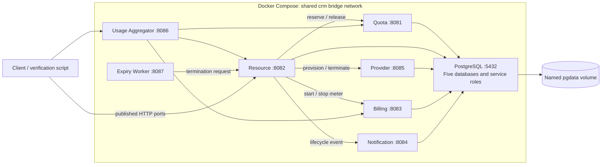

# Assignment 2: Containerization and Deployment

**Application:** Cloud Resource Manager  
**Course:** SEZG583 Scalable Services  
**Team:** Prajwal, Vinayak, Karan and Siddharth  
**Report date:** 3 November 2026

This report summarizes the implementation and available deployment evidence.
Compose results were captured on 2 November 2026; the repository's Kubernetes
evidence records verification on 1 November 2026. These are recorded results, not
a claim that the deployments were rerun during report preparation.

## 1. Brief Application Overview and Deployment Architecture

Cloud Resource Manager is a seven-service Java 21 application developed in
Assignment 1. It provisions simulated computing resources for tenants while
enforcing CPU, RAM and instance quotas. Resource coordinates a saga: reserve
quota, provision infrastructure through Provider, start Billing, and record the
successful lifecycle through Notification. Clients receive an asynchronous
acceptance response and poll until the reservation is `COMPLETED` and the
resource is `ACTIVE`. Usage Aggregator combines information from the services;
Expiry Worker requests termination of expired resources.

| Service | Port | Responsibility | Database |
|---|---:|---|---|
| Quota | 8081 | Tenant limits, quota admission and release | quota_db |
| Resource | 8082 | Resource lifecycle, idempotency and saga coordination | resource_db |
| Billing | 8083 | Billing meters and cost calculation | billing_db |
| Notification | 8084 | Lifecycle history and simulated delivery | notification_db |
| Provider | 8085 | Simulated infrastructure provisioning | provider_db |
| Usage Aggregator | 8086 | Combined quota, resource and billing view | None |
| Expiry Worker | 8087 | Scheduled termination requests | None |

Assignment 2 packages the services into independent images and deploys them
together. Compose uses eight containers: seven application containers and one
PostgreSQL container. Five separate databases and roles preserve logical service
ownership while sharing the database server. Provider simulates infrastructure;
the deployment does not create real cloud virtual machines.



Container-to-container traffic uses service DNS names, such as
`http://provider:8085`, rather than `localhost`. Host HTTP ports are 8081-8087;
PostgreSQL is published on host port 5433.

## 2. Docker Containerization and Docker Compose Deployment

### Containerization

Each service has its own multi-stage Dockerfile. The build stage uses
`maven:3.9-eclipse-temurin-21` to compile the source and package an executable JAR.
The runtime stage uses `eclipse-temurin:21-jre`, receives only the application JAR
from the build stage, and starts it with `java -jar`. This excludes Maven and
source files from the runtime stage and avoids requiring a prebuilt host JAR.
The wildcard JAR copy supports differing service artifact names.

Maven's dependency cache reduces repeated downloads. Runtime images include
curl for HTTP healthchecks. Image packaging uses `-DskipTests`; successful
packaging is therefore not presented as proof that tests passed.

Runtime settings are supplied through environment variables, including ports,
database connection settings and peer URLs. The default JVM maximum heap is
256 MB, configurable through `JAVA_TOOL_OPTIONS`; this is not a total container
memory limit. The example environment file contains local placeholder values,
and real local `.env` files are ignored by Git.

### Compose configuration

[docker-compose.yml](../../docker-compose.yml) provides shared networking,
readiness checks, application configuration and a persistent `pgdata` volume.
The first startup of an empty PostgreSQL volume runs
[init-compose.sh](../../scripts/db/init-compose.sh), which reuses
[setup-u1.sql](../../scripts/db/setup-u1.sql) and
[setup-u2-u4.sql](../../scripts/db/setup-u2-u4.sql). It creates the five databases
and users; each application subsequently applies its own Flyway migrations.

Initialization receives the same `DB_PASSWORD` as the applications and uses
quoted psql variables. SQL failures stop initialization. Changing the environment
password later does not rotate passwords in an existing database.

PostgreSQL's TCP healthcheck avoids accepting its temporary initialization
server as ready. Application healthchecks call `/health`. The database-owning
services wait for healthy PostgreSQL; Resource additionally waits for Quota,
Provider, Billing and Notification. Usage and Expiry wait for their peers.
YAML anchors share these settings without duplicating configuration.

`restart: unless-stopped` handles unexpected process exits. Readiness dependency
conditions gate startup, not continuous dependency recovery; an unhealthy status
alone does not trigger an automatic restart. Provider random failures and
automatic expiry are disabled in the default demonstration configuration.

Build and deploy from the repository root:

```powershell
docker compose config --quiet
docker compose up -d --build --wait --wait-timeout 600
docker compose ps --all
```

### Deployment and main-workflow evidence

The successful Windows Compose capture is in
[evidence/compose/20261102-090524](../../evidence/compose/20261102-090524).
Its [transcript](../../evidence/compose/20261102-090524/verification.log) records
eight healthy containers, five successful database logins, and
`Saga COMPLETED -> ACTIVE`. Its
[workflow JSON](../../evidence/compose/20261102-090524/before-restart-workflow.json)
records:

| Check | Captured result |
|---|---|
| Provisioning | Resource `6b30f6e7-5500-47e1-8a02-9ac1fa9ba9d4` is ACTIVE |
| Quota | 4 CPUs, 8 GB RAM and 1 instance allocated |
| Provider | Resource has a provider instance; the verifier checked its ACTIVE database record |
| Billing | Meter is ACTIVE for the same resource and tenant |
| Notification | ACTIVE event recorded with SENT delivery status |
| Usage | Resource returned; quota, resource and billing availability are all true |

The initial acceptance response remains `PENDING` in the saved JSON because it
precedes background processing; the transcript records completion after polling.
All seven images also built successfully during the recorded implementation
session. Ten mocked Pester verification-script tests passed separately; those
are not substitutes for the live workflow.

**Compose evidence boundary:** these captures used `-SkipBuild -SkipRestart`.
A separate clean-checkout repeat and Compose `down`/`up` persistence demonstration
are not established by the available captures. The named volume is configured,
but its Compose restart behavior must still be demonstrated without using
`down -v`. Kubernetes persistence evidence below is a different deployment test.

## 3. Situated-Learning Problem

### Observed symptom

A genuine failure occurred during the Windows happy-path check: all eight
containers were healthy, but the database-login verification exited with code 2.
PostgreSQL reported:

```text
FATAL: role "sh" does not exist
```

The failing command was intended to authenticate as `quota_user` against
`quota_db`. The failure is recorded in the
[failed transcript](../../evidence/compose/20261102-090138/verification.log)
and [container logs](../../evidence/compose/20261102-090138/failure-containers.log).

### Diagnosis

`docker compose ps --all` confirmed application readiness, while PostgreSQL logs
showed that it was accepting connections. Reproducing the verification command
revealed that the wrong username reached psql. Windows PowerShell 5.1 altered
nested quotes in the command passed through `docker compose exec ... sh -c`.
This was an argument-handling problem in the verification harness, not missing
service roles or a failed application startup.

### Solution

The corrected verifier sent the shell script through standard input to
`sh -s --`, leaving database user/name arguments separate. SQL queries were
likewise sent to psql through standard input. JSON-array handling was also
corrected so notification evidence contained a single matching record rather
than a PowerShell array wrapper.

### Validation

After correction, all ten mocked regression tests passed, including checks for
standard-input command handling and matching notification identity. The live
verifier then passed all five database logins and the full provisioning workflow.
The successful transcript and workflow JSON linked in Section 2 provide the
post-fix evidence.

**Reproduction caution:** the currently inspected repository copy of
[verify-compose.ps1](../../scripts/demo/verify-compose.ps1) again contains the
original `sh -c` command. The historical passing capture used the corrected
implementation. Restore or merge that correction before repeating the Windows
demo; the saved result does not prove the current script has the fix.

### Learning and team troubleshooting contribution

Healthy containers do not guarantee that host-side verification tools are
correct. Diagnosis must follow the failure across PowerShell, Docker, the
container shell and PostgreSQL. Native quoting boundaries require real-platform
tests; mocks alone did not expose this issue.

Karan's [Task 3 contribution](Karan_task_3_report.md) separately reports Billing
starting before PostgreSQL readiness and being stabilized with a database
healthcheck and `service_healthy`. This reinforces that startup order is not
readiness. The available Compose evidence confirms healthy Billing and a working
meter after deployment, but does not independently capture that earlier Billing
startup failure. Karan should supply the corresponding before-fix evidence for
his individual troubleshooting demonstration. In this repository, the Compose
service name is `billing` and its health endpoint is `/health`.

## 4. Advanced Task and Evidence

The advanced task was attempted: Kubernetes deployment on Minikube, plus Provider
self-healing and scaling. The [Kubernetes configuration](../../k8s) includes
application Deployments and Services, a runtime ConfigMap, a locally generated
database Secret, startup/readiness/liveness probes, and a PostgreSQL StatefulSet
with a 5 GiB persistent volume claim. Kustomize reuses the database init scripts.
Resource is accessible through a host port-forward.

The repository's [advanced evidence summary](../../evidence/k8s/README.md) and
[results.json](../../evidence/k8s/results.json) record:

| Demonstration | Recorded evidence |
|---|---|
| Main workflow through Kubernetes | ACTIVE resource with matching quota, Provider, ACTIVE Billing meter, SENT notification and available Usage |
| Provider self-healing | Deleted and replacement pod UIDs differ; fresh provisioning succeeds |
| Provider scaling | Two distinct Ready Service endpoints; provisioning through the scaled Service succeeds |
| PostgreSQL persistence | Replacement pod UID; same PVC/volume and original resource, provider, meter and notification identities |
| Host entry point | Provisioning through port-forward; health and Swagger return HTTP 200 |
| Additional verification | Idempotency, termination, compensation, durable teardown, partial outage and scheduled expiry results |

The evidence summary also records 142 Java tests with zero failures or skips and
a passing full-stack integration scenario. These counts are reported from the
repository capture, not from a new test run performed for this report.

**Limits:** scaling establishes two Ready endpoints and a successful workflow,
not increased throughput or proof that both replicas received requests.
Database persistence was checked across pod replacement on one local node, not
node-loss recovery or backup restoration. The Kubernetes video and personal
explanations remain separate individual deliverables.

## 5. Individual Contributions and AI-Use Declaration

Responsibilities follow [the assignment work allocation](units.md). Shared
templates and integration work cross service boundaries; task ownership should
not be interpreted as proof that one person authored every related line.

| Member | Assigned responsibility and reportable contribution |
|---|---|
| Prajwal | Task 1 containerization lead; Quota and Resource ownership. Multi-stage image template, service configuration contract and placeholder environment configuration underpin the deployment. |
| Vinayak | Task 2 Compose lead; Provider ownership. Shared network and peer wiring, database initialization/password alignment, health-gated startup, named storage, runtime curl integration, workflow/restart verifier, regression checks and deployment/demo documentation. Live Compose happy-path results are captured. |
| Karan | Task 3 troubleshooting lead; Billing ownership. Individual report describes the database-readiness diagnosis, healthcheck/dependency solution and readiness reflection; original failure evidence still needs to accompany that claim. |
| Siddharth | Part B lead; Notification, Usage and Expiry ownership. Kubernetes deployment and advanced workflow verification, Provider recovery/scaling, persistent database configuration and captured advanced results. |

Each member should review their contribution claims, explain their own
configuration and present their own segment of the team demonstration. A passing
shared workflow does not replace individual reflection or demonstration evidence.

**AI-use declaration:** An AI assistant using Copilot SDK in VS Code assisted
with Compose hardening, initialization wiring, verification-script implementation,
regression tests, troubleshooting, demo notes and this evidence-based report.
The existing Assignment 1 report separately declares OpenAI Codex assistance.
Other members should confirm any additional AI tools they used. AI-generated
changes and text require human review; the team remains responsible for their
correctness, evidence, understanding and final submission.
