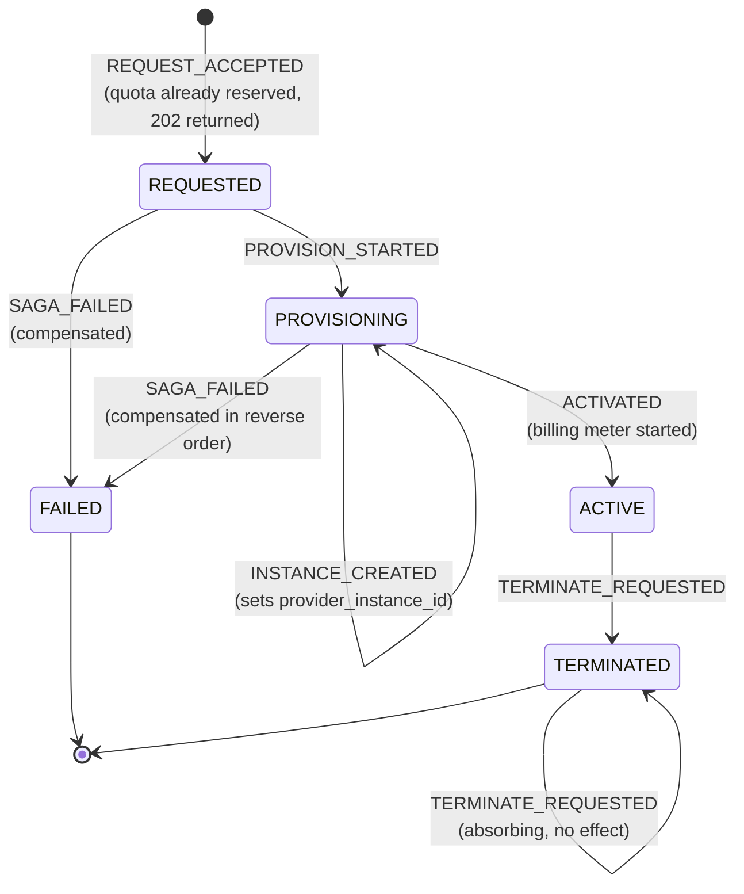

# Functional Design — Unit U1 (Core Challenge Services)

**Stage**: CONSTRUCTION / Functional Design
**Status**: APPROVED (2026-10-14)
**Unit**: U1 — Core Challenge Services
**Owner**: Prajwal (core owner)
**Services in scope**: Quota (`:8081`, `quota_db`), Resource / Orchestrator (`:8082`, `resource_db`)
**Depends on**: `inception/requirements/requirements.md` (approved), `inception/design/application-design.md` (approved, contracts frozen), `inception/units.md` (approved)
**Consumed by**: `nfr-requirements.md`, `nfr-design.md`, `infrastructure-design.md`, then Code Generation for U1

This document is the implementable specification of U1's behaviour: endpoints, DTOs, domain
model, the resource lifecycle state machine, and the four algorithms that carry the graded
challenges. It adds no new product decisions. Where the frozen Inception documents are silent
or disagree, the reading taken is recorded in section 13, not resolved silently.

---

## 1. Unit Scope

| Service | Port | Database | Owns | Carries | Business rules enforced |
|---------|------|----------|------|---------|-------------------------|
| Quota | 8081 | `quota_db` / `quota_user` | Tenants, tiers, quota limits and usage, the quota reservation ledger | Challenge 1 (concurrency control) | BR1, BR7, BR8 |
| Resource / Orchestrator | 8082 | `resource_db` / `resource_user` | Resource lifecycle, async reservations, idempotency records | Challenge 2 (idempotency), Challenge 3C (saga with compensation) | BR2, BR3, BR4, BR6 |

U1 is built and tested against **WireMock stubs** of its four downstream dependencies. Quota is
real (it is in this unit); Provider mock (U3), Billing (U2) and Notification (U4) are stubbed.
No other unit needs to be running for U1 to be demonstrated end to end.

The Quota service is also the **reference implementation** for the cross-cutting patterns that
U2, U3 and U4 copy: the RFC 9457 error model, the correlation-ID filter, structured JSON
logging, environment-variable configuration, the Flyway layout, and the package structure.
Those patterns are specified in `nfr-design.md`; this document specifies only the behaviour.

### 1.1 Out of scope for U1

Billing meters (BR5, FR-26 to FR-31), provider simulation internals (FR-39 to FR-44),
notification delivery (FR-32 to FR-35), the composite usage view (FR-36 to FR-38) and the
expiry sweep schedule (FR-24) belong to other units. U1 owns the *endpoints those units call*
and the contracts it calls them through, nothing more.

---

## 2. Package and Layer Structure

Both services use the three-layer split frozen in `application-design.md` section 9: `api`
holds controllers and DTOs, `domain` holds rules and state machines, `persistence` holds
entities and repositories. **Every business rule lives in `domain` and is unit-tested there**,
with no Spring context and no database, except where the rule is enforced by SQL (BR1, BR3,
BR7) and therefore tested with Testcontainers.

### 2.1 Quota service — `com.crm.quota`

```
com.crm.quota
├── QuotaApplication.java                     // @SpringBootApplication
├── api
│   ├── TenantController.java                 // POST /tenants, GET /tenants/{id}, GET /tenants/{id}/quota
│   ├── QuotaController.java                  // POST /quota/reservations, POST /quota/reservations/{resourceId}/release
│   └── dto
│       ├── CreateTenantRequest.java          // validated inbound DTO
│       ├── TenantResponse.java
│       ├── QuotaUsageResponse.java
│       ├── ReserveQuotaRequest.java
│       ├── ReserveQuotaResponse.java
│       └── ReleaseQuotaResponse.java
├── domain
│   ├── Tier.java                             // FREE | STANDARD | ENTERPRISE + its fixed limits (FR-5)
│   ├── ResourceType.java                     // VM | CONTAINER | CLUSTER
│   ├── ReservationState.java                 // RESERVED | RELEASED
│   ├── TierPolicy.java                       // BR8: which types a tier may provision
│   ├── QuotaSnapshot.java                    // value object: used/limit/remaining per dimension
│   ├── QuotaDimension.java                   // CPU | RAM_GB | INSTANCES — names the exhausted limit (AC-1.3)
│   └── service
│       ├── TenantService.java                // FR-1, FR-2, FR-3
│       └── QuotaService.java                 // FR-7 to FR-10, BR1, BR7, BR8
├── persistence
│   ├── entity      { Tenant, TenantQuota, QuotaReservation }
│   ├── repository  { TenantRepository, TenantQuotaRepository, QuotaReservationRepository }
│   └── SavepointGuard.java                   // duplicate-key recovery inside one live transaction (§7.2.1)
├── common                                    // the reference cross-cutting implementation
│   ├── error       { ApiException + subclasses, ErrorCode, ProblemDetailsFactory, GlobalExceptionHandler }
│   └── web         { CorrelationIdFilter }
└── config          { OpenApiConfig, JacksonConfig }
```

### 2.2 Resource / Orchestrator service — `com.crm.resource`

```
com.crm.resource
├── ResourceApplication.java
├── api
│   ├── ResourceController.java               // POST /resources, GET /resources/{id}, GET /resources,
│   │                                         // POST /resources/{id}/termination, GET /resources/expired
│   ├── ReservationController.java            // GET /reservations/{id}
│   └── dto
│       ├── ProvisionResourceRequest.java
│       ├── ProvisionAcceptedResponse.java
│       ├── ResourceResponse.java
│       ├── ResourceListResponse.java
│       ├── ReservationStatusResponse.java
│       ├── TerminationAcceptedResponse.java
│       └── ExpiredResourceResponse.java
├── domain
│   ├── ResourceStatus.java                   // REQUESTED | PROVISIONING | ACTIVE | FAILED | TERMINATED
│   ├── ResourceEvent.java                    // the events of the transition table (section 6)
│   ├── ReservationStatus.java                // PENDING | COMPLETED | FAILED
│   ├── ResourceType.java                     // VM | CONTAINER | CLUSTER
│   ├── ResourceLifecycle.java                // BR4: the explicit state machine (FR-50)
│   ├── RequestFingerprint.java               // BR2/BR3: canonicalisation + SHA-256
│   ├── ClientToken.java                      // FR-19: deterministic provider client token
│   ├── SimulateFailureDirective.java         // FR-42/FR-45/FR-46: parse and route the header
│   └── service
│       ├── IdempotencyService.java           // Challenge 2, BR2, BR3
│       ├── ProvisioningService.java          // the synchronous part of POST /resources (FR-13, FR-14)
│       ├── ProvisioningSaga.java             // Challenge 3C forward path + compensation, BR6
│       ├── TerminationService.java           // FR-20 to FR-22, BR7 gate
│       └── ResourceQueryService.java         // FR-17, FR-18, FR-24 support
├── persistence
│   ├── entity      { Resource, Reservation, IdempotencyRecord }
│   ├── repository  { ResourceRepository, ReservationRepository, IdempotencyRecordRepository }
│   └── SavepointGuard.java                   // copied from Quota; duplicate-key recovery (§7.2.1)
├── client                                    // outbound REST, one class per peer
│   ├── QuotaClient.java        (real peer, :8081)
│   ├── ProviderClient.java     (WireMock in U1, :8085 later)
│   ├── BillingClient.java      (WireMock in U1, :8083 later)
│   ├── NotificationClient.java (WireMock in U1, :8084 later)
│   └── dto         { per-peer request/response records }
├── common          { error, web }             // copied from Quota, not shared (NFR-5)
└── config          { AsyncConfig, RestClientConfig, OpenApiConfig }
```

**Alternatives considered and rejected.**

| Choice | Alternative rejected | Reason |
|--------|---------------------|--------|
| Root package `com.crm.resource` | `com.crm.orchestrator` | The service, its database (`resource_db`), its user and its API paths are all named *resource*; a third name for the same thing costs more than it explains. The orchestration role is carried by class names (`ProvisioningSaga`), where it is visible at the point of use |
| Cross-cutting code copied into each service's `common` package | A shared `crm-common` Maven library | NFR-5 forbids a shared code library between services. Copying is the deliberate cost of service independence, and the duplication is ~5 small classes |
| Business rules as named domain classes (`TierPolicy`, `ResourceLifecycle`) | Rules inline in the controllers or in repository default methods | BR1–BR8 must each trace to one code location and one test (DOC-4). A rule inline in a controller cannot be unit-tested without a web context |
| Peer access through one class per peer (`BillingClient`) | One generic `PeerHttpClient` with URL parameters | Each peer has its own pair of timeouts, its own **retry predicate** (which failures are worth retrying — see `nfr-design.md` §8.2, where Quota retries connect failures only) and its own simulate-failure routing (section 9). The backoff parameters themselves are global (`RETRY_*`), deliberately: one policy is easier to defend than four. A generic client would push the per-peer part into call sites |

---

## 3. Quota Service API

Frozen in `application-design.md` section 5.1. Every business path is under `/api/v1`
(NFR-7). `GET /health` sits outside the version prefix because it is an operability endpoint,
not a business one (NFR-12).

| # | Method | Path | Purpose | Success | Error codes it can emit |
|---|--------|------|---------|---------|-------------------------|
| Q1 | POST | `/api/v1/tenants` | Create a tenant (FR-1) | 201 + `Location` | 400 `VALIDATION_FAILED`, 409 `TENANT_ALREADY_EXISTS`, 422 `INVALID_TIER` |
| Q2 | GET | `/api/v1/tenants/{tenantId}` | Read tenant and limits (FR-2) | 200 | 404 `TENANT_NOT_FOUND` |
| Q3 | GET | `/api/v1/tenants/{tenantId}/quota` | Usage and headroom (FR-9) | 200 | 404 `TENANT_NOT_FOUND` |
| Q4 | POST | `/api/v1/quota/reservations` | Reserve quota atomically (FR-7, FR-10) | 200 | 400 `VALIDATION_FAILED`, 404 `TENANT_NOT_FOUND`, 409 `QUOTA_RESERVATION_ALREADY_RELEASED`, 422 `QUOTA_EXCEEDED`, 422 `TIER_FORBIDS_RESOURCE_TYPE` |
| Q5 | POST | `/api/v1/quota/reservations/{resourceId}/release` | Release a resource's quota exactly once (FR-8) | 200 | 404 `QUOTA_RESERVATION_NOT_FOUND` |
| Q6 | GET | `/health` | Liveness + DB connectivity (NFR-12) | 200 | 503 (actuator `DOWN`) |

### 3.1 Q1 — Create tenant

**Request DTO** `CreateTenantRequest`

| Field | Type | Validation | Notes |
|-------|------|------------|-------|
| `tenantId` | String | optional, `@Size(max = 64)`, `@Pattern("^[a-z0-9][a-z0-9-]{1,63}$")` | Client-supplied so the seed script can fix demo IDs (FR-4). Generated as `tnt-<uuid>` when absent |
| `name` | String | `@NotBlank`, `@Size(max = 200)` | |
| `tier` | String | `@NotBlank` | Carried as `String`, **not** as an enum (see note below) |

**Response DTO** `TenantResponse`: `tenantId`, `name`, `tier`, `limits { cpu, ramGb, instances }`,
`createdAt` (UTC ISO-8601). `Location: /api/v1/tenants/{tenantId}`.

Creating a tenant also creates its `tenant_quota` row in the same transaction, with `*_used = 0`
and the limits taken from `Tier` (FR-5). There is no endpoint that changes a tier (FR-3), so
the limits are immutable for the tenant's lifetime.

**Why `tier` is a String in the DTO.** The frozen API table requires *422* for a bad tier, but
Jackson's enum binding fails during deserialisation and yields 400. Binding the field as a
String and converting it in `TierPolicy.parseTier` puts the decision in the domain layer, where
it can raise the 422 the contract promises. The same reasoning does not apply to
`ResourceType`, whose contract error is a plain 400.

```json
// POST /api/v1/tenants
{ "tenantId": "tnt-std-001", "name": "Acme Corp", "tier": "STANDARD" }
```
```json
// 201 Created
{
  "tenantId": "tnt-std-001",
  "name": "Acme Corp",
  "tier": "STANDARD",
  "limits": { "cpu": 20, "ramGb": 64, "instances": 10 },
  "createdAt": "2026-10-14T09:12:04Z"
}
```

### 3.2 Q2 / Q3 — Read tenant, read quota

`GET /api/v1/tenants/{id}` returns the `TenantResponse` above.

**Response DTO** `QuotaUsageResponse` (FR-9, all three dimensions):

```json
// 200 OK — GET /api/v1/tenants/tnt-std-001/quota
{
  "tenantId": "tnt-std-001",
  "tier": "STANDARD",
  "cpu":       { "limit": 20, "used": 16, "remaining": 4 },
  "ramGb":     { "limit": 64, "used": 32, "remaining": 32 },
  "instances": { "limit": 10, "used": 4,  "remaining": 6 }
}
```

`remaining` is computed (`limit - used`), never stored: a stored remainder is a second copy of
the same truth and can drift from it. The Usage aggregator (U4) consumes exactly this shape.

### 3.3 Q4 — Reserve quota (Challenge 1 entry point)

**Request DTO** `ReserveQuotaRequest`

| Field | Type | Validation |
|-------|------|------------|
| `tenantId` | String | `@NotBlank`, `@Size(max = 64)` |
| `resourceId` | String | `@NotBlank`, `@Size(max = 64)` — the orchestrator's resource UUID, opaque here (NFR-4) |
| `type` | String | `@NotBlank`, must be `VM`/`CONTAINER`/`CLUSTER` (custom `@ValueOfEnum`, 400 if not) |
| `cpu` | Integer | `@NotNull`, `@Min(1)`, `@Max(256)` |
| `ramGb` | Integer | `@NotNull`, `@Min(1)`, `@Max(2048)` |

The `@Max` bounds are **syntactic sanity, not business rules**. 256 CPU is above the
ENTERPRISE limit of 200 on purpose: a request for 250 CPU must be rejected by BR1 with a
business 422 that names the exhausted limit, not by a validation 400. Validation protects the
service from nonsense; the business rule protects the tenant's quota.

**Response DTO** `ReserveQuotaResponse`

```json
// 200 OK
{
  "reservationId": "7c6f1b1e-5d1e-4a2d-9a2f-0f2d1c6ab001",
  "tenantId": "tnt-std-001",
  "resourceId": "e5f1a2b3-1111-4c2d-8e3f-9a0b1c2d3e4f",
  "state": "RESERVED",
  "cpu": 4,
  "ramGb": 8,
  "replay": false,
  "usage": {
    "cpu":       { "limit": 20, "used": 20, "remaining": 0 },
    "ramGb":     { "limit": 64, "used": 40, "remaining": 24 },
    "instances": { "limit": 10, "used": 5,  "remaining": 5 }
  }
}
```

- `200`, not `201`, per the frozen table: a reservation is an effect on the tenant's quota row,
  and the endpoint is idempotent on `resourceId`, so repeating it must not keep minting 201s.
- `replay: true` is returned when the ledger already holds a `RESERVED` row for this
  `resourceId`; the response is then the stored reservation and **no usage is added**. This is
  what makes a retried reserve safe (NFR-27) and it is enforced by `UNIQUE(resource_id)`, not
  by an application check.
- Rejection body (AC-1.3) names the exhausted dimension:

```json
// 422 Unprocessable Content
{
  "type": "https://crm.example/errors/quota-exceeded",
  "title": "Insufficient quota",
  "status": 422,
  "detail": "Requested 4 CPU exceeds remaining 0 CPU for tenant tnt-std-001",
  "instance": "/api/v1/quota/reservations",
  "code": "QUOTA_EXCEEDED",
  "exhausted": ["CPU"],
  "correlationId": "b1c2d3e4-f5a6-4b7c-8d9e-0f1a2b3c4d5e",
  "timestamp": "2026-10-14T09:12:05Z"
}
```

`exhausted` is an RFC 9457 extension member carrying `QuotaDimension` values, so the Challenge 1
script can assert *which* limit stopped each rejected request rather than parsing prose.

### 3.4 Q5 — Release quota (BR7)

No request body; the `resourceId` is the path variable. Response `ReleaseQuotaResponse`:

```json
// 200 OK
{
  "resourceId": "e5f1a2b3-1111-4c2d-8e3f-9a0b1c2d3e4f",
  "state": "RELEASED",
  "released": true,
  "releasedAt": "2026-10-14T11:03:41Z",
  "usage": {
    "cpu":       { "limit": 20, "used": 16, "remaining": 4 },
    "ramGb":     { "limit": 64, "used": 32, "remaining": 32 },
    "instances": { "limit": 10, "used": 4,  "remaining": 6 }
  }
}
```

`released: false` with `state: "RELEASED"` is the **second and later** call: 200, no quota
effect, idempotent (FR-21, AC-3.7, BR7). A `resourceId` with no ledger row at all is 404
`QUOTA_RESERVATION_NOT_FOUND` — an unknown resource is a caller error, while a repeat is not.

---

## 4. Resource / Orchestrator Service API

Frozen in `application-design.md` section 5.2.

| # | Method | Path | Purpose | Success | Error codes it can emit |
|---|--------|------|---------|---------|-------------------------|
| R1 | POST | `/api/v1/resources` | Provision (main entry). Headers: `Idempotency-Key` **required**, `X-Simulate-Failure` optional | 202 + `Location` | 400 `IDEMPOTENCY_KEY_REQUIRED`, 400 `VALIDATION_FAILED`, 404 `TENANT_NOT_FOUND`, 422 `QUOTA_EXCEEDED`, 422 `TIER_FORBIDS_RESOURCE_TYPE`, 422 `IDEMPOTENCY_PAYLOAD_MISMATCH`, 503 `DOWNSTREAM_UNAVAILABLE` |
| R2 | GET | `/api/v1/reservations/{reservationId}` | Poll reservation status (FR-16) | 200 | 404 `RESERVATION_NOT_FOUND` |
| R3 | GET | `/api/v1/resources/{resourceId}` | Read a resource (FR-17) | 200 | 404 `RESOURCE_NOT_FOUND` |
| R4 | GET | `/api/v1/resources?tenantId=&status=` | List a tenant's resources (FR-18) | 200 | 400 `VALIDATION_FAILED` |
| R5 | POST | `/api/v1/resources/{resourceId}/termination` | Terminate, idempotent (FR-20 to FR-22) | 202 | 404 `RESOURCE_NOT_FOUND`, 409 `INVALID_STATE_TRANSITION` |
| R6 | GET | `/api/v1/resources/expired` | Internal: ACTIVE resources past `expires_at` (FR-24 support) | 200 | — |
| R7 | GET | `/health` | Liveness + DB connectivity | 200 | 503 |

R1's list extends the three errors frozen in `application-design.md` §5.2 with 404
`TENANT_NOT_FOUND`, 422 `TIER_FORBIDS_RESOURCE_TYPE` and 503 `DOWNSTREAM_UNAVAILABLE`. The first
two are Quota's rejections propagated unchanged under the rule in `nfr-design.md` §2.4 — the
orchestrator neither looks tenants up (§5.3) nor owns the tier policy (§10) — and the 503 is
NFR-28's clean-failure answer when Quota cannot be reached. Recorded as deviation **A12** in
section 13, in the same form as A2 and A9 on Quota's frozen lists.

### 4.1 R1 — Provision a resource

**Headers**

| Header | Required | Effect |
|--------|----------|--------|
| `Idempotency-Key` | **Yes** (FR-12) | Absent or blank → 400 `IDEMPOTENCY_KEY_REQUIRED`. Max 200 chars; longer → 400 `VALIDATION_FAILED` |
| `X-Simulate-Failure` | No | Persisted with the reservation and replayed on the matching downstream call (FR-46). Grammar in section 9.4 |
| `X-Correlation-Id` | No | Reused if present, generated if absent (NFR-13) |

**Request DTO** `ProvisionResourceRequest`

| Field | Type | Validation | Notes |
|-------|------|------------|-------|
| `tenantId` | String | `@NotBlank`, `@Size(max = 64)` | Opaque; owned by Quota (NFR-4). Existence is proven by the quota reserve call, not by a separate lookup |
| `type` | String | `@NotBlank`, `@ValueOfEnum(ResourceType.class)` | `VM`/`CONTAINER`/`CLUSTER` |
| `cpu` | Integer | `@NotNull`, `@Min(1)`, `@Max(256)` | |
| `ramGb` | Integer | `@NotNull`, `@Min(1)`, `@Max(2048)` | |
| `durationSeconds` | Long | optional, `@Min(30)`, `@Max(2592000)` | Absent = no expiry (FR-23). Floor of 30 s because the expiry sweep interval is 30 s, so a shorter hold cannot be honoured meaningfully. Ceiling is 30 days |

**Response DTO** `ProvisionAcceptedResponse` — 202 Accepted (FR-14):

```json
// POST /api/v1/resources
// Idempotency-Key: 0f8c3a7e-provision-001
// X-Simulate-Failure: billing:always-fail        (optional, Challenge 3C)
{ "tenantId": "tnt-std-001", "type": "VM", "cpu": 4, "ramGb": 8, "durationSeconds": 7200 }
```
```json
// 202 Accepted
// Location: /api/v1/reservations/3b9a1c2d-4e5f-4a6b-8c7d-9e0f1a2b3c4d
{
  "reservationId": "3b9a1c2d-4e5f-4a6b-8c7d-9e0f1a2b3c4d",
  "resourceId": "e5f1a2b3-1111-4c2d-8e3f-9a0b1c2d3e4f",
  "status": "PENDING",
  "statusUrl": "/api/v1/reservations/3b9a1c2d-4e5f-4a6b-8c7d-9e0f1a2b3c4d"
}
```

202 means *quota is already reserved and the provisioning saga is queued*. It never means "we
will check your quota later": the synchronous quota reservation ahead of the response is what
keeps the Challenge 1 count deterministic (FR-13, AC-1.2). A client that receives 202 therefore
knows its capacity is held; only provisioning, billing and notification are still outstanding.

A replayed request (same key, same body) returns the **stored** 202 body verbatim, including the
same `reservationId` and `resourceId` (AC-2.1), and carries `Idempotency-Replayed: true` so the
Challenge 2 script can distinguish a replay from fresh processing without reading logs (AC-2.5).

### 4.2 R2 — Reservation status

**Response DTO** `ReservationStatusResponse` (FR-16):

```json
// 200 OK — provisioning complete
{
  "reservationId": "3b9a1c2d-4e5f-4a6b-8c7d-9e0f1a2b3c4d",
  "status": "COMPLETED",
  "resourceId": "e5f1a2b3-1111-4c2d-8e3f-9a0b1c2d3e4f",
  "instanceId": "i-mock-7f3a9c21",
  "failureReason": null,
  "createdAt": "2026-10-14T09:12:05Z",
  "updatedAt": "2026-10-14T09:12:09Z"
}
```
```json
// 200 OK — saga failed at billing and compensated (Challenge 3C)
{
  "reservationId": "3b9a1c2d-4e5f-4a6b-8c7d-9e0f1a2b3c4d",
  "status": "FAILED",
  "resourceId": "e5f1a2b3-1111-4c2d-8e3f-9a0b1c2d3e4f",
  "instanceId": null,
  "failureReason": "BILLING_UNAVAILABLE: billing meter start failed after 3 attempts (503)",
  "createdAt": "2026-10-14T09:14:01Z",
  "updatedAt": "2026-10-14T09:14:08Z"
}
```

`instanceId` is **not** a column on `reservations`; it is read from the linked `resources` row
(`provider_instance_id`) inside the same database. After a compensated saga it is `null`
because the provider instance was terminated and the column cleared, which is the queryable
evidence that nothing is left running (AC-3.5).

Clearing the column is a **recorded deviation** from `application-design.md` §8.4, which reads a
retained `provider_instance_id` on a FAILED row as the signal that compensation had to undo a
completed provisioning step. That signal moves to `failure_reason`, and the deviation, its
reason and its cost are set out in section 13, assumption **A11**. Nothing else in the frozen
saga contract changes.

### 4.3 R3 / R4 — Read and list resources

```json
// 200 OK — GET /api/v1/resources/e5f1a2b3-1111-4c2d-8e3f-9a0b1c2d3e4f
{
  "resourceId": "e5f1a2b3-1111-4c2d-8e3f-9a0b1c2d3e4f",
  "tenantId": "tnt-std-001",
  "type": "VM",
  "cpu": 4,
  "ramGb": 8,
  "status": "ACTIVE",
  "providerInstanceId": "i-mock-7f3a9c21",
  "createdAt": "2026-10-14T09:12:05Z",
  "activatedAt": "2026-10-14T09:12:09Z",
  "expiresAt": "2026-10-14T11:12:05Z",
  "terminatedAt": null,
  "failureReason": null
}
```

`GET /api/v1/resources`: `tenantId` is **required** (a cross-tenant listing has no caller in
this system and would be an accidental data-exposure endpoint); `status` is optional and must
be a `ResourceStatus` name, else 400 `VALIDATION_FAILED` naming the allowed values. Response
is `{ "items": [ ...ResourceResponse ], "count": n }` — an envelope rather than a bare array,
so a later addition of paging is not a breaking change. The Usage aggregator (U4) calls this
with `status=ACTIVE`.

### 4.4 R5 — Terminate a resource

No body. No `Idempotency-Key`: the frozen contract requires the header only on provisioning,
and termination's idempotency comes from the state guard in section 9.5, which is stronger than
a header the expiry worker would have to invent per attempt.

```json
// 202 Accepted — POST /api/v1/resources/{id}/termination
{
  "resourceId": "e5f1a2b3-1111-4c2d-8e3f-9a0b1c2d3e4f",
  "status": "TERMINATED",
  "terminatedAt": "2026-10-14T11:03:41Z",
  "alreadyTerminated": false
}
```

- First call on an `ACTIVE` resource: 202, `alreadyTerminated: false`, teardown queued.
- Repeat call: 202, `alreadyTerminated: true`, **no** provider call, **no** meter stop, **no**
  second quota release (FR-21, BR7).
- `REQUESTED`, `PROVISIONING` or `FAILED`: 409 `INVALID_STATE_TRANSITION` with the current
  state in the body (FR-22, BR4).

```json
// 409 Conflict
{
  "type": "https://crm.example/errors/invalid-state-transition",
  "title": "Invalid state transition",
  "status": 409,
  "detail": "Resource e5f1a2b3-... is PROVISIONING; termination requires ACTIVE",
  "instance": "/api/v1/resources/e5f1a2b3-1111-4c2d-8e3f-9a0b1c2d3e4f/termination",
  "code": "INVALID_STATE_TRANSITION",
  "currentStatus": "PROVISIONING",
  "correlationId": "9d8c7b6a-5f4e-4d3c-2b1a-0f9e8d7c6b5a",
  "timestamp": "2026-10-14T11:03:41Z"
}
```

Status is 202, not 200, because the provider teardown, meter stop, quota release and
notification run after the response. The resource's own row is already `TERMINATED` when the
202 is written, so a client that reads it back immediately sees the final state.

### 4.5 R6 — Expired resources

```json
// 200 OK — GET /api/v1/resources/expired
{ "items": [ { "resourceId": "e5f1...", "tenantId": "tnt-std-001", "expiresAt": "2026-10-14T11:12:05Z" } ], "count": 1 }
```

`status = 'ACTIVE' AND expires_at IS NOT NULL AND expires_at < now()`. It returns candidates
only; the worker (U4) then calls R5 per item, and R5's guard is what makes a concurrent or
repeated sweep safe (FR-25). The endpoint is deliberately unfiltered by tenant: its only
caller is the worker.

---

## 5. Domain Model

Columns and types are fixed in `infrastructure-design.md`; this section fixes the *meaning* and
the invariants. All instants are UTC (NFR-22).

### 5.1 Quota service

| Element | Kind | Invariants it upholds |
|---------|------|----------------------|
| `Tenant` | entity (`tenants`) | `tier` is one of three values and never changes after creation (FR-3). `name` non-blank |
| `TenantQuota` | entity (`tenant_quota`) | One row per tenant, created with the tenant. `used <= limit` on all three dimensions at all times (BR1) — held by the atomic update and backed by a CHECK constraint. `used >= 0` (a release can never drive usage negative, held by BR7's exactly-once ledger) |
| `QuotaReservation` | entity (`quota_reservations`) | At most one row per `resource_id` (`UNIQUE`, BR7). `state RESERVED` ⇒ `released_at IS NULL`; `state RELEASED` ⇒ `released_at IS NOT NULL`. `cpu > 0`, `ram_gb > 0` |
| `Tier` | enum + limits | FREE 2/4/1, STANDARD 20/64/10, ENTERPRISE 200/512/100 (FR-5). Limits are code constants copied into the row at tenant creation, so a later code change cannot silently re-limit an existing tenant |
| `ResourceType` | enum | `VM`, `CONTAINER`, `CLUSTER`. Every type counts as one instance (FR-6) |
| `ReservationState` | enum | `RESERVED`, `RELEASED` — no third state; a ledger row is never deleted |
| `QuotaDimension` | enum | `CPU`, `RAM_GB`, `INSTANCES`. Used to name the exhausted limit (AC-1.3) |
| `QuotaSnapshot` | value object | Immutable `(limit, used)` triple per dimension; `remaining()` is derived, never stored |
| `TierPolicy` | domain rule | BR8: `FREE` may provision `VM` and `CONTAINER` only |

### 5.2 Orchestrator service

| Element | Kind | Invariants it upholds |
|---------|------|----------------------|
| `Resource` | entity (`resources`) | `status` is one of five values. `ACTIVE` ⇒ `activated_at` set. `FAILED` ⇒ `failure_reason` set. `TERMINATED` ⇒ `terminated_at` set. Transitions only along section 6's graph (BR4) |
| `Reservation` | entity (`reservations`) | One row per provisioning request. At most one row per `resource_id` (`UNIQUE`). `PENDING` is non-terminal; `COMPLETED` and `FAILED` are terminal. `FAILED` ⇒ `failure_reason` set. Holds the persisted `X-Simulate-Failure` directive (FR-46). `created_at` and `updated_at` are equal at insert; **`updated_at` is maintained by `ReservationService`**, which writes `clock.instant()` into it in the same statement as every status change — PostgreSQL's `DEFAULT now()` covers the insert only and no trigger exists (see section 9.5) |
| `IdempotencyRecord` | entity (`idempotency_records`) | PK is the client's key — the uniqueness guard for BR2/BR3. `request_fingerprint` is a 64-char SHA-256 hex. `COMPLETED` ⇒ `response_status` and `response_body` set. `expires_at = created_at + idempotency.retention-hours` (`IDEMPOTENCY_RETENTION_HOURS`, default 24), computed at insert from configuration so the row's horizon and the sweep's predicate always agree (§9.2) |
| `ResourceStatus` | enum | `REQUESTED`, `PROVISIONING`, `ACTIVE`, `FAILED`, `TERMINATED` |
| `ReservationStatus` | enum | `PENDING`, `COMPLETED`, `FAILED` |
| `ResourceLifecycle` | domain rule | BR4: the explicit transition table, implemented as data and not inferred from field values (FR-50) |
| `RequestFingerprint` | value object | Canonical-JSON SHA-256 of the request body. Equal payloads ⇒ equal fingerprints; any field difference ⇒ different fingerprint (BR3) |
| `ClientToken` | value object | `ct-<resourceId>`: derived from resource identity, therefore stable across retries (FR-19, NFR-27) |
| `SimulateFailureDirective` | value object | Parsed `(peer, mode)` pair; unknown input is ignored rather than rejected, so a stray header can never fail a real request |

### 5.3 Why the orchestrator stores `tenant_id` as opaque text

`resources.tenant_id` and `reservations.tenant_id` are `varchar(64)` with **no** foreign key:
the tenant is owned by Quota (NFR-3, NFR-4). The orchestrator never validates a tenant by
lookup — the quota reserve call is the validation, and a 404 from Quota is propagated as 404
`TENANT_NOT_FOUND`. This keeps one round trip instead of two and leaves tenant existence a
single authority.

---

## 6. Resource Lifecycle State Machine (BR4, FR-47 to FR-50)

The lifecycle is **linear**: `REQUESTED → PROVISIONING → ACTIVE → TERMINATED`, with `FAILED`
as a terminal state reachable from `REQUESTED` or `PROVISIONING`. There is no stop/start
operation and no `STOPPING`/`STOPPED` state (see section 13, assumption A1).

### 6.1 Transition table

The table *is* the implementation: `ResourceLifecycle` holds it as an immutable
`Map<ResourceStatus, Map<ResourceEvent, ResourceStatus>>`, so a transition is a lookup and an
illegal transition is a missing key. Nothing is inferred from timestamps or from
`provider_instance_id` (FR-50).

| From | Event | To | Guard / side effect | Raised by |
|------|-------|----|---------------------|-----------|
| *(none)* | `REQUEST_ACCEPTED` | `REQUESTED` | Quota already reserved; row inserted with `created_at`, optional `expires_at` | `ProvisioningService` |
| `REQUESTED` | `PROVISION_STARTED` | `PROVISIONING` | — | `ProvisioningSaga` step 2 |
| `PROVISIONING` | `INSTANCE_CREATED` | `PROVISIONING` | Self-transition: sets `provider_instance_id`. Explicit so the saga's progress is queryable (AC-3.1) | `ProvisioningSaga` step 2 |
| `PROVISIONING` | `ACTIVATED` | `ACTIVE` | Sets `activated_at`. **Only path to ACTIVE** (BR4) | `ProvisioningSaga` step 4 |
| `REQUESTED` | `SAGA_FAILED` | `FAILED` | Sets `failure_reason`; compensation has already run | `ProvisioningSaga.compensate` |
| `PROVISIONING` | `SAGA_FAILED` | `FAILED` | Sets `failure_reason`. Does **not** itself touch `provider_instance_id`: compensation step (2) in §9.5 clears it through `lifecycle.clearInstanceId` immediately after terminating the instance, so the column is already `null` by the time this transition runs (deviation **A11**: `failure_reason`, not a retained instance id, is the "how far did the saga get" signal) | `ProvisioningSaga.compensate` |
| `ACTIVE` | `TERMINATE_REQUESTED` | `TERMINATED` | Sets `terminated_at`. Applied by a conditional UPDATE guarded on `status = 'ACTIVE'` (BR7 gate) | `TerminationService` |
| `TERMINATED` | `TERMINATE_REQUESTED` | `TERMINATED` | **Absorbing**: no effect, no downstream calls, 202 `alreadyTerminated: true` (FR-21) | `TerminationService` |
| any other pair | — | — | `IllegalStateTransitionException` | `ResourceLifecycle.transition` |

`ACTIVE → SAGA_FAILED` is deliberately **absent**. Once a resource is ACTIVE the saga has
committed; a later failure (for example a notification failure) must not unwind it (FR-33).

### 6.2 State diagram



### 6.3 Behaviour on an illegal transition

Two distinct paths, deliberately different:

1. **Client-driven** (R5 on a non-terminable resource): `TerminationService` consults
   `ResourceLifecycle.canTransition` *before* writing, and the controller advice maps the
   resulting `IllegalStateTransitionException` to **409 `INVALID_STATE_TRANSITION`** with
   `currentStatus` in the body (FR-22, NFR-9). Nothing is written, nothing downstream is called.
2. **Saga-driven** (an internal step tries an impossible transition — a bug or a late
   duplicate task): the same exception is thrown inside the background task, caught by the saga's
   `catch`, logged at `ERROR` with the correlation ID and the attempted `(from, event)` pair
   (FR-50), and handled as a saga failure, so compensation runs and the resource ends `FAILED`
   rather than stuck in `PROVISIONING`.

**Alternatives considered and rejected.**

| Choice | Alternative rejected | Reason |
|--------|---------------------|--------|
| Transition table as data in one class | A `switch` per service method, or Spring StateMachine | A `switch` scattered over call sites cannot be unit-tested as "the graph" and drifts; Spring StateMachine adds a framework and a persistence story for a six-node graph. FR-50 asks for explicit, not elaborate |
| `TERMINATED` as an absorbing state | 409 on a repeated termination | FR-21 requires a repeat to return the terminated resource. A 409 would also break the expiry worker, which legitimately re-sends terminations after a timeout |
| `INSTANCE_CREATED` as an explicit self-transition | Just setting the column | AC-3.1 wants the saga's progress queryable; naming the event keeps the one place that writes `provider_instance_id` inside the state machine, so compensation has a symmetric place to clear it |

---

## 7. Algorithm: Atomic Quota Reservation (Challenge 1, BR1, FR-10)

### 7.1 The statement

Reproduced verbatim from `application-design.md` section 6. It is the whole mechanism: the
affected-row count is the decision.

```sql
UPDATE tenant_quota
   SET cpu_used      = cpu_used + :cpu,
       ram_used_gb   = ram_used_gb + :ram,
       instance_used = instance_used + 1
 WHERE tenant_id = :tenantId
   AND cpu_used      + :cpu <= cpu_limit
   AND ram_used_gb   + :ram <= ram_limit_gb
   AND instance_used + 1    <= instance_limit;
```

One row updated = reserved. Zero rows = rejected with 422 `QUOTA_EXCEEDED`. There is no
version column, no retry loop, no `SELECT ... FOR UPDATE`, and no read-then-write in
application code.

Spring Data declaration (the only place this SQL exists):

```java
public interface TenantQuotaRepository extends JpaRepository<TenantQuota, String> {

    /** BR1. Returns 1 when the reservation fit, 0 when any limit would be breached. */
    @Modifying(clearAutomatically = true, flushAutomatically = true)
    @Query(value = """
        UPDATE tenant_quota
           SET cpu_used      = cpu_used + :cpu,
               ram_used_gb   = ram_used_gb + :ram,
               instance_used = instance_used + 1
         WHERE tenant_id = :tenantId
           AND cpu_used      + :cpu <= cpu_limit
           AND ram_used_gb   + :ram <= ram_limit_gb
           AND instance_used + 1    <= instance_limit
        """, nativeQuery = true)
    int reserveIfWithinLimits(@Param("tenantId") String tenantId,
                              @Param("cpu") int cpu,
                              @Param("ram") int ramGb);
}
```

### 7.2 The service method

```java
// com.crm.quota.domain.service.QuotaService
@Transactional
public ReserveOutcome reserve(ReserveQuotaCommand cmd) {

    // 1. Tenant must exist. Safe to read first: there is no delete-tenant operation (FR-3),
    //    so this cannot go stale between the check and the update.
    Tenant tenant = tenantRepository.findById(cmd.tenantId())
            .orElseThrow(() -> new TenantNotFoundException(cmd.tenantId()));

    // 2. BR8, before any write. A FREE tenant may not provision a CLUSTER.
    tierPolicy.assertTypeAllowed(tenant.getTier(), cmd.type());   // -> 422 TIER_FORBIDS_RESOURCE_TYPE

    // 3. Ledger first: UNIQUE(resource_id) makes a duplicate reserve impossible (BR7, NFR-27).
    //    The insert runs inside a SAVEPOINT, so that after a duplicate-key violation the
    //    transaction is still usable and the replay below can actually read (see §7.2.1).
    ReserveOutcome duplicate = savepointGuard.insertOrRecover(
            () -> quotaReservationRepository.saveAndFlush(
                      QuotaReservation.reserved(cmd.resourceId(), cmd.tenantId(), cmd.cpu(), cmd.ramGb())),
            () -> replayExistingLedgerRow(cmd));   // 200 replay=true, or 409 if already RELEASED
    if (duplicate != null) {
        return duplicate;                          // same resourceId: nothing is added to tenant_quota
    }

    // 4. THE decision. One statement, no window.
    int updated = tenantQuotaRepository.reserveIfWithinLimits(cmd.tenantId(), cmd.cpu(), cmd.ramGb());
    if (updated == 0) {
        // Roll back the ledger insert from step 3 and report which limit was exhausted.
        throw new QuotaExceededException(cmd, exhaustedDimensions(cmd));   // -> 422, transaction rolls back
    }

    return ReserveOutcome.reserved(/* ledger row + fresh snapshot */);
}
```

Four points this ordering buys:

- **Steps 3 and 4 are one transaction.** If the update affects no row, the exception rolls the
  ledger insert back, so a rejected request leaves no trace in the ledger and the Challenge 1
  row counts stay exact (AC-1.4).
- **The ledger insert is before the update, not after.** Two simultaneous reserves for the
  *same* `resource_id` (a retry of the same provisioning attempt) collide on the unique
  constraint before either can touch `tenant_quota`, so usage can never be added twice for one
  resource.
- **`exhaustedDimensions` is diagnostic only.** It re-reads the quota row *after* the decision
  has already been made, purely to write a useful `detail` and `exhausted` array (AC-1.3). It
  never decides anything, so its staleness is harmless. This distinction is worth stating in
  the report: the mechanism is the row count; the message is cosmetics.
- **No retry.** A zero-row result is a final business answer, not a transient conflict.

### 7.2.1 Recovering from a duplicate-key violation: `SavepointGuard`

Both challenge guards in U1 use a unique-constraint insert as the concurrency mechanism and
then need to *read* the row that beat them: the ledger row here (BR7, step 3 above) and the
idempotency record in section 9.2 (BR2, BR3). That read is not free.

**The failure mode being designed around.** In PostgreSQL a constraint violation aborts the
whole transaction. Every subsequent statement on that connection is refused with *"current
transaction is aborted, commands ignored until end of transaction block"* until the
transaction ends. Spring does **not** insert a savepoint automatically just because the
application caught `DataIntegrityViolationException`. So a plain
`catch (DataIntegrityViolationException e) { repository.findBy...(); }` inside an
`@Transactional` method cannot work: the catch block is reached, and then the recovery read
fails. That would break the exact branches the challenges rest on — the replayed reserve
(NFR-27) and the replayed 202 (AC-2.1, AC-2.3) — and it would break them *only under
concurrency*, which is the worst possible place for it to be a surprise in the skeleton.

**The mechanism.** Wrap the guarded insert in a SQL `SAVEPOINT`. Rolling back to the savepoint
discards the failed statement and leaves the surrounding transaction live, so the recovery read
and the rest of the method proceed normally.

```java
// com.crm.quota.persistence.SavepointGuard   (copied verbatim into com.crm.resource.persistence)
@Component
public class SavepointGuard {

    private final EntityManager entityManager;   // constructor-injected

    /**
     * Runs {@code insert} inside a savepoint.
     * Returns {@code null} when the insert succeeded (the caller carries on).
     * On a duplicate-key violation: roll back TO THE SAVEPOINT — which leaves the transaction
     * usable — clear the persistence context so the failed flush is forgotten, then evaluate
     * {@code onDuplicate} and return its value.
     */
    public <T> T insertOrRecover(Runnable insert, Supplier<T> onDuplicate) {
        TransactionStatus tx = TransactionAspectSupport.currentTransactionStatus();
        Object savepoint = tx.createSavepoint();
        try {
            insert.run();                        // saveAndFlush: the constraint fires here or not at all
            tx.releaseSavepoint(savepoint);
            return null;
        } catch (DataIntegrityViolationException duplicate) {
            tx.rollbackToSavepoint(savepoint);   // transaction is live again
            entityManager.clear();               // drop the failed insert from the persistence context
            return onDuplicate.get();            // safe to read, and safe to throw a 409/422 from here
        }
    }
}
```

Two implementation requirements that the skeleton must carry, because they are invisible at the
call site:

1. **Savepoints must be enabled on the transaction manager.** `JpaTransactionManager` only
   exposes a savepoint manager when nested transactions are allowed, so the skeleton configures
   `transactionManager.setNestedTransactionAllowed(true)` on the bean. Without it
   `createSavepoint()` throws `NestedTransactionNotSupportedException` at the first duplicate.
2. **The insert must be flushed inside the guard** (`saveAndFlush`, not `save`), or the
   violation surfaces at commit — outside the savepoint, where nothing can recover from it.

Putting the recovery in one small collaborator rather than inline also keeps the two domain
services unit-testable: `QuotaServiceTest` and `IdempotencyServiceTest` substitute a stub guard
that runs the insert and calls `onDuplicate` on exception, with no transaction in sight. The
real behaviour — that a *concurrent* duplicate really does recover against PostgreSQL — is
proven by the Testcontainers tests (`QuotaReservationAtomicityIT`, `IdempotencyConcurrencyIT`).

**Alternatives considered and rejected.**

| Alternative | Reason rejected |
|-------------|-----------------|
| Catch the violation and read in the same transaction, no savepoint | Does not work: PostgreSQL has already aborted the transaction, so the recovery read fails. This is the defect this subsection exists to prevent |
| Do the recovery read in a `REQUIRES_NEW` transaction | The read would succeed on a second connection, but the *outer* transaction stays aborted, so the replay path could neither write nor commit anything afterwards. It also doubles connection usage on precisely the concurrent path where the pool is tightest |
| `SELECT` first, insert only if absent | Reintroduces the read-write window that the unique-constraint guard exists to close — the bug Challenge 2 is graded on |
| Let the violation propagate and retry the whole request in a new transaction | Turns a deterministic replay into a retry loop, and an idempotent reserve into something whose outcome depends on timing. Also contradicts the frozen "no retry loop" decision on Challenge 1 |

### 7.3 Why the alternatives were rejected (frozen; restated for the report)

| Alternative | Why rejected |
|-------------|--------------|
| Check-then-update in application code | Two requests both read 16 of 20 CPU used, both conclude 4 more fit, both write 20 — 24 allocated against a limit of 20. The read and the write are separate statements with a window between them. The statement above has no window: the predicate is evaluated by the database as part of the write, under the row lock the write itself takes. Explicitly not acceptable per the brief |
| Optimistic locking with a version column | Correct, and suggested by the brief, but without retries a request can fail on a version conflict while capacity remains, which breaks AC-1.2 ("exactly N"); with retries it adds a loop, a backoff policy and a retry-exhaustion failure mode for no behavioural gain on a single-row, single-predicate update |
| Pessimistic locking (`SELECT ... FOR UPDATE`) | Correct, but serialises every request for a tenant behind a row lock held for the whole transaction — which here includes nothing else, so the lock buys nothing the conditional update does not already give — and introduces lock ordering as a concern |
| A database `CHECK (cpu_used <= cpu_limit)` as the only guard | The constraint does prevent over-allocation, but a breach surfaces as a constraint-violation exception, which maps naturally to 500, not to the 422 with a named dimension AC-1.3 requires. It is kept as defence in depth (see `infrastructure-design.md`), not as the mechanism |

### 7.4 Test that proves it

`QuotaReservationAtomicityIT` (Testcontainers, TR-3, TR-4): a STANDARD tenant pre-set to
`cpu_used = 0, cpu_limit = 20`; 20 threads release a `CountDownLatch` simultaneously, each
reserving 4 CPU / 8 GB. Assertions: exactly 5 outcomes are `reserved`, 15 are
`QUOTA_EXCEEDED`, `cpu_used = 20`, and `quota_reservations` holds exactly 5 `RESERVED` rows.
CPU is the binding dimension by construction (RAM would allow 8, instances 10), so the
assertion also proves the `exhausted` array says `CPU`.

---

## 8. Algorithm: Quota Release Exactly Once (BR7, FR-8)

The ledger's `UNIQUE(resource_id)` makes the row unique; a **conditional update on `state`**
makes the *release* unique.

```java
// com.crm.quota.persistence.repository.QuotaReservationRepository
/** BR7. Returns 1 for the first release, 0 for every repeat. */
@Modifying(clearAutomatically = true, flushAutomatically = true)
@Query(value = """
    UPDATE quota_reservations
       SET state = 'RELEASED', released_at = now()
     WHERE resource_id = :resourceId
       AND state = 'RESERVED'
    """, nativeQuery = true)
int markReleasedIfReserved(@Param("resourceId") String resourceId);
```

```java
// com.crm.quota.domain.service.QuotaService
@Transactional
public ReleaseOutcome release(String resourceId) {

    QuotaReservation ledger = quotaReservationRepository.findByResourceId(resourceId)
            .orElseThrow(() -> new QuotaReservationNotFoundException(resourceId));  // 404

    // The gate. Exactly one caller can ever see 1 here, however many call concurrently.
    int flipped = quotaReservationRepository.markReleasedIfReserved(resourceId);

    if (flipped == 0) {
        // Already RELEASED: idempotent no-op, no arithmetic on tenant_quota (BR7, AC-3.7).
        return ReleaseOutcome.alreadyReleased(ledger, snapshotOf(ledger.getTenantId()));
    }

    // Only the winner subtracts, and it subtracts the amounts stored in the ledger row,
    // never amounts supplied by the caller — so a wrong caller cannot corrupt usage.
    tenantQuotaRepository.releaseUsage(ledger.getTenantId(), ledger.getCpu(), ledger.getRamGb());
    return ReleaseOutcome.released(ledger, snapshotOf(ledger.getTenantId()));
}
```

The decrement statement is itself floored so usage can never go negative even if the ledger
were ever wrong:

```sql
UPDATE tenant_quota
   SET cpu_used      = GREATEST(cpu_used - :cpu, 0),
       ram_used_gb   = GREATEST(ram_used_gb - :ram, 0),
       instance_used = GREATEST(instance_used - 1, 0)
 WHERE tenant_id = :tenantId;
```

**Two gates, one guarantee.** BR7 is enforced twice on purpose, at two different layers:

1. The orchestrator will only *call* release once, because `UPDATE resources SET status =
   'TERMINATED' WHERE resource_id = ? AND status = 'ACTIVE'` admits one winner (section 9.5).
2. Quota will only *act* on the first call, because of the ledger flip above.

Gate 1 keeps the common path quiet; gate 2 is the one that holds when the expiry worker and a
user terminate the same resource at the same instant from two processes, or when a retried
release arrives after a timeout. The database-backed test exercises gate 2 directly.

**Alternative rejected:** deleting the ledger row on release. Then a repeated release would
look identical to an unknown resource (404 vs 200), the "released exactly once" evidence for
AC-3.4 would be gone from the database, and a retry after a lost response would be
indistinguishable from a bug. Keeping `RELEASED` rows makes BR7 auditable with a single
`SELECT`.

`QuotaReleaseLedgerIT` (Testcontainers, TR-3): one `RESERVED` row, 10 threads call release
simultaneously; exactly one reports `released: true`, `tenant_quota` returns exactly to its
pre-reservation values, `released_at` is set once.

---

## 9. Algorithms: Idempotency, the Saga, and Termination

### 9.1 Request fingerprint (BR3)

```java
// com.crm.resource.domain.RequestFingerprint
// Canonical form: a JSON object with keys in a fixed alphabetical order, no whitespace,
// absent optional fields written as null, `type` upper-cased, `tenantId` trimmed.
//   {"cpu":4,"durationSeconds":7200,"ramGb":8,"tenantId":"tnt-std-001","type":"VM"}
// Fingerprint = lowercase hex SHA-256 of those UTF-8 bytes (64 chars).
static String of(ProvisionResourceRequest r) { ... }
```

Canonicalisation matters because BR3 must be insensitive to things that are not the payload
(key order, whitespace, `"VM"` vs `"vm"`) and sensitive to everything that is (any value
change, a field appearing or disappearing). The fingerprint covers the **request body only**;
headers, including `X-Simulate-Failure`, are excluded, per the frozen wording "hash of
canonical request body" (see section 13, assumption A4).

### 9.2 The idempotency decision table (Challenge 2, BR2, BR3)

Evaluation order on `POST /api/v1/resources`. Order is part of the contract: a request that
fails steps 1–2 must never leave a record behind, otherwise a client could burn a key on a
typo.

| Step | Condition | Outcome |
|------|-----------|---------|
| 1 | `Idempotency-Key` header absent or blank | **400 `IDEMPOTENCY_KEY_REQUIRED`**. No record written |
| 2 | Bean Validation fails on the body | **400 `VALIDATION_FAILED`**. No record written |
| 3 | PK insert of `(key, fingerprint, IN_PROGRESS)` **succeeds** | Process the request (section 9.3) |
| 4 | Insert fails, stored fingerprint **differs** | **422 `IDEMPOTENCY_PAYLOAD_MISMATCH`**, naming the key. No effect |
| 5 | Insert fails, fingerprint matches, record `COMPLETED` | Return the **stored status and body verbatim** + `Idempotency-Replayed: true`. No reprocessing: no second quota reservation, no second provider call, no second meter (AC-2.1, AC-2.2). Verbatim is absolute — see "What a replay does *not* re-stamp" below |
| 6 | Insert fails, fingerprint matches, record `IN_PROGRESS` | **202** pointing at the **same** `reservationId` held on the record |
| 7 | Record past `expires_at` | Still authoritative, and still decided by steps 4–6, until the retention sweep deletes the row. The sweep is what enforces expiry; see "When a key actually becomes reusable" below |

```java
// com.crm.resource.domain.service.IdempotencyService
IdempotencyDecision beginOrReplay(String key, String fingerprint, UUID candidateReservationId) {

    // The PK insert is the guard. It runs inside a SAVEPOINT (§7.2.1) so that after a
    // duplicate-key violation this transaction is still live and the stored record can be read.
    Instant now = clock.instant();
    IdempotencyDecision duplicate = savepointGuard.insertOrRecover(
            // expires_at = now + idempotency.retention-hours (IDEMPOTENCY_RETENTION_HOURS,
            // default 24). The configured value is read here, never hard-coded, so the record's
            // own horizon and what the sweep deletes can never disagree.
            () -> repository.saveAndFlush(IdempotencyRecord.inProgress(
                      key, fingerprint, candidateReservationId,
                      now, now.plus(retentionHours, ChronoUnit.HOURS))),
            () -> decideFromStoredRecord(key, fingerprint));

    return duplicate != null ? duplicate : IdempotencyDecision.proceed();   // step 3
}

/** Reached only on a duplicate key, after the savepoint rollback has restored the transaction. */
private IdempotencyDecision decideFromStoredRecord(String key, String fingerprint) {
    IdempotencyRecord stored = repository.findById(key).orElseThrow();
    if (!stored.getRequestFingerprint().equals(fingerprint)) {
        throw new IdempotencyPayloadMismatchException(key);         // step 4 -> 422
    }
    return stored.getState() == COMPLETED
            ? IdempotencyDecision.replay(stored)                    // step 5
            : IdempotencyDecision.inFlight(stored.getReservationId());  // step 6
}
```

**The database is the concurrency guard, not the application.** Nothing here reads before
writing. Two simultaneous identical requests both attempt the insert; PostgreSQL lets exactly
one in. The loser's insert **blocks** on the uncommitted primary key until the winner's
transaction ends, then fails with a duplicate-key error — at which point the record is already
`COMPLETED`, so the loser replays the winner's exact response, including the same
`resourceId` (AC-2.1, AC-2.3). If instead the winner rolled back, the loser's insert succeeds
and it processes normally. This blocking behaviour is the reason the frozen contract can say
"fails the insert and waits for or reads the first result" without any application-level
waiting, polling or locking.

The savepoint of section 7.2.1 is what makes "reads the first result" literally executable: the
duplicate-key violation would otherwise have aborted the loser's transaction, and its read of
the winner's record would fail instead of replaying. The guard is the constraint; the savepoint
is only how the loser survives losing.

The cost is honest and worth stating in the report: the loser holds a database connection for
as long as the winner's transaction runs, and the winner's transaction contains a synchronous
HTTP call to Quota (section 9.3). The quota client's 2-second read timeout bounds that wait.
The alternative — reserving quota *before* the idempotency insert — would let ten concurrent
duplicates each reserve quota, breaking AC-2.2 outright, so the ordering is not negotiable.

Step 6's `IN_PROGRESS` branch is implemented exactly as the frozen table specifies, and the
`candidateReservationId` is generated *before* the insert precisely so an in-flight duplicate
has a reservation to point at. With the single-transaction design above it is rarely reached
in practice (the loser usually observes `COMPLETED` after blocking); it is proven by a test
that inserts an `IN_PROGRESS` row directly, which is also what would be observed if the record
were ever committed early by a future refactor.

**When a key actually becomes reusable.** `decideFromStoredRecord` deliberately does **not**
read `expires_at`: a stored record decides the request as long as the row exists. Expiry is
therefore enforced by deletion, not by comparison — the `@Scheduled` retention sweep
(`nfr-design.md` §9, D5) deletes rows past `expires_at` every `IDEMPOTENCY_SWEEP_INTERVAL_MS`
(one hour by default), and only after that deletion does the step-3 insert succeed again for the
same key. The honest bound is therefore **between `IDEMPOTENCY_RETENTION_HOURS` and
`IDEMPOTENCY_RETENTION_HOURS` + one sweep interval** after first use — 24 to 25 hours on the
defaults — not exactly 24 hours.

That is the right trade-off here, and stating it is cheaper than removing it. Checking
`expires_at` on the recovery path would mean a delete-then-insert inside the savepoint recovery,
which is a second write on the contended concurrent path for a case no test and no challenge
script ever reaches (every script finishes in seconds). The frozen requirement is a *retention*
guarantee — records are kept 24 h (`requirements.md` §6.2, `application-design.md` §7 step 6) —
and keeping a record slightly longer than its horizon honours that; it never shortens it. The
only observable consequence is that a client reusing a key in the 24–25 h window gets its
original answer back instead of fresh processing, which is the safe direction for an idempotency
guard to fail.

**What a replay does *not* re-stamp.** Step 5 returns the stored status and body **byte for
byte**, and that rule wins over `nfr-design.md` §2.4's "`correlationId` is local, `timestamp` is
re-stamped" whenever the two collide. They collide on exactly one path: a key that owns a stored
**error** body (the quota-rejection path of section 9.3 step (b)), whose problem document already
carries the first caller's `correlationId` and `timestamp`. A replay returns those original
values unchanged.

- **Why verbatim wins.** AC-2.1 asks for a response *identical* to the first, and the Challenge 2
  script asserts that by comparing the two bodies. Rewriting two members would make a replay
  detectably different from the response it is replaying, which is the one property the criterion
  is about. §2.4's rule exists to stop a *peer* blanking the field while a body is being
  constructed; a replay constructs nothing.
- **How the replay is still traceable.** The replaying request's own correlation ID is not lost:
  it is on the `Idempotency-Replayed: true` response, in the `idempotency.replay` log line
  (`nfr-design.md` §4.5), and in the access log. So the trace reads "correlation X replayed the
  answer first produced under correlation Y", which is more informative than overwriting Y.
- **Content type.** The replay bypasses `ProblemDetailsFactory`, so the controller sets the type
  from the stored status rather than inheriting a default: `application/problem+json` when
  `response_status >= 400`, `application/json` otherwise. No extra column is needed — the status
  is already stored, and U1 emits exactly these two media types. Asserted by
  `IdempotencyReplayTest.replayedRejectionKeepsProblemJsonAndOriginalCorrelationId`.

**Alternatives considered and rejected.**

| Choice | Alternative rejected | Reason |
|--------|---------------------|--------|
| PK insert as the guard | `SELECT` then `INSERT` | The read-write window is exactly the bug Challenge 2 exists to prevent; two concurrent duplicates would both see "no record" and both provision |
| Record the key in the same transaction as the work | Commit `IN_PROGRESS` first, then process | Needs a reaper for records stranded `IN_PROGRESS` by a crash, and lets a duplicate receive a 202 for a `reservationId` whose row is not committed yet — a client polling it would get 404 |
| 422 on payload mismatch | 409 | The brief allows either; 422 is what the frozen contract and NFR-9 fixed ("422 business-rule violation"), and 409 is already taken by state conflicts here |
| Fingerprint = SHA-256 of canonical JSON | Store the whole body and compare strings | A raw-body compare is sensitive to key order and whitespace, producing false mismatches on a byte-identical intent; a 64-char hash also keeps the row small and logs payload-free (NFR-17) |

### 9.3 The synchronous part of provisioning (FR-13, FR-14)

```java
// com.crm.resource.domain.service.ProvisioningService
@Transactional
public ProvisionOutcome provision(String idempotencyKey,
                                  ProvisionResourceRequest req,
                                  String simulateFailureHeader) {

    String fingerprint   = RequestFingerprint.of(req);
    UUID   resourceId    = UUID.randomUUID();
    UUID   reservationId = UUID.randomUUID();

    // (a) Idempotency gate. May return a replay, or throw 422 on a payload mismatch.
    IdempotencyDecision decision = idempotencyService.beginOrReplay(idempotencyKey, fingerprint, reservationId);
    if (!decision.proceed()) {
        return ProvisionOutcome.of(decision);          // stored 202 body, or in-flight 202
    }

    // (b) Quota reserved SYNCHRONOUSLY, before the response. The Challenge 1 count is decided here.
    ReserveQuotaResult quota;
    try {
        quota = quotaClient.reserve(req.tenantId(), resourceId, req.type(), req.cpu(), req.ramGb());
    } catch (BusinessRejection rejected) {             // 404 tenant / 422 quota / 422 BR8 from Quota
        // Record the business answer against the key, then let the controller render it.
        idempotencyService.complete(idempotencyKey, rejected.status(), rejected.body());
        return ProvisionOutcome.rejected(rejected);    // transaction COMMITS: the key now owns this answer
    }
    // Infrastructure failure (timeout, connection refused, 5xx) propagates: the whole
    // transaction rolls back, the idempotency record disappears, and the key is reusable.

    // (c) Rows exist only after quota is held (FR-13: no resource on a rejected request).
    resourceRepository.save(Resource.requested(resourceId, req, expiresAt(req), clock.instant()));
    reservationRepository.save(Reservation.pending(reservationId, req.tenantId(), resourceId,
                                                   SimulateFailureDirective.normalise(simulateFailureHeader)));

    // (d) Freeze the 202 body on the key, so every replay is byte-identical (AC-2.1).
    ProvisionAcceptedResponse body = ProvisionAcceptedResponse.pending(reservationId, resourceId);
    idempotencyService.complete(idempotencyKey, 202, json(body));

    // (e) Hand the saga to the background pool AFTER COMMIT, never inside the transaction.
    sagaDispatcher.afterCommit(new ProvisioningTask(reservationId, resourceId, req.tenantId(),
            req.type(), req.cpu(), req.ramGb(),
            SimulateFailureDirective.normalise(simulateFailureHeader),
            MDC.get("correlationId")));

    return ProvisionOutcome.accepted(body);
}
```

Three deliberate details:

- **Step (e) runs after commit**, via `TransactionSynchronizationManager.registerSynchronization`
  (`afterCommit`). Dispatching inside the transaction is a classic bug: the pooled thread can
  start before the `resources` row is visible and then "cannot find" a resource that is being
  inserted on another connection.
- **A business rejection commits; an infrastructure failure rolls back.** A 422
  `QUOTA_EXCEEDED` is a *final answer* about this payload, so it is stored against the key and
  replayed identically — verbatim, including the original `correlationId` and `timestamp`, with
  `application/problem+json` as the content type, per the replay rule in section 9.2. A 503 from
  an unreachable Quota is not an answer at all, so the key is released and the client may retry
  (see section 13, assumption A3).
- **The idempotency record is written before the reservation row exists, and that is why
  `idempotency_records.reservation_id` carries no foreign key.** Step (a) mints
  `reservationId` and stores it on the record; the `reservations` row is only inserted at step
  (c). On the rejection path above, the record commits with a `reservationId` whose row is never
  created at all — correctly, because the key owns the 422 answer, not a reservation. The column
  is therefore a bare reference exactly as `application-design.md` §4.2 declares it
  (`infrastructure-design.md` §2.2 carries the matching migration).
- **`durationSeconds` becomes `expires_at = created_at + durationSeconds`** at insert time
  (FR-23); absent duration leaves the column null and the resource never expires.

### 9.4 Failure-injection routing (FR-42, FR-45, FR-46)

`X-Simulate-Failure` must survive the async boundary, so it is persisted on
`reservations.simulate_failure` and replayed from the background task — the header is long gone
by then, since the client's HTTP exchange ended at the 202.

| Stored value | Replayed to Provider | Replayed to Billing |
|--------------|---------------------|---------------------|
| *(absent)* | nothing | nothing |
| `always-fail`, `always-succeed`, `slow` | that value (bare form targets the provider, per FR-42) | nothing |
| `provider:<mode>` | `<mode>` | nothing |
| `billing:<mode>` | nothing | `<mode>` |
| anything else | nothing | nothing (logged at `DEBUG`, never an error) |

`SimulateFailureDirective.normalise` lower-cases and trims; an unrecognised value is dropped so
a stray header can never fail a genuine request. The Challenge 3C script sends
`X-Simulate-Failure: billing:always-fail`, which is the forced step-3 failure the saga
evidence needs (see section 13, assumption A5 on `units.md`'s shorthand `true`).

### 9.5 Saga forward path and compensation (Challenge 3C, BR6)

State lives in `resources.status`, `reservations.status` and `resources.failure_reason`. There
are **no saga coordination tables**: the forward path is a sequence of statements in one method
and compensation is its `catch` block, calling reverse operations in reverse order.

```java
// com.crm.resource.domain.service.ProvisioningSaga
@Async("sagaExecutor")
public void run(ProvisioningTask task) {
    String  instanceId     = null;     // step 2 progress
    boolean meterStarted   = false;    // step 3 progress
    try {
        // ---- Step 2: PROVISION -------------------------------------------------
        lifecycle.apply(task.resourceId(), PROVISION_STARTED);                  // -> PROVISIONING
        instanceId = providerClient.provision(ClientToken.of(task.resourceId()),  // FR-19: stable token
                task.type(), task.cpu(), task.ramGb(), task.simulate().forProvider());
        lifecycle.apply(task.resourceId(), INSTANCE_CREATED, instanceId);       // sets provider_instance_id

        // ---- Step 3: START_BILLING --------------------------------------------
        billingClient.startMeter(task.resourceId(), task.tenantId(), task.cpu(),
                RATE_PER_CPU_HOUR, task.simulate().forBilling());               // forced 503 here in Challenge 3C
        meterStarted = true;

        // ---- Step 4: ACTIVATE --------------------------------------------------
        lifecycle.apply(task.resourceId(), ACTIVATED);                          // -> ACTIVE, activated_at (BR4)
        reservationService.complete(task.reservationId());                      // -> COMPLETED

        // ---- Step 5: NOTIFY (best effort, outside compensation, FR-33) --------
        notifyQuietly(task, "ACTIVE", "Resource " + task.resourceId() + " is ready (" + instanceId + ")");

    } catch (Exception failure) {
        compensate(task, instanceId, meterStarted, failure);
    }
}
```

```java
/** BR6, AC-3.3: reverse order, and only for steps that actually completed. */
private void compensate(ProvisioningTask task, String instanceId, boolean meterStarted, Exception cause) {
    String reason = FailureReason.of(cause);        // e.g. "BILLING_UNAVAILABLE: ... (503)"
    log.error("saga.compensation.start step={} reason={}", failedStep(instanceId, meterStarted), reason);

    // (1) Undo step 3 first, if it ever succeeded. Idempotent on resourceId.
    if (meterStarted) {
        quietly(() -> billingClient.stopMeter(task.resourceId()), "compensate.billing");
    }
    // (2) Undo step 2. Idempotent on instance id; a 404 is success, not a failure.
    if (instanceId != null) {
        quietly(() -> providerClient.terminate(instanceId), "compensate.provider");
        lifecycle.clearInstanceId(task.resourceId());   // deviation A11: see §13
    }
    // (3) Undo step 1 — the quota reservation taken synchronously before the 202 (BR6, AC-3.4).
    //     Exactly-once by the ledger's UNIQUE(resource_id) + state flip (BR7).
    quietly(() -> quotaClient.release(task.resourceId()), "compensate.quota");

    // (4) Record the outcome. This is the queryable saga state (AC-3.1, AC-3.5).
    lifecycle.apply(task.resourceId(), SAGA_FAILED, reason);        // -> FAILED, failure_reason set
    reservationService.fail(task.reservationId(), reason);          // -> FAILED

    // (5) Tell the tenant (AC-3.6). Best effort: a notification failure must not re-enter compensation.
    notifyQuietly(task, "FAILED", reason);
    log.error("saga.compensation.done resourceId={} status=FAILED", task.resourceId());
}
```

**`reservations.updated_at` has exactly one writer.** `ReservationService.complete(id)` and
`ReservationService.fail(id, reason)` are the only methods that move a reservation off
`PENDING`, and each writes `status`, `failure_reason` and `updated_at = clock.instant()` in one
`UPDATE`. The column's `DEFAULT now()` applies to the insert only; nothing else touches the row,
so `updatedAt` as surfaced by R2 is always the instant the saga reached its outcome. A database
trigger was considered and rejected: the value is already available on the one code path that
changes the row, and a trigger would hide that from the skeleton Prajwal implements.

**Why compensation is ordered 3 → 2 → 1.** Reverse order is both what the brief asks for and
what the domain needs: the meter must stop before the instance it meters disappears (otherwise
a stopped-meter call could race a terminated instance and leave an open meter), and quota is
released last because it is the only step whose undo is a *promise to the tenant* — releasing
it first would let another request consume the capacity while this resource's instance is still
alive.

**Why step (2) clears `provider_instance_id`, and what that costs.** The column is the one place
a reader can look to ask "is there still an instance out there?", and after a successful
`providerClient.terminate` the honest answer is no — so leaving the id in place would assert the
opposite of the state the compensation just achieved, and AC-3.5 ("no orphaned data remains") is
read straight off that column in `infrastructure-design.md` §7.3. The cost is that
`application-design.md` §8.4's second evidence case — a FAILED row that *keeps* its
`provider_instance_id`, meaning compensation had to undo a completed provisioning step — can no
longer be observed in that column. That signal is carried instead by `failure_reason`, whose
prefix names the step that broke (`BILLING_UNAVAILABLE: ...` can only be reached with step 2
already complete, `PROVIDER_UNAVAILABLE: ...` only with step 2 incomplete), and corroborated by
the WireMock request journal, which shows the `DELETE /api/v1/provider/instances/{id}` that
carried the now-erased id. Both are asserted by the Challenge 3C script. Recorded as deviation
**A11** in section 13 because it is a reading of a frozen document, not a free choice.

**What `FailureReason.of(cause)` emits.** Since A11 makes the prefix carry evidence, the mapping
is fixed here rather than left to the implementer. The prefix is the error `code` from the
vocabulary in `nfr-design.md` §2.2, followed by `": "` and a short human detail; it never
contains a stack trace or a payload (NFR-17):

| Cause | `failure_reason` | Reachable with |
|-------|------------------|----------------|
| Provider unreachable or 503 after retries | `PROVIDER_UNAVAILABLE: <detail> (<status>)` | step 2 incomplete, so no instance ever existed |
| Billing unreachable or 503 after retries | `BILLING_UNAVAILABLE: <detail> (<status>)` | step 2 complete, so an instance existed and was terminated |
| Illegal lifecycle transition inside the saga (§6.3: a bug, or a late duplicate task) | `INVALID_STATE_TRANSITION: <from> --<event>--> rejected` | either; the step reached is whatever `failedStep` reports |
| Any other exception | `INTERNAL_ERROR: <exception class>` | either |

The last two rows are the non-peer path, and for them the prefix deliberately says *nothing*
about how far the saga got — only the first two rows carry that signal. In the non-peer case the
"how far" evidence comes from two other places that are present regardless of cause: the
`saga.compensation.start step=...` line, which logs `failedStep(instanceId, meterStarted)`
before any undo runs, and the WireMock request journal, where the presence or absence of
`DELETE /api/v1/provider/instances/{id}` and of the billing stop shows exactly which steps had
completed. Challenge 3C forces a billing 503, so its evidence always lands on row 2; the other
two rows exist so that an unexpected failure still produces a reason a reader can act on rather
than an empty column.

**Why `quietly`.** Each compensating call is wrapped so that a failure is logged and the
remaining compensations still run. A compensation that aborts half-way is worse than one that
pushes on: the resource would be left `PROVISIONING` with quota held. Every compensating
endpoint is idempotent (provider delete on instance id, billing stop on resource id, quota
release on resource id), so a retried or repeated compensation pass causes no further effect
(AC-3.7).

**Known limitation, stated honestly.** If the orchestrator process dies mid-saga, the resource
stays `PROVISIONING` and its quota stays held: there is no recovery scanner, because adding one
would reintroduce the saga-coordination machinery the design deliberately removed. The failure
is visible (`SELECT * FROM resources WHERE status = 'PROVISIONING'`) and the fix is manual
termination. Recorded in section 13 (assumption A6) and in the report's limitations section.

### 9.6 Termination (FR-20 to FR-22, BR7 gate 1)

```java
// com.crm.resource.domain.service.TerminationService
@Transactional
public TerminationOutcome terminate(UUID resourceId) {
    Resource resource = resourceRepository.findById(resourceId)
            .orElseThrow(() -> new ResourceNotFoundException(resourceId));          // 404

    if (resource.getStatus() == TERMINATED) {
        return TerminationOutcome.alreadyTerminated(resource);                      // 202, no effects (FR-21)
    }
    if (!lifecycle.canTransition(resource.getStatus(), TERMINATE_REQUESTED)) {
        throw new IllegalStateTransitionException(resource, TERMINATE_REQUESTED);    // 409 (FR-22, BR4)
    }

    // The gate: one winner, however many callers (user + expiry worker + retries) arrive at once.
    int flipped = resourceRepository.markTerminatedIfActive(resourceId, clock.instant());
    if (flipped == 0) {
        return TerminationOutcome.alreadyTerminated(resourceRepository.findById(resourceId).orElseThrow());
    }

    teardownDispatcher.afterCommit(new TerminationTask(resourceId,
            resource.getTenantId(), resource.getProviderInstanceId(), MDC.get("correlationId")));
    return TerminationOutcome.terminated(resource);                                 // 202
}
```

Background teardown order is the mirror of provisioning, and every step is idempotent:

1. `providerClient.terminate(instanceId)` — skipped when the resource never got an instance.
2. `billingClient.stopMeter(resourceId)` — BR5 is Billing's rule (U2); U1 only makes the call.
3. `quotaClient.release(resourceId)` — exactly once by BR7's ledger flip.
4. `notificationClient.send(..., "TERMINATED", ...)` — best effort (FR-32, FR-33).

**Termination is not a compensating saga.** There is nothing to roll back: `TERMINATED` is the
desired end state, every step is idempotent, and a failed step is retried and logged rather than
undone. Undoing a termination would mean resurrecting a destroyed instance, which is not
possible and not wanted. The residual risk — a permanently failing quota release leaking
capacity — is logged at `ERROR` and listed as a limitation; no reconciler is in scope.

---

## 10. Tier Policy and BR8

| Tier | CPU limit | RAM limit (GB) | Instance limit | Allowed types | Source |
|------|-----------|----------------|----------------|---------------|--------|
| `FREE` | 2 | 4 | 1 | `VM`, `CONTAINER` | FR-5, BR8 |
| `STANDARD` | 20 | 64 | 10 | `VM`, `CONTAINER`, `CLUSTER` | FR-5 |
| `ENTERPRISE` | 200 | 512 | 100 | `VM`, `CONTAINER`, `CLUSTER` | FR-5 |

The instance limit counts **every** resource type, not VMs alone (FR-6): `instance_used` is
incremented by exactly 1 per reservation regardless of `type`.

```java
// com.crm.quota.domain.TierPolicy
void assertTypeAllowed(Tier tier, ResourceType type) {
    if (tier == Tier.FREE && type == ResourceType.CLUSTER) {
        throw new TierForbidsResourceTypeException(tier, type);   // 422 TIER_FORBIDS_RESOURCE_TYPE
    }
}
```

BR8 is checked **in the Quota service**, before the atomic update and before the ledger insert,
because the tier is Quota's data (NFR-3). The orchestrator does not duplicate the rule; it
propagates Quota's 422 unchanged, so the rule has exactly one home and one test
(`TierPolicyTest`). A FREE tenant asking for a CLUSTER is rejected even if the cluster would
fit inside 2 CPU — the policy is about type, not size, and is evaluated first.

```json
// 422 Unprocessable Content
{
  "type": "https://crm.example/errors/tier-forbids-resource-type",
  "title": "Resource type not permitted for tier",
  "status": 422,
  "detail": "Tier FREE may not provision CLUSTER resources",
  "instance": "/api/v1/quota/reservations",
  "code": "TIER_FORBIDS_RESOURCE_TYPE",
  "correlationId": "3a2b1c0d-9e8f-4a7b-6c5d-4e3f2a1b0c9d",
  "timestamp": "2026-10-14T09:20:11Z"
}
```

**Alternative rejected:** enforcing BR8 in the orchestrator as a fast local check. It would
need a copy of each tenant's tier in `resource_db`, which breaks NFR-3/NFR-4, and it would give
BR8 two enforcement points that could disagree.

---

## 11. Cost and Rate Constants the Orchestrator Passes to Billing

| Field | Value / source | Type | Why the orchestrator sends it |
|-------|----------------|------|-------------------------------|
| `resourceId` | the resource UUID | string | Billing's idempotency key for meter start (FR-30) |
| `tenantId` | from the request | string | Billing needs it for month-to-date aggregation (FR-29) |
| `cpu` | from the request | integer | Cost is per CPU-hour (FR-28) |
| `ratePerCpuHour` | `BILLING_RATE_PER_CPU_HOUR`, default **0.12** USD | `BigDecimal`, scale 4 → `0.1200` | FR-28. Sent explicitly so the price in force at provisioning time is the price metered, even if the default later changes |

```json
// POST http://billing/api/v1/billing/meters   (WireMock in U1)
{ "resourceId": "e5f1a2b3-1111-4c2d-8e3f-9a0b1c2d3e4f", "tenantId": "tnt-std-001",
  "cpu": 4, "ratePerCpuHour": "0.1200" }
```

Money is decimal, never floating point (NFR-22): the rate is parsed into `BigDecimal` from
configuration and serialised as a JSON **string** to stop a JSON client re-reading it as a
double. Cost computation itself (`rate × cpu × seconds / 3600`) is Billing's, in U2; U1 neither
computes nor stores money. A worked example for the demo: 4 CPU × 0.12 = **0.48 USD/hour**.

---

## 12. Traceability: Rules and Requirements → Code → Test

### 12.1 Business rules

The last column is the one DOC-4 asks for — rule → code → test → **evidence file** — so the
report's traceability table is a copy of this one rather than a rebuild. Paths are the ones the
scripts write in `infrastructure-design.md` §7.3.

| Rule | Owner | Class and method that enforces it | Test class and method | Test kind | Evidence file |
|------|-------|-----------------------------------|----------------------|-----------|---------------|
| **BR1** quota never exceeds tier limits under any concurrency | Quota (U1) | `TenantQuotaRepository.reserveIfWithinLimits` (the atomic conditional UPDATE), called by `QuotaService.reserve` | `QuotaReservationAtomicityIT.exactlyNConcurrentReservationsSucceed` | Testcontainers (TR-3, TR-4) | `evidence/challenge-1/output.txt` (5 × 202, 15 × 422), `evidence/challenge-1/db-after.txt` (`cpu_used = 20`, 5 `RESERVED` rows), `evidence/challenge-1/explanation.md` |
| **BR2** provisioning is idempotent | Orchestrator (U1) | `IdempotencyService.beginOrReplay` + `ProvisioningService.provision` | `IdempotencyServiceTest.replayReturnsStoredResponseWithoutReprocessing`; `IdempotencyReplayTest.replayedRejectionKeepsProblemJsonAndOriginalCorrelationId` (the verbatim rule of §9.2); `IdempotencyConcurrencyIT.tenConcurrentDuplicatesCreateOneResource` | Unit + Testcontainers (TR-5) | `evidence/challenge-2/output.txt` (identical bodies, same `resourceId`), `evidence/challenge-2/db-after.txt` (one row per key), `evidence/challenge-2/replay-logs.txt` |
| **BR3** reused key with a different payload is rejected | Orchestrator (U1) | `IdempotencyService.beginOrReplay` → `decideFromStoredRecord` (fingerprint compare after the savepoint rollback, §7.2.1) + `RequestFingerprint.of` | `RequestFingerprintTest.differentPayloadsDifferentFingerprints`; `IdempotencyPayloadMismatchIT.reusedKeyAlteredPayloadReturns422` | Unit + Testcontainers (TR-3) | `evidence/challenge-2/output.txt` (the 422 case), `evidence/challenge-2/db-after.txt` (first record unchanged) |
| **BR4** only the defined lifecycle transitions occur; ACTIVE only from PROVISIONING | Orchestrator (U1) | `ResourceLifecycle.transition` / `.canTransition` | `ResourceLifecycleTest.activeOnlyReachableFromProvisioning`; `.illegalTransitionIsRejected` | Unit (TR-2) | `evidence/unit-tests/u1-test-report.txt`; the 409 body in `evidence/e2e/e2e-output.txt` |
| **BR5** billing meter stops on termination and accrues nothing after | **Billing (U2) — out of scope for U1** | U1 only calls `BillingClient.stopMeter` from `TerminationService` teardown | U1 asserts the call was made: `TerminationTeardownTest.stopsMeterOnTermination` (WireMock). The rule itself is Karan's `BillingMeterTest` | Out of scope for U1 | U1 contributes only the stop-meter journal line in `evidence/e2e/e2e-output.txt`; the rule's own evidence belongs to U2 |
| **BR6** compensation releases reserved quota in full | Orchestrator (U1) | `ProvisioningSaga.compensate` step (3) → `QuotaClient.release` | `ProvisioningSagaCompensationTest.billingFailureReleasesQuotaAndTerminatesInstance` (WireMock, reverse-order assertion) + Challenge 3C script | Unit + script (TR-7) | `evidence/challenge-3/compensation-logs.txt` (`order=1,2`), `evidence/challenge-3/db-before.txt` and `evidence/challenge-3/db-after.txt` (quota identical before and after), `evidence/challenge-3/output.txt` |
| **BR7** quota released exactly once | Quota (U1) gate 2; Orchestrator (U1) gate 1 | `QuotaReservationRepository.markReleasedIfReserved` + `QuotaService.release`; `ResourceRepository.markTerminatedIfActive` + `TerminationService.terminate` | `QuotaReleaseLedgerIT.concurrentReleasesDecrementOnce`; `TerminationIdempotencyIT.repeatedTerminationHasNoFurtherEffect` | Testcontainers (TR-3) | `evidence/challenge-3/db-after.txt` (`state = RELEASED`, one `released_at`, usage back to pre-request), `evidence/challenge-1/db-after.txt` (5 ledger rows, no double count) |
| **BR8** no CLUSTER on FREE tier | Quota (U1) | `TierPolicy.assertTypeAllowed` | `TierPolicyTest.freeTierMayNotProvisionCluster` | Unit (TR-2) | `evidence/unit-tests/u1-test-report.txt`; the 422 for `tnt-free-001` in `evidence/e2e/e2e-output.txt` |

### 12.2 Functional requirements owned by U1

| FR | Where it is satisfied | Test / evidence |
|----|----------------------|-----------------|
| FR-1, FR-2 | `TenantController` + `TenantService` | `TenantServiceTest`, OpenAPI |
| FR-3 | No tier-change endpoint exists; `Tenant.tier` has no setter | `TenantServiceTest.tierIsImmutable` (no mutator exposed) |
| FR-4 | Seed script with fixed demo tenant IDs (`infrastructure-design.md` §4) | `seed.ps1` output |
| FR-5, FR-6 | `Tier` limits copied into `tenant_quota`; `instance_used + 1` for every type | `TierPolicyTest`, `QuotaReservationAtomicityIT` |
| FR-7 | `QuotaService.reserve` — all three dimensions in one predicate, no partial reservation | `QuotaReservationAtomicityIT` |
| FR-8 | `QuotaService.release` | `QuotaReleaseLedgerIT` |
| FR-9 | `GET /tenants/{id}/quota` → `QuotaUsageResponse` | `QuotaControllerTest` |
| FR-10 | Single atomic statement; no read-then-write anywhere in `QuotaService.reserve` | Code review + `QuotaReservationAtomicityIT` |
| FR-11, FR-12 | `ProvisionResourceRequest` + mandatory `Idempotency-Key` | `ResourceControllerTest.missingKeyReturns400` |
| FR-13, FR-14 | `ProvisioningService.provision` steps (b)–(d); 202 + `Location` | `ProvisioningServiceTest`, Challenge 1 script |
| FR-15 | `sagaDispatcher.afterCommit` → `@Async("sagaExecutor")` | `ProvisioningSagaCompensationTest`, E2E script |
| FR-16 | `ReservationController` → `ReservationStatusResponse` | `ReservationControllerTest` |
| FR-17, FR-18 | `ResourceQueryService` + R3/R4 | `ResourceQueryServiceTest` |
| FR-19 | `ClientToken.of(resourceId)` passed on every provider call | `ClientTokenTest`, WireMock request journal |
| FR-20, FR-21, FR-22 | `TerminationService.terminate` | `TerminationIdempotencyIT`, `TerminationServiceTest.nonTerminableReturns409` |
| FR-23 | `expires_at = created_at + durationSeconds` | `ProvisioningServiceTest.durationSetsExpiry` |
| FR-25 | R5's conditional-update gate makes a repeated or concurrent sweep safe | `TerminationIdempotencyIT` |
| FR-46 | `reservations.simulate_failure` + `SimulateFailureDirective` replay | `SimulateFailureHeaderTest`, Challenge 3C script |
| FR-47, FR-48, FR-49, FR-50 | `ResourceLifecycle` table; no stop/start endpoint; `FAILED` set only after compensation | `ResourceLifecycleTest` |
| FR-24 | R6 provides the candidate list; the **schedule** is U4's worker | Out of scope for U1 |
| FR-26 to FR-45 (except FR-46) | Billing (U2), Provider (U3), Notification + aggregator + worker (U4) | Out of scope for U1 |

### 12.3 Error paths that belong to no single BR or FR

Three codes exist because a real API needs an answer for a case the frozen tables did not
enumerate (section 13, assumptions A2 and A9). Each still needs a named test, or it is an
untested branch in the skeleton.

| Code | Endpoint | Where it is raised | Test class and method | Test kind |
|------|----------|--------------------|----------------------|-----------|
| `TENANT_ALREADY_EXISTS` (409) | Q1 | `TenantService.create` — the `tenants` PK insert through `SavepointGuard`, recovered and mapped | `TenantServiceTest.duplicateTenantIdMapsTo409` (stub guard); `TenantCreationConflictIT.duplicateTenantIdReturns409` | Unit + Testcontainers |
| `QUOTA_RESERVATION_ALREADY_RELEASED` (409) | Q4 | `QuotaService.reserve` → `replayExistingLedgerRow`, when the existing ledger row is `RELEASED` | `QuotaServiceTest.reserveOnReleasedLedgerRowReturns409` (stub guard); `QuotaReleaseLedgerIT.reserveAfterReleaseIsRejected` | Unit + Testcontainers |
| `INVALID_TIER` (422) | Q1 | `TierPolicy.parseTier` on an unknown tier string | `TierPolicyTest.unknownTierStringReturns422` | Unit |

The two 409s share one shape: a duplicate-key insert recovered through `SavepointGuard`
(§7.2.1), where the recovery inspects the row that already exists and decides whether it is a
replay (200) or a conflict (409). Testing both halves — the mapping with a stub guard, the real
constraint with Testcontainers — is deliberate: the unit test proves the decision, the
integration test proves the recovery actually survives PostgreSQL aborting the statement.

---

## 13. Open Questions and Assumptions

Recorded rather than silently resolved, as required. None blocks Code Generation.

| ID | Issue found in the frozen inputs | Reading taken | Impact if wrong |
|----|----------------------------------|---------------|-----------------|
| **A1** | `requirements.md` §3.11 and FR-47 list `STOPPING` and `STOPPED` as lifecycle states, while `application-design.md` §4.2 fixes `status` to five values without them, and the approved Construction brief freezes the linear lifecycle without them | Followed `application-design.md` (the later, frozen contract): five states, no `STOPPING`/`STOPPED`. FR-48 ("no stop or start operation") is honoured either way, so no behaviour the tenant can observe is lost | A CHECK constraint and an enum would need two more values; no API change |
| **A2** | Neither document says whether `tenantId` is client-supplied or generated, yet FR-4 requires fixed demo IDs | `tenantId` is optional in `CreateTenantRequest`; supplied → used after pattern validation, absent → `tnt-<uuid>`. A collision is 409 `TENANT_ALREADY_EXISTS` (a new code, consistent with NFR-9) | If IDs must always be generated, the seed script would need to read back generated IDs |
| **A3** | §7 of `application-design.md` does not say what happens to an idempotency record when processing ends in an *error* | Business rejections (404/422) are stored against the key and replayed identically; infrastructure failures (503/timeouts) roll the record back so the key is reusable | If 422s should be retryable under the same key, step (b) would roll back instead |
| **A4** | "Fingerprint = hash of canonical request body" leaves headers undefined | Headers are excluded, including `X-Simulate-Failure`. Consequence: the same key with the same body but a different simulate header replays the original response and does **not** re-inject. The challenge scripts therefore use a fresh key per scenario | Including the header would make replays sensitive to an operational concern, which is worse |
| **A5** | `units.md` §3 shows the Challenge 3C script sending `X-Simulate-Failure: true`, which cannot say *which* peer should fail, while FR-42 defines the vocabulary `always-fail`/`always-succeed`/`slow` | Adopted the `<peer>:<mode>` grammar of §9.4, with the bare mode meaning the provider (FR-42's own default target). The script uses `billing:always-fail`. `true` is treated as unrecognised and ignored | Only the scripts and the WireMock matcher change |
| **A6** | Nothing in the frozen inputs covers an orchestrator crash mid-saga, since the saga tables were removed | No recovery scanner. A crashed saga leaves `status = 'PROVISIONING'` with quota held; it is queryable and resolved manually. Documented as a limitation, not hidden | Adding recovery would mean reintroducing coordination state, which is explicitly out of scope |
| **A7** | `application-design.md` §4.2 does not list a column for the persisted simulate-failure header, but FR-46 requires persisting it | Added `reservations.simulate_failure varchar(40)`. It is internal (no API shape changes), so it extends the data model without touching a frozen contract | None beyond the migration |
| **A8** | §5.2's list filter is written `?tenantId=&status=` without saying which is required | `tenantId` required, `status` optional. A cross-tenant listing has no caller and would be an accidental data-exposure endpoint | U4's aggregator already sends both |
| **A9** | `application-design.md` §5.1 freezes Q4's errors as "422 insufficient, 422 BR8 cluster on FREE, 404 tenant", with no answer for a reserve against a `resourceId` whose ledger row is already `RELEASED` | Added **409 `QUOTA_RESERVATION_ALREADY_RELEASED`** (§3.3, §7.2). Reserving again for a resource whose quota has already been given back is a state conflict, not a fresh reservation: returning 200 would mean re-reserving under a row the ledger says is closed, and 422 would claim a quota problem that does not exist. The code is in the single vocabulary (`nfr-design.md` §2.2) and tested in §12.3. Same shape of deviation as A2's `TENANT_ALREADY_EXISTS`, recorded here so neither is read as having been slipped in | If 200-replay were wanted instead, only `replayExistingLedgerRow` and one test change; no schema or API shape moves |
| **A10** | `requirements.md` §11 DR-1 puts the Billing service **and** BR1–BR7 on the core owner, while the later-approved `units.md` §2 scopes U1 to Quota and Resource/Orchestrator only, leaving Billing to Karan (U2) | Followed `units.md`, the later approved document: U1 is two services, and **BR5 is reassigned to U2**, which is why §12.1 marks it out of scope rather than dropped. The fallback in `units.md` §5 still names Billing as Prajwal's to pick up if U2 stalls, so DR-1's intent survives as a contingency, not as U1 scope. Recorded because a reader of §12.1 alone could otherwise conclude BR5 had been lost | If U2 stalls and Prajwal takes Billing, it becomes a new unit of work (U1 does not grow): BR5, FR-26 to FR-31 and the WireMock-to-real swap all move together |
| **A11** | `application-design.md` §8.4 (frozen by its own §12) states that "a FAILED resource with a `provider_instance_id` means compensation had to undo a completed provisioning step", but §8's own compensation requires terminating that instance, after which keeping the id asserts something untrue | Compensation **clears** `provider_instance_id` (§6.1, §9.5 step (2)), so AC-3.5's "no orphaned data" reads directly off the column and §7.3's assertion is a null check. §8.4's second case is therefore unobservable **in that column**; the "how far did the saga get" signal moves to `failure_reason`, whose prefix distinguishes a step-2 failure (`PROVIDER_UNAVAILABLE: ...`, no instance was ever created) from a step-3 failure (`BILLING_UNAVAILABLE: ...`, an instance existed and was terminated), and is corroborated by the WireMock journal's `DELETE /api/v1/provider/instances/{id}`. Both are asserted by the Challenge 3C script (`infrastructure-design.md` §7.3). Recorded because it is a deviation from a frozen document, not a free choice | If the retained id is wanted as the evidence instead, revert `lifecycle.clearInstanceId` in §9.5 step (2) and flip §7.3's assertion from "cleared" to "retained, instance TERMINATED in the journal". R2 would then report an `instanceId` for a destroyed instance, which is why it is not the default |
| **A12** | `application-design.md` §5.2 freezes R1's error list as "400 missing key, 422 quota, 422 payload-mismatch on key reuse", with no entry for a peer rejection or an unreachable peer, although §7 and NFR-28 both require R1 to have an answer for them | R1 additionally emits **404 `TENANT_NOT_FOUND`**, **422 `TIER_FORBIDS_RESOURCE_TYPE`** and **503 `DOWNSTREAM_UNAVAILABLE`** (§4). The first two are not new rules: the orchestrator does not look tenants up (§5.3) and does not own the tier policy (§10), so Quota's rejection is propagated under the rule in `nfr-design.md` §2.4, extension members included. The 503 is NFR-28's clean-failure answer when Quota is unreachable after retries. All three are in the single vocabulary table (`nfr-design.md` §2.2) and marked propagated there. Recorded for the same reason as A2 and A9, which extend Quota's frozen lists: an extension that is only visible by diffing two documents is an extension that was slipped in | None behavioural — removing them would mean R1 answering a tenant-not-found with a 500. If the frozen list must be literal, the only alternative is a pre-flight tenant lookup, which costs a second round trip and gives tenant existence two authorities |
| **A13** | `application-design.md` §7 step 6 and `requirements.md` §6.2 fix 24-hour retention but say nothing about *when* a key becomes reusable, and nothing about who evaluates `expires_at` | Retention is enforced by **deletion, not comparison**: the recovery path never reads `expires_at`, and the hourly `@Scheduled` sweep (`nfr-design.md` §9, D5) removes expired rows, so a key is reusable between `IDEMPOTENCY_RETENTION_HOURS` and that plus one sweep interval after first use (24–25 h on the defaults). Stated in §9.2 rather than rounded to "24 h". The horizon itself is computed at insert from the configured value, so the row and the sweep cannot disagree | If an exact 24-hour bound is required, `decideFromStoredRecord` deletes an expired record and lets the caller proceed — one extra write on the concurrent path, for a case no test or script reaches |

---

## 14. Stage Acceptance

This stage is complete when approved. Specifically:

- Both U1 services' endpoints match `application-design.md` §5.1 and §5.2 exactly, with request
  DTO validation, response DTOs, status codes and emittable error codes stated per endpoint
  (sections 3 and 4).
- The domain model names every entity, value object and enum with the invariants it upholds
  (section 5), and the resource lifecycle is an explicit transition table plus diagram with
  defined illegal-transition behaviour (section 6).
- The four algorithms carrying the challenges are specified precisely enough to implement from:
  atomic reservation (7) including the savepoint recovery both unique-constraint guards depend on
  (7.2.1), exactly-once release (8), the idempotency decision table (9.2), the saga forward path
  and compensation (9.5), plus termination (9.6).
- The tier policy and BR8 enforcement point are fixed (10), and the rate constants U1 must pass
  to Billing are fixed (11).
- BR1–BR8 and every FR owned by U1 trace to a class, a method, a named test **and an evidence
  file** (DOC-4), with other units' rules marked out of scope, and the three error codes that
  belong to no BR or FR given their own tests (12.1 to 12.3).
- Each significant choice carries an alternatives-considered-and-rejected note, and every gap
  or contradiction found in the frozen inputs is recorded in section 13 rather than resolved
  silently.

**Next stage for U1**: `nfr-requirements.md` (which NFRs bind this unit), then `nfr-design.md`,
then `infrastructure-design.md`, then Code Generation of the test skeletons Prajwal fills in.


