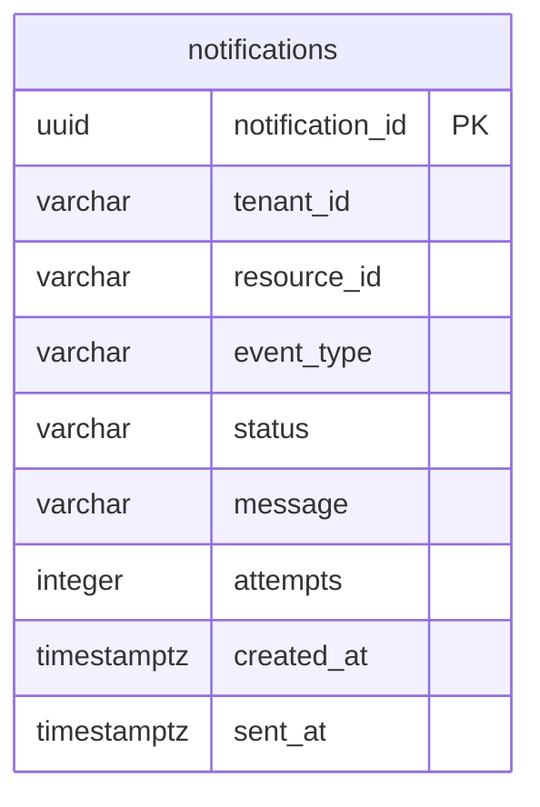

# Notification, Usage Aggregator and Expiry Worker

## Services

| Service | Port | Database |
|---|---|---|
| Notification | 8084 | notification_db |
| Usage Aggregator | 8086 | None |
| Expiry Worker | 8087 | None |

Each service has its own Maven project, configuration and README. Responsibilities follow
[units.md](../../inception/units.md). Requirements are FR-23–25 and FR-32–38.

## Notification

POST `/api/v1/notifications` accepts tenantId, resourceId, eventType and message.
GET on the same path requires tenantId and returns that tenant's history.

Delivery is simulated by logging event identifiers. The first attempt runs in the transaction
that records the notification. Success sets SENT and sent_at. Failure leaves PENDING until the
attempt limit is reached, then sets FAILED. The response is 202 after the transaction commits;
a database failure returns 503.

A scheduled job retries up to 100 PENDING records per interval. Each row is locked before delivery,
so concurrent retries cannot resend a SENT record. Attempts and outcomes survive restart.

Delivery is at least once. The POST contract has no event ID, so a repeated POST creates another
notification. A send followed by a failed database commit can also be repeated. Deduplication
would need an agreed event identifier in the request.

## Usage Aggregator

GET `/api/v1/usage/{tenantId}` reads Quota, Resource and Billing over HTTP. It returns Quota and
Billing objects unchanged and extracts Resource's `items` array. The billing period is the current
UTC month. Cost calculation stays in Billing.

Unavailable sections are omitted and marked false in `availability.quota`, `.resources` or
`.billing`. Available zero cost and empty resource lists remain present. Upstream errors,
including 404, degrade the affected section. The endpoint returns 200 even during a total outage.
It does not perform a separate tenant lookup.

Reads are sequential with connect and read timeouts. There is no cache or common snapshot across
services. Each outbound request carries the incoming correlation ID.

## Expiry Worker

The scheduler fetches `/api/v1/resources/expired`, checks candidate UUIDs and expiry times, and
posts to `/api/v1/resources/{id}/termination`. A failed fetch waits for the next sweep. A failed
termination is logged without stopping the remaining candidates.

Fixed-delay scheduling prevents overlapping sweeps within one process. Multiple workers rely
on the orchestrator's atomic termination guard. The worker stores no processed-resource list.
A 202 acknowledges the termination request; provider shutdown, billing stop and quota release
are the orchestrator's responsibility.

## Notification data



Flyway checks event and delivery states, nonblank identifiers and messages, nonnegative attempts,
and consistency between SENT and sent_at. Indexes support tenant history and pending retries.
There are no cross-service foreign keys. Aggregator and Worker have no datasource.

## Common behavior

- Request validation uses Bean Validation; errors name the affected fields.
- Errors use RFC 9457 Problem Details with code, correlationId and timestamp.
- Business endpoints use `/api/v1`; health and OpenAPI use `/health` and `/v3/api-docs.yaml`.
- Business logs are JSON with service, level and correlationId. Timestamps are UTC.
- Scheduled jobs generate a correlation ID per sweep. Startup logs have no request ID.
- Configuration uses environment variables with local defaults, listed in each `.env.example`.
- Notification health checks its database. Aggregator and Worker health exclude peer availability.
- Maven wrappers verify the distribution checksum. Dependabot covers these three projects.

Framework errors use ENDPOINT_NOT_FOUND (404), NOT_ACCEPTABLE (406) and UNSUPPORTED_MEDIA_TYPE
(415). Other framework statuses use HTTP_<status>. OpenAPI includes these services' response
schemas and the unhealthy-service response.

## Tests

| Requirement | Code | Tests |
|---|---|---|
| FR-32, FR-34, FR-35 | NotificationController, NotificationService, DeliverySimulator | NotificationHttpIT: lifecycle events, persistence and tenant history |
| FR-33 | NotificationService, NotificationRetry | NotificationServiceTest and NotificationHttpIT: retry, exhaustion and concurrency |
| FR-36 | UsageService | UsageHttpTest: composition and UTC month selection |
| FR-37, FR-38 | UsageService | UsageHttpTest: availability, zero cost, malformed responses and timeouts |
| FR-24, FR-25 worker behavior | ExpirySweep, ExpirySchedule | ExpirySweepTest: candidates, conflicts and failures; process test: scheduler |

After creating the development and test databases as described in the
[Notification README](../../../services/notification-service/README.md), run:

```powershell
pwsh scripts/u4/verify.ps1 -Postgres
pwsh scripts/u4/e2e.ps1 -SkipBuild
```

The process test starts three service jars and WireMock on separate ports, uses PostgreSQL,
exports OpenAPI and captures logs. It uses a new tenant per run and stops its child processes.
Notification integration tests delete rows in the configured test database; use a dedicated database.

[Test results and logs](../../../evidence/u4/README.md)

## Integration

The orchestrator must send ACTIVE, FAILED and TERMINATED notifications, including expiry events.
Billing returns its cost object for the requested period. All seven services are now present.
The [integration script](../../../scripts/integration.ps1) runs them against PostgreSQL and checks
provider shutdown, meter stop, quota release and lifecycle notifications. The isolated U4 tests
continue to use WireMock for failure and timeout cases.

Resource returns expired candidates in the agreed `items/count` envelope. Billing accepts the
orchestrator's named simulation modes directly.

Resource records durable work for provisioning and teardown. Failed cleanup is retried after
peer recovery or restart; the worker does not need terminated rows in the expired list.

## AI use

OpenAI Codex assisted with implementation, documentation and tests.
