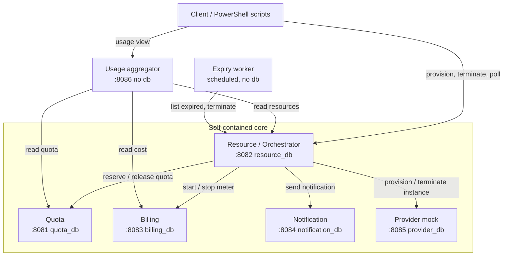
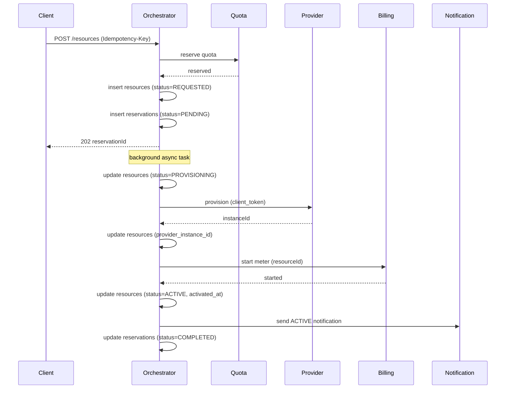
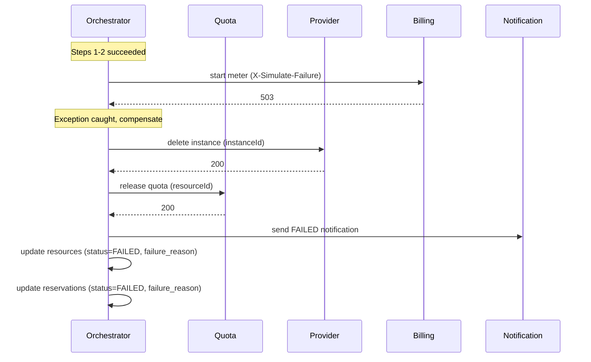

# Application Design

**Stage**: INCEPTION / Application Design
**Status**: Awaiting approval
**Depends on**: `inception/requirements/requirements.md` (approved)

This document fixes service boundaries, data ownership, the API of each service, the error
model, and the saga contract. The service contracts defined here are frozen on approval:
each unit is then built against them, with the rest stubbed. Alternatives considered are
recorded with their rationale, because the marking rewards justified boundaries.

---

## 1. Service Decomposition

Split by business capability, not technical layer. Each service is explainable in one
sentence and owns its data outright.

| Service | One-sentence responsibility | Owns data | Counts toward Condition A |
|---------|----------------------------|-----------|---------------------------|
| Quota | Holds each tenant and its tier, and reserves or releases quota atomically | Yes | Yes |
| Resource / Orchestrator | The tenant-facing entry point: drives the provisioning saga, owns resource lifecycle, and enforces idempotency | Yes | Yes |
| Billing | Meters cost from a resource becoming active until it is terminated | Yes | Yes |
| Notification | Records and best-effort delivers lifecycle notifications | Yes | Yes |
| Provider mock | Simulates an unreliable infrastructure provider | Yes | No (supporting; satisfies Condition E) |
| Usage aggregator | Composes a read-only usage and billing view over the other services | No | No (reporting; owns no data) |
| Expiry worker | On a schedule, terminates resources whose hold has expired | No | No (scheduled job) |

Four data-owning business services satisfy Condition A exactly. The provider mock satisfies
Condition E. The aggregator and the worker are additional deployables that own no data.

### 1.1 Why these boundaries

- **Quota is separate from Resource.** Quota is the contended resource (Challenge 1) and
  changes under a different pressure than resource lifecycle. Keeping it separate means the
  concurrency control is isolated and independently testable, and the orchestrator holds no
  quota state of its own.
- **Idempotency lives with the Orchestrator, not Billing.** The unsafe-to-repeat operation
  (Challenge 2) is the provisioning request, whose endpoint is on the orchestrator. The
  idempotency records are therefore owned there. Billing applies the same pattern locally for
  its meter start, keyed on resource id.
- **Billing is separate.** Cost accrual has its own lifecycle (start, accrue, stop) and its
  own data, and the usage view needs it independently.
- **Notification is separate and best-effort.** It must never roll back a provisioned,
  paid-for resource, so it sits outside the saga's compensation path.
- **The Provider mock is a service, not a library.** Condition E requires a real, separately
  runnable mock. It also has to be stoppable for the resilience baseline.

### 1.2 Alternatives considered

| Alternative | Rejected because |
|-------------|------------------|
| Fold Quota into the Orchestrator | The orchestrator would then own the contended resource and the saln state together, coupling Challenge 1 to Challenge 3 and making the concurrency control harder to test in isolation |
| A separate dedicated Saga/Orchestration service distinct from Resource | The resource lifecycle and the saga that drives it are the same aggregate; splitting them would put a state machine and its data on opposite sides of a REST boundary for no gain |
| Idempotency as its own service | It needs a transactional unique-constraint insert in the same database as the request it guards; a separate service would reintroduce the distributed-duplicate problem it exists to solve |
| Usage view as a data-owning service | It owns no data by definition; giving it a database would duplicate other services' data and risk the "no service reads another's data" rule |

### 1.3 OPEN-3 resolved

**Decision: the usage view and the expiry sweep are separate, data-less deployables, not
folded into the orchestrator.**

- The **usage aggregator** is a thin read-only service. It demonstrates API composition and
  graceful degradation (FR-36 to FR-38) and owns no data, so it cannot violate the
  no-shared-database rule. Keeping it separate also keeps it out of the core owner's files, so
  it is a clean independent unit.
- The **expiry worker** is a small scheduled service that calls the orchestrator's "list
  expired" and "terminate" endpoints. It holds no state; the safety and idempotency of expiry
  (FR-25) are enforced by the orchestrator's already-idempotent terminate path and BR7, so the
  worker can be simple.

**Alternative (rejected): fold both into the orchestrator** as a `GET /usage` endpoint and an
`@Scheduled` method. Simpler to deploy, but it concentrates everything in one service, removes
two cleanly separable units, and mixes a cross-service read and a background job into the
service that already carries the most logic.

---

## 2. Component View



Only the orchestrator, the aggregator, and the expiry worker make outbound calls. The four
other services are leaves. No arrow crosses into another service's database.

---

## 3. Data Ownership

Every row below is owned by exactly one service. Cross-service references are stored as bare
identifiers; there are no foreign keys across service boundaries and no cross-service joins.

| Data | Owner | Cross-service references held |
|------|-------|-------------------------------|
| Tenant, tier, quota limits and usage | Quota | — |
| Quota reservation ledger (per resource) | Quota | `resource_id` (opaque) |
| Resource and its lifecycle | Orchestrator | `tenant_id` (opaque), `provider_instance_id` (opaque) |
| Request reservation and saga state | Orchestrator | `tenant_id`, `resource_id` |
| Idempotency records | Orchestrator | `reservation_id` |
| Billing meters | Billing | `tenant_id`, `resource_id` (opaque) |
| Notifications | Notification | `tenant_id`, `resource_id` (opaque) |
| Provider instances | Provider mock | `client_token` (opaque) |

---

## 4. Per-Service Data Models

Column lists are the design intent; exact types and constraints are set in each unit's Flyway
baseline during Construction.

### 4.1 Quota (`quota_db`)

```
tenants
  tenant_id        text  PK
  name             text  not null
  tier             text  not null   -- FREE | STANDARD | ENTERPRISE
  created_at       timestamptz not null

tenant_quota
  tenant_id        text  PK references tenants (same service)
  cpu_used         int   not null default 0
  cpu_limit        int   not null
  ram_used_gb      int   not null default 0
  ram_limit_gb     int   not null
  instance_used    int   not null default 0
  instance_limit   int   not null

quota_reservations                     -- the release-exactly-once ledger (BR7)
  reservation_id   uuid  PK
  tenant_id        text  not null
  resource_id      text  not null  UNIQUE   -- one ledger row per resource
  cpu              int   not null
  ram_gb           int   not null
  state            text  not null   -- RESERVED | RELEASED
  created_at       timestamptz not null
  released_at      timestamptz
```

The `tenant_quota` row carries no version column: concurrency is handled by the atomic
conditional update of section 6, not optimistic locking. The `UNIQUE(resource_id)` on the
ledger is what makes both reservation and release idempotent and exactly-once.

### 4.2 Resource / Orchestrator (`resource_db`)

```
resources
  resource_id          uuid PK
  tenant_id            text not null
  type                 text not null   -- VM | CONTAINER | CLUSTER
  cpu                  int  not null
  ram_gb               int  not null
  status               text not null   -- REQUESTED | PROVISIONING | ACTIVE | FAILED | TERMINATED
  provider_instance_id text
  expires_at           timestamptz
  created_at           timestamptz not null
  activated_at         timestamptz
  terminated_at        timestamptz
  failure_reason       text           -- set when status=FAILED

reservations                            -- request-level async handle (FR-14, FR-16)
  reservation_id   uuid PK
  tenant_id        text not null
  resource_id      uuid           -- set once the resource row exists
  status           text not null  -- PENDING | COMPLETED | FAILED
  failure_reason   text
  created_at       timestamptz not null
  updated_at       timestamptz not null

idempotency_records
  idempotency_key   text PK
  request_fingerprint text not null   -- hash of the canonical request body
  reservation_id    uuid
  response_status   int
  response_body     text
  state             text not null  -- IN_PROGRESS | COMPLETED
  created_at        timestamptz not null
  expires_at        timestamptz not null   -- created_at + 24h
```

The saga state is tracked implicitly through `resources.status` and `reservations.status`. No
separate saga coordination tables are needed: the orchestrator runs the provisioning steps
sequentially and compensates on exception.

### 4.3 Billing (`billing_db`)

```
billing_meters
  meter_id          uuid PK
  resource_id       text not null UNIQUE   -- idempotent start keyed here (BR5, FR-30)
  tenant_id         text not null
  cpu               int  not null
  rate_per_cpu_hour numeric(10,4) not null  -- default 0.1200
  state             text not null  -- ACTIVE | STOPPED
  started_at        timestamptz not null
  stopped_at        timestamptz

billing_events
  event_id          bigserial PK
  resource_id       text not null
  event_type        text not null  -- START | STOP
  event_time        timestamptz not null
```

Cost is `rate_per_cpu_hour * cpu * secondsActive / 3600`, computed on read, prorated per
second (FR-28). Money is `numeric`, never floating point (NFR-22).

### 4.4 Notification (`notification_db`)

```
notifications
  notification_id  uuid PK
  tenant_id        text not null
  resource_id      text
  event_type       text not null  -- ACTIVE | FAILED | TERMINATED
  status           text not null  -- PENDING | SENT | FAILED
  message          text not null
  attempts         int  not null default 0
  created_at       timestamptz not null
  sent_at          timestamptz
```

### 4.5 Provider mock (`provider_db`)

```
instances
  instance_id    text PK            -- e.g. i-mock-<uuid>
  client_token   text not null UNIQUE   -- idempotent create (FR-43, FR-19)
  type           text not null
  cpu            int  not null
  ram_gb         int  not null
  status         text not null      -- ACTIVE | TERMINATED
  created_at     timestamptz not null
  terminated_at  timestamptz
```

### 4.6 Usage aggregator and Expiry worker

No database. Both are stateless and derive everything from REST calls.

---

## 5. API Design

All business paths are under `/api/v1`. Every service also exposes `GET /health` (NFR-12) and
`GET /v3/api-docs.yaml` via springdoc, exported to a committed `openapi.yaml` (NFR-11).

Status codes follow NFR-9: 200 read, 201 created, 202 accepted, 400 malformed, 404 absent,
409 state conflict, 422 business-rule violation, 503 downstream unavailable.

### 5.1 Quota (`:8081`)

| Method | Path | Purpose | Success | Errors |
|--------|------|---------|---------|--------|
| POST | `/api/v1/tenants` | Create a tenant | 201 | 400, 422 bad tier |
| GET | `/api/v1/tenants/{id}` | Read a tenant and its limits | 200 | 404 |
| GET | `/api/v1/tenants/{id}/quota` | Current usage and headroom | 200 | 404 |
| POST | `/api/v1/quota/reservations` | Reserve quota for a resource (atomic) | 200 | 422 insufficient, 422 BR8 cluster on FREE, 404 tenant |
| POST | `/api/v1/quota/reservations/{resourceId}/release` | Release a resource's quota (exactly once) | 200 | 404 |

Reserve request: `{ tenantId, resourceId, type, cpu, ramGb }`. Release and reserve are both
idempotent on `resourceId`.

### 5.2 Resource / Orchestrator (`:8082`)

| Method | Path | Purpose | Success | Errors |
|--------|------|---------|---------|--------|
| POST | `/api/v1/resources` | Provision (main entry). Headers: `Idempotency-Key` required, `X-Simulate-Failure` optional | 202 + `Location` | 400 missing key, 422 quota, 422 payload-mismatch on key reuse |
| GET | `/api/v1/reservations/{id}` | Poll reservation status | 200 | 404 |
| GET | `/api/v1/resources/{id}` | Read a resource | 200 | 404 |
| GET | `/api/v1/resources?tenantId=&status=` | List resources | 200 | 400 bad filter |
| POST | `/api/v1/resources/{id}/termination` | Terminate (idempotent) | 202 | 404, 409 not terminable |
| GET | `/api/v1/resources/expired` | Internal: ACTIVE resources past `expires_at` (for the worker) | 200 | — |

Provision request: `{ tenantId, type, cpu, ramGb, durationSeconds? }`.
Reservation status response: `{ reservationId, status, resourceId?, instanceId?, failureReason? }`.

### 5.3 Billing (`:8083`)

| Method | Path | Purpose | Success | Errors |
|--------|------|---------|---------|--------|
| POST | `/api/v1/billing/meters` | Start a meter (idempotent on resourceId). Header `X-Simulate-Failure` optional | 201 or 200 replay | 400, 422 |
| POST | `/api/v1/billing/meters/{resourceId}/stop` | Stop a meter (idempotent) | 200 | 404 |
| GET | `/api/v1/billing/meters/{resourceId}` | Read a meter and its accrued cost | 200 | 404 |
| GET | `/api/v1/billing/tenants/{tenantId}/cost?period=YYYY-MM` | Month-to-date cost | 200 | 400 bad period |

### 5.4 Notification (`:8084`)

| Method | Path | Purpose | Success | Errors |
|--------|------|---------|---------|--------|
| POST | `/api/v1/notifications` | Record and best-effort send | 202 | 400 |
| GET | `/api/v1/notifications?tenantId=` | History for a tenant | 200 | 400 |

### 5.5 Provider mock (`:8085`)

| Method | Path | Purpose | Success | Errors |
|--------|------|---------|---------|--------|
| POST | `/api/v1/provider/instances` | Provision (idempotent on clientToken). Header `X-Simulate-Failure` optional | 201 | 503 simulated failure |
| DELETE | `/api/v1/provider/instances/{id}` | Terminate an instance | 200 | 404 |

Config: `PROVIDER_FAILURE_RATE` (default 0.2), `PROVIDER_DELAY_MIN_MS` (1000),
`PROVIDER_DELAY_MAX_MS` (3000).

### 5.6 Usage aggregator (`:8086`)

| Method | Path | Purpose | Success |
|--------|------|---------|---------|
| GET | `/api/v1/usage/{tenantId}` | Composed quota + active resources + month-to-date cost, with per-section availability | 200 (always, degrading per FR-37) |

### 5.7 Error model (NFR-10)

Every error, in every service, is RFC 9457 Problem Details extended with three fields:

```json
{
  "type": "https://crm.example/errors/insufficient-quota",
  "title": "Insufficient quota",
  "status": 422,
  "detail": "Requested 4 CPU exceeds remaining 2 CPU for tenant acme",
  "instance": "/api/v1/resources",
  "code": "QUOTA_EXCEEDED",
  "correlationId": "b1c2...",
  "timestamp": "2026-10-11T10:30:15Z"
}
```

A shared `code` vocabulary (e.g. `QUOTA_EXCEEDED`, `IDEMPOTENCY_KEY_REQUIRED`,
`IDEMPOTENCY_PAYLOAD_MISMATCH`, `INVALID_STATE_TRANSITION`, `PROVIDER_UNAVAILABLE`,
`DOWNSTREAM_UNAVAILABLE`) is listed in `CONTRIBUTING.md` so services agree.

---

## 6. Concurrency Contract (Challenge 1)

Quota reservation is one atomic statement whose affected-row count is the decision:

```sql
UPDATE tenant_quota
   SET cpu_used      = cpu_used + :cpu,
       ram_used_gb   = ram_used_gb + :ram,
       instance_used = instance_used + 1
 WHERE tenant_id = :tenantId
   AND cpu_used      + :cpu <= cpu_limit
   AND ram_used_gb   + :ram <= ram_limit_gb
   AND instance_used + 1    <= instance_limit;
```

One row updated means reserved; zero means rejected with `QUOTA_EXCEEDED`. The ledger insert
(`quota_reservations`, unique on `resource_id`) and this update happen in one transaction, so
a duplicate reserve for the same resource is stopped by the unique constraint and never
double-counts. BR8 (no CLUSTER on FREE) is checked before the update and returns 422.

---

## 7. Idempotency Contract (Challenge 2)

On `POST /api/v1/resources`:

1. No `Idempotency-Key` header -> 400 `IDEMPOTENCY_KEY_REQUIRED`.
2. Compute a fingerprint over the canonical request body.
3. Insert `idempotency_records(key, fingerprint, state=IN_PROGRESS)`. The PK insert is the
   concurrency guard: the second of two simultaneous identical requests fails the insert and
   waits for or reads the first result.
4. Insert succeeded -> process: create the reservation, start the saga, then store the
   response and set `state=COMPLETED`.
5. Insert failed (key exists):
   - fingerprint differs -> 422 `IDEMPOTENCY_PAYLOAD_MISMATCH`;
   - fingerprint matches, record `COMPLETED` -> return the stored response verbatim;
   - fingerprint matches, record `IN_PROGRESS` -> 202 pointing at the same reservation.
6. Records expire 24h after creation.

---

## 8. Saga Contract (Challenge 3C)

Orchestrated saga with compensation. The orchestrator drives the provisioning flow sequentially
in a background async task. State is tracked through `resources.status` and
`reservations.status`; no separate saga coordination tables are needed.

The request returns 202 before the saga runs (FR-13 to FR-15); the saga proceeds asynchronously
in a background task.

### 8.1 Provisioning Steps

| # | Step | Forward call | Compensation (on failure) |
|---|------|--------------|---------------------------|
| 1 | RESERVE_QUOTA | Quota reserve | Quota release |
| 2 | PROVISION | Provider create instance (carries `client_token`) | Provider delete instance |
| 3 | START_BILLING | Billing start meter | Billing stop meter (if started) |
| 4 | NOTIFY | Notification send | none (best effort) |

**Flow:**
1. Quota is reserved **synchronously** in step 1 before the 202 response (so the Challenge 1
   count is deterministic).
2. Steps 2 to 4 run in the background async task.
3. If any step fails, the orchestrator **immediately compensates** by calling reverse operations
   for all completed steps in reverse order.
4. Compensation is idempotent (AC-3.7): each compensating call targets an idempotent endpoint
   (provider delete is idempotent on instance_id, quota release is idempotent on resource_id
   via the ledger's unique constraint).

### 8.2 Happy Path



### 8.3 Failure at Step 3 (Billing) — Compensation Triggered



### 8.4 Queryable State (AC-3.1)

The saga outcome is queryable via `resources.status`:

```sql
-- All failed provisions (compensated)
SELECT resource_id, tenant_id, status, failure_reason, created_at
  FROM resources
 WHERE status = 'FAILED';

-- All active provisions (saga completed successfully)
SELECT resource_id, tenant_id, status, provider_instance_id, activated_at
  FROM resources
 WHERE status = 'ACTIVE';

-- Provisions in progress
SELECT resource_id, tenant_id, status, created_at
  FROM resources
 WHERE status IN ('REQUESTED', 'PROVISIONING');
```

The compensation outcome is visible: a FAILED resource with no `provider_instance_id` or
`activated_at` means compensation happened before activation; a FAILED resource with a
`provider_instance_id` means compensation had to undo a completed provisioning step.

### 8.5 Implementation Notes

The orchestrator's async provisioning task is structured as:

```java
try {
    // Step 1: already done synchronously before 202
    
    // Step 2: provision
    updateResourceStatus(resourceId, PROVISIONING);
    String instanceId = providerClient.provision(clientToken, type, cpu, ram);
    updateResourceInstanceId(resourceId, instanceId);
    
    // Step 3: start billing
    billingClient.startMeter(resourceId, tenantId, cpu, rate);
    
    // Step 4: activate
    updateResourceStatus(resourceId, ACTIVE, now());
    
    // Step 5: notify
    notificationClient.send(tenantId, resourceId, "ACTIVE", message);
    
    // Complete reservation
    updateReservationStatus(reservationId, COMPLETED);
    
} catch (Exception e) {
    // Compensate in reverse order
    compensate(resourceId, instanceId);  // calls provider delete, quota release
    updateResourceStatus(resourceId, FAILED, e.getMessage());
    updateReservationStatus(reservationId, FAILED, e.getMessage());
    notificationClient.send(tenantId, resourceId, "FAILED", e.getMessage());
}
```

This is simpler than a separate saga state machine and satisfies AC-3.1 through the
`resources` table.

---

## 9. Cross-Cutting Conventions (frozen in CONTRIBUTING.md)

Every service follows the same shape so NFR-10 and NFR-13 hold across the system:

- **Layering**: `api` (controllers, DTOs), `domain` (rules, state machines), `persistence`
  (repositories, entities). Rules live in `domain` and are unit-tested there.
- **Correlation id**: a servlet filter reads `X-Correlation-Id` or generates one, puts it in
  the logging MDC, and an outbound HTTP interceptor forwards it on every call (NFR-13, NFR-14).
- **Logging**: structured JSON to stdout, every line carrying `correlationId`, `service`,
  `level`; no secrets or full payloads (NFR-15, NFR-17).
- **Config**: all via environment variables with local defaults (NFR-18, NFR-19); a table of
  variables per service in its README.
- **Migrations**: Flyway `V1__baseline.sql` per service; no ORM auto-DDL (NFR-23).
- **Build**: independent Maven module per service with the wrapper; a root aggregator pom
  builds all (NFR-1, NFR-6).
- **Testing**: JUnit 5 everywhere; Testcontainers for BR1, BR3, BR7 (section 8 of requirements).

---

## 10. Ports and Databases

| Service | Port (default) | Database | DB user |
|---------|----------------|----------|---------|
| Quota | 8081 | quota_db | quota_user |
| Resource / Orchestrator | 8082 | resource_db | resource_user |
| Billing | 8083 | billing_db | billing_user |
| Notification | 8084 | notification_db | notification_user |
| Provider mock | 8085 | provider_db | provider_user |
| Usage aggregator | 8086 | none | — |
| Expiry worker | 8087 | none | — |

One PostgreSQL server, a separate database and least-privilege user per service (NFR-2). All
values overridable by environment variables.

---

## 11. Business-Rule Placement

| Rule | Service | Where |
|------|---------|-------|
| BR1 quota never exceeds limits | Quota | atomic conditional update, section 6 |
| BR2 provisioning idempotent | Orchestrator | idempotency layer, section 7 |
| BR3 payload-mismatch rejected | Orchestrator | fingerprint compare, section 7 |
| BR4 valid lifecycle transitions | Orchestrator | resource domain state machine |
| BR5 billing stops on termination | Billing | meter stop |
| BR6 compensation refunds quota | Orchestrator | saga compensation, section 8 |
| BR7 quota released exactly once | Quota | release ledger, unique on resource_id |
| BR8 no CLUSTER on FREE | Quota | tier policy before reserve |

---

## 12. Frozen Contracts

On approval, the per-service API tables in section 5, the request/response shapes, the error
model in section 5.7, and the saga contract in section 8 are frozen. Each unit's first
Construction output is its `openapi.yaml` matching this; thereafter every service codes
against the frozen contracts and stubs peers with WireMock. A contract change after this point
is a new, logged decision.

---

## 13. Open Items Carried Forward

- **OPEN-1** (how each unit's starting point is produced) — Units Generation.
- **OPEN-2** (member names) — Units Generation.
- OPEN-3 is resolved in section 1.3.

---

## 14. Stage Acceptance

Complete when approved. On approval, the next stage is **Units Generation**, which turns these
services into units of work with an owner and a dependency DAG, and resolves OPEN-1 and OPEN-2.
