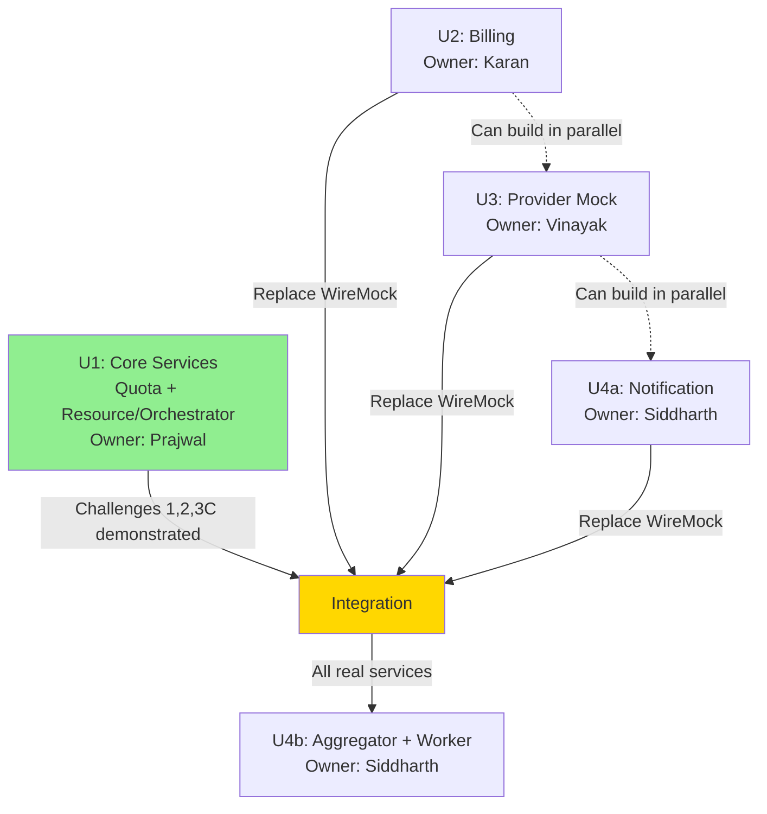

# Units Generation

**Stage**: INCEPTION / Units Generation
**Status**: APPROVED (2026-10-13)
**Depends on**: `inception/design/application-design.md` (approved)

This document defines the units of work, assigns owners, establishes the build order, and
resolves the two open items from earlier stages. Every unit is a deployable service or a set of
related deployables built by one owner.

---

## 1. Summary

The 7 services from Application Design are grouped into **4 units** owned by 4 team members.
The core owner (Prajwal) builds the challenge-bearing services (Quota, Resource/Orchestrator)
first with WireMock stubs for dependencies, demonstrating all 3 challenges with mocked
downstream services. The other three members build the remaining services from skeletons in
parallel. Once complete, the mocks are replaced with real services for full integration.

---

## 2. Unit Definitions

| Unit ID | Unit Name | Services Included | Owner | Deliverable |
|---------|-----------|-------------------|-------|-------------|
| U1 | Core Challenge Services | Quota, Resource/Orchestrator | Prajwal | Working services + WireMock stubs + Challenge 1, 2, 3C evidence |
| U2 | Billing Service | Billing | Karan | Working service from skeleton |
| U3 | Provider Mock Service | Provider mock | Vinayak | Working service from skeleton |
| U4 | Supporting Services | Notification, Usage Aggregator, Expiry Worker | Siddharth | 3 working services from skeletons |

**Total:** 7 deployable services across 4 units.

---

## 3. Per-Unit Scope and Owner Responsibilities

### Unit U1: Core Challenge Services (Owner: Prajwal)

**Services:**
1. **Quota Service** (:8081, `quota_db`)
2. **Resource/Orchestrator Service** (:8082, `resource_db`)

**Starting Point:**
- Test skeletons with:
  - Spring Boot project structure
  - Database schema (Flyway `V1__baseline.sql`)
  - JPA entities defined
  - Repository interfaces (Spring Data)
  - Controller method signatures (no implementation)
  - Service layer stubs (method signatures, TODOs)
  - Test class structure (method names, no assertions)
  - `application.yml` config templates
  - README with build/run instructions

**What Prajwal Implements:**
- ✅ All business logic in service layers
- ✅ All controller endpoint implementations
- ✅ Atomic conditional update SQL for quota reservation (Challenge 1)
- ✅ Idempotency layer with fingerprint checking (Challenge 2)
- ✅ Saga orchestration with compensation (Challenge 3C)
- ✅ Error handling and validation
- ✅ All unit tests with assertions
- ✅ WireMock configuration for: Provider, Billing, Notification
- ✅ Testcontainers tests for BR1, BR3, BR7

**WireMock Stubs (for Challenge demonstrations):**
```java
// Provider mock
POST /api/v1/provider/instances → 201 {"instanceId": "i-mock-..."}
DELETE /api/v1/provider/instances/{id} → 200

// Billing mock
POST /api/v1/billing/meters → 201 (or 503 with X-Simulate-Failure header)
POST /api/v1/billing/meters/{resourceId}/stop → 200

// Notification mock
POST /api/v1/notifications → 202
```

**Challenge Evidence (Prajwal delivers):**
- **Challenge 1 (Concurrency):**
  - Script: 20 parallel quota reservation requests
  - Output: exactly N succeed (where N = quota limit)
  - Database state: `quota_reservations` table with N rows, `tenant_quota` showing correct usage
  - Explanation: atomic conditional UPDATE prevents over-allocation

- **Challenge 2 (Idempotency):**
  - Script: 10 identical provision requests with same `Idempotency-Key`
  - Output: all return same `reservationId`, only 1 resource created
  - Database state: 1 row in `idempotency_records`, 1 row in `reservations`, 1 row in `resources`
  - Concurrent test: 5 simultaneous identical requests → 1 resource
  - Payload mismatch test: reused key with different body → 422 error

- **Challenge 3C (Saga with Compensation):**
  - Script: provision request with `X-Simulate-Failure: true` header (forces billing failure)
  - Output: reservation status = FAILED, resource status = FAILED
  - Database state:
    - `resources.status = 'FAILED'`, `failure_reason` populated
    - `tenant_quota` restored to original value (quota released)
    - `quota_reservations` shows RELEASED state
  - Logs: show compensation executing in reverse order (provider delete, quota release)
  - Explanation: orchestrator caught billing 503, triggered compensation

**Acceptance Criteria:**
- [ ] Quota service runs on :8081, passes health check
- [ ] Resource/Orchestrator service runs on :8082, passes health check
- [ ] All 3 challenge scripts execute successfully with WireMock stubs
- [ ] All unit tests pass
- [ ] Testcontainers tests for BR1, BR3, BR7 pass
- [ ] OpenAPI specs generated and committed
- [ ] README documents how to run with WireMock

---

### Unit U2: Billing Service (Owner: Karan)

**Services:**
1. **Billing Service** (:8083, `billing_db`)

**Starting Point:**
- Test skeleton with:
  - Spring Boot project structure
  - Database schema: `billing_meters`, `billing_events`
  - JPA entities defined
  - Repository interfaces
  - Controller stubs: `POST /meters`, `POST /meters/{resourceId}/stop`, `GET /meters/{resourceId}`, `GET /tenants/{tenantId}/cost`
  - Service layer stubs
  - Test class structure
  - README

**What Karan Implements:**
- ✅ Meter start logic (idempotent on `resource_id`)
- ✅ Meter stop logic (idempotent)
- ✅ Cost calculation: `cpu × rate × (stopped_at - started_at) / 3600`
- ✅ Month-to-date cost aggregation for tenant
- ✅ Failure simulation (`X-Simulate-Failure` header support)
- ✅ Error handling and validation
- ✅ All unit tests
- ✅ BR5 test: billing stops when resource terminated

**Enhancement Brief:**
```
The Billing service meters resource usage and calculates costs.

Core APIs (required for Challenge 3C):
- POST /api/v1/billing/meters: Start a meter (idempotent on resource_id)
- POST /api/v1/billing/meters/{resourceId}/stop: Stop a meter
- GET /api/v1/billing/meters/{resourceId}: Read meter and current cost

Additional APIs (enhance functionality):
- GET /api/v1/billing/tenants/{tenantId}/cost?period=YYYY-MM: Month-to-date cost

Business Rules:
- BR5: Billing stops when resource is terminated (test this)
- Cost prorated per second: rate × cpu × seconds / 3600
- Money stored as numeric (never float)
- Support X-Simulate-Failure header (default: never fail)

Testing:
- Unit test: meter lifecycle (start → calculate cost → stop)
- Unit test: idempotency (start same resource twice → same meter)
- Unit test: cost calculation accuracy
```

**Acceptance Criteria:**
- [ ] Billing service runs on :8083, passes health check
- [ ] All 4 API endpoints implemented and working
- [ ] Meter start is idempotent (database UNIQUE constraint on `resource_id`)
- [ ] Cost calculation is accurate (test with known duration)
- [ ] X-Simulate-Failure header works (returns 503 when true)
- [ ] BR5 test passes
- [ ] OpenAPI spec generated and committed
- [ ] README documents configuration (failure rate, default rate)

---

### Unit U3: Provider Mock Service (Owner: Vinayak)

**Services:**
1. **Provider Mock** (:8085, `provider_db`)

**Starting Point:**
- Test skeleton with:
  - Spring Boot project structure
  - Database schema: `instances`
  - JPA entities defined
  - Repository interfaces
  - Controller stubs: `POST /provider/instances`, `DELETE /provider/instances/{id}`
  - Service layer stubs
  - Test class structure
  - README

**What Vinayak Implements:**
- ✅ Instance provisioning (idempotent on `client_token`)
- ✅ Instance termination
- ✅ Simulated delay (1-3 seconds, configurable)
- ✅ Simulated failure (20% rate, configurable, or forced via `X-Simulate-Failure` header)
- ✅ Generate mock instance IDs: `i-mock-{uuid}`
- ✅ Error handling and validation
- ✅ All unit tests
- ✅ FR-19 test: client token idempotency

**Enhancement Brief:**
```
The Provider Mock simulates an unreliable infrastructure provider API.

APIs:
- POST /api/v1/provider/instances: Create instance (idempotent on client_token)
  - Input: { "clientToken", "type", "cpu", "ramGb" }
  - Output: { "instanceId": "i-mock-...", "status": "ACTIVE" }
  - Behavior: sleep 1-3s, fail 20% of time (or if X-Simulate-Failure header present)
  
- DELETE /api/v1/provider/instances/{id}: Terminate instance
  - Output: 200 (idempotent, 404 if not found)

Configuration (environment variables):
- PROVIDER_FAILURE_RATE (default 0.2)
- PROVIDER_DELAY_MIN_MS (default 1000)
- PROVIDER_DELAY_MAX_MS (default 3000)

Business Rules:
- FR-19: Client token makes provisioning idempotent (UNIQUE constraint on client_token)
- FR-43: Failure simulation via X-Simulate-Failure header overrides rate

Testing:
- Unit test: provision succeeds, returns instance ID
- Unit test: same client token twice → same instance (idempotency)
- Unit test: X-Simulate-Failure header → 503
- Unit test: termination idempotent (call twice, no error)
```

**Acceptance Criteria:**
- [x] Provider service defaults to :8085; live HTTP health check includes database connectivity
- [x] Provisioning is idempotent on `client_token` (including 16 concurrent HTTP calls)
- [x] Simulated delay and failure work (configurable)
- [x] X-Simulate-Failure header forces 503 for new operations; persisted replays bypass simulation
- [x] Termination is idempotent
- [x] FR-19 and FR-43 tests pass
- [x] OpenAPI spec generated and committed with U3
- [x] README documents configuration variables

---

### Unit U4: Supporting Services (Owner: Siddharth)

**Services:**
1. **Notification Service** (:8084, `notification_db`)
2. **Usage Aggregator** (:8086, no database)
3. **Expiry Worker** (:8087, no database)

**Starting Point (3 separate skeletons):**

**Notification skeleton:**
- Spring Boot project structure
- Database schema: `notifications`
- JPA entities and repositories
- Controller stubs: `POST /notifications`, `GET /notifications`
- Service layer stubs
- Test class structure
- README

**Usage Aggregator skeleton:**
- Spring Boot project structure (no database)
- Controller stub: `GET /usage/{tenantId}`
- Service layer stubs with HTTP client configuration
- Test class structure
- README

**Expiry Worker skeleton:**
- Spring Boot project structure (no database)
- Scheduled job stub (`@Scheduled` annotation)
- HTTP client configuration
- Test class structure
- README

**What Siddharth Implements:**

**Notification Service:**
- ✅ Record notification (tenant, resource, event type, message)
- ✅ Best-effort send (log to console, mark as SENT)
- ✅ Query notifications by tenant
- ✅ Error handling
- ✅ All unit tests

**Usage Aggregator:**
- ✅ Compose usage view from 3 services:
  - Call Quota: `GET /tenants/{id}/quota`
  - Call Resource/Orchestrator: `GET /resources?tenantId={id}&status=ACTIVE`
  - Call Billing: `GET /tenants/{id}/cost?period=YYYY-MM`
- ✅ Graceful degradation (FR-37): if one service fails, return partial data with availability flags
- ✅ Error handling
- ✅ All unit tests (with WireMock for upstream services)

**Expiry Worker:**
- ✅ Scheduled job (runs every 30 seconds, configurable)
- ✅ Call Orchestrator: `GET /resources/expired`
- ✅ For each expired resource: `POST /resources/{id}/termination`
- ✅ Log actions
- ✅ Idempotency: termination endpoint is idempotent (FR-25, AC-7.2)
- ✅ All unit tests (with WireMock for orchestrator)

**Enhancement Briefs:**

**Notification:**
```
Best-effort notification service (sits outside saga compensation path).

APIs:
- POST /api/v1/notifications: Record and send notification
  - Input: { "tenantId", "resourceId", "eventType", "message" }
  - Output: 202 (always accepted)
  
- GET /api/v1/notifications?tenantId={id}: Query notification history
  - Output: list of notifications with status (SENT/FAILED)

Implementation:
- Insert notification row with status=PENDING
- Log message to console (simulates email/SMS)
- Mark status=SENT
- Always return 202 (best effort, never fails)

Testing:
- Unit test: notification recorded and marked SENT
- Unit test: query returns notifications for tenant
```

**Usage Aggregator:**
```
Read-only API composition service (no database).

API:
- GET /api/v1/usage/{tenantId}: Composed usage view
  - Output: { "quota": {...}, "resources": [...], "cost": {...}, "availability": {...} }

Implementation:
- Call 3 upstream services in parallel (or sequentially)
- If Quota unavailable: set availability.quota=false, omit quota data
- If Resource unavailable: set availability.resources=false, omit resources
- If Billing unavailable: set availability.billing=false, omit cost
- Always return 200 with whatever data is available (FR-37)

Configuration:
- QUOTA_SERVICE_URL (default http://localhost:8081)
- RESOURCE_SERVICE_URL (default http://localhost:8082)
- BILLING_SERVICE_URL (default http://localhost:8083)

Testing:
- Unit test: all services available → full data
- Unit test: billing unavailable → partial data with availability flag
```

**Expiry Worker:**
```
Scheduled background job (no HTTP endpoints, no database).

Job:
- Runs every 30 seconds (configurable: EXPIRY_CHECK_INTERVAL_MS)
- Call Orchestrator: GET /resources/expired
- For each expired resource: POST /resources/{id}/termination
- Log each termination action

Configuration:
- RESOURCE_SERVICE_URL (default http://localhost:8082)
- EXPIRY_CHECK_INTERVAL_MS (default 30000)

Safety:
- Termination endpoint is idempotent (FR-25, AC-7.2)
- Safe to run multiple workers (each termination call is idempotent)
- Never terminates FAILED or already TERMINATED resources (orchestrator enforces)

Testing:
- Unit test: fetches expired resources from orchestrator
- Unit test: calls termination for each expired resource
- Unit test: handles empty list gracefully
```

**Acceptance Criteria:**
- [ ] Notification service runs on :8084, passes health check
- [ ] Usage Aggregator runs on :8086, passes health check
- [ ] Expiry Worker runs on :8087, passes health check
- [ ] Notification API works (record and query)
- [ ] Usage Aggregator returns composed view with graceful degradation
- [ ] Expiry Worker scheduled job runs and terminates expired resources
- [ ] All unit tests pass for all 3 services
- [ ] OpenAPI specs generated for Notification and Aggregator
- [ ] READMEs document configuration for all 3 services

---

## 4. Dependency DAG (Build Order)



**Build Phases:**

**Phase 1 (Week 1-2): Core Owner (Prajwal)**
- Build U1 (Quota + Resource/Orchestrator) with WireMock stubs
- Deliver Challenge 1, 2, 3C evidence with mocks
- **Milestone:** Self-contained core is complete and gradeable

**Phase 2 (Week 2-3): Team Members (parallel)**
- Karan: Build U2 (Billing)
- Vinayak: Build U3 (Provider)
- Siddharth: Build U4a (Notification)
- **Milestone:** All 3 team services complete

**Phase 3 (Week 3): Integration**
- Replace WireMock stubs with real services
- Re-run Challenge 3C with real Billing service
- Integration testing across all services
- **Milestone:** Full system integration

**Phase 4 (Week 3): Final Layer**
- Siddharth: Build U4b (Aggregator + Worker) — depends on all other services
- **Milestone:** All 7 services complete

---

## 5. Fallback Strategy

**If team members don't complete their units:**

**Fallback Option 1: Prajwal takes over**
- Prajwal has skeletons for all services
- Can implement Billing, Provider, or Notification from skeletons
- Priority: Billing (needed for strongest Challenge 3C evidence)

**Fallback Option 2: Stay with mocks**
- Challenge evidence is still valid with WireMock stubs
- Report explains: "Real services were designed, core implemented with mocks for demonstration"
- Demonstrates understanding of saga pattern and compensation logic

**Grading Impact:**
- Individual marks based on actual contribution (git commits, demo participation)
- Prajwal's core (U1) is self-contained and demonstrates all challenges
- Team members graded on their own unit completion

---

## 6. Open Items Resolution

### OPEN-1: Starting Point for Code Generation

**Decision:** Test skeletons for all units (Option B)

**Rationale:**
- Deeper learning: owners understand the code they write
- Flexibility: Prajwal can take over if needed (everyone has same starting point)
- Consistency: all skeletons follow the same structure

**What skeletons include:**
- Project structure (Spring Boot, Maven)
- Database schema (Flyway migrations)
- JPA entities (annotations, relationships)
- Repository interfaces (Spring Data)
- Controller method signatures (no implementation)
- Service layer stubs (method signatures, TODOs)
- Test class structure (method names, no assertions)
- Configuration templates (`application.yml`)
- README with build/run instructions

**What owners implement:**
- All business logic
- All endpoint implementations
- All test assertions
- Error handling
- Validation logic

---

### OPEN-2: Team Member Names

**Decision:** Use actual first names (Option 2)

**Team:**
- **Prajwal** (Core Owner): Quota + Resource/Orchestrator
- **Karan**: Billing
- **Vinayak**: Provider Mock
- **Siddharth**: Notification + Aggregator + Worker

**Contribution Table (for report appendix):**

| Member | Unit | Services | Lines of Code (est.) | Key Responsibilities |
|--------|------|----------|----------------------|----------------------|
| Prajwal | U1 | Quota, Resource/Orchestrator | ~1500 | Challenge 1, 2, 3C implementation and evidence |
| Karan | U2 | Billing | ~400 | Billing meters, cost calculation, BR5 |
| Vinayak | U3 | Provider Mock | ~300 | Simulated delays and failures, FR-19, FR-43 |
| Siddharth | U4 | Notification, Aggregator, Worker | ~500 | Best-effort notifications, API composition, expiry job |

---

## 7. Test Strategy Per Unit

### U1 (Prajwal)
- **Unit tests:** All business rules (BR1, BR2, BR3, BR4, BR6, BR7, BR8)
- **Integration tests (Testcontainers):** BR1 (atomic quota update), BR3 (idempotency unique constraint), BR7 (release ledger unique constraint)
- **Challenge scripts:** Concurrency (20 parallel), Idempotency (10 repeats + concurrent), Saga (forced billing failure)
- **WireMock tests:** Full saga with mocked downstream services

### U2 (Karan)
- **Unit tests:** Meter start/stop, cost calculation, idempotency, BR5
- **Integration test:** Real database test for meter idempotency (UNIQUE constraint)

### U3 (Vinayak)
- **Unit tests:** Provision, terminate, idempotency (FR-19), failure simulation (FR-43)
- **Integration test:** Real database test for client token idempotency

### U4 (Siddharth)
- **Notification unit tests:** Record, query, always 202
- **Aggregator unit tests:** API composition, graceful degradation (with WireMock upstream)
- **Worker unit tests:** Scheduled job, termination calls (with WireMock orchestrator)

---

## 8. Configuration Management

All services use environment variables for configuration (NFR-18, NFR-19).

**Common variables (all services):**
```
SERVER_PORT (default per service: 8081, 8082, ...)
DB_HOST (default localhost)
DB_PORT (default 5432)
DB_NAME (quota_db, resource_db, ...)
DB_USER (quota_user, resource_user, ...)
DB_PASSWORD (changeme)
LOG_LEVEL (default INFO)
```

**Service-specific variables:**

**Quota:**
```
(none, uses common only)
```

**Resource/Orchestrator:**
```
QUOTA_SERVICE_URL (default http://localhost:8081)
PROVIDER_SERVICE_URL (default http://localhost:8085)
BILLING_SERVICE_URL (default http://localhost:8083)
NOTIFICATION_SERVICE_URL (default http://localhost:8084)
```

**Billing:**
```
DEFAULT_CPU_RATE (default 0.12)
```

**Provider:**
```
PROVIDER_FAILURE_RATE (default 0.2)
PROVIDER_DELAY_MIN_MS (default 1000)
PROVIDER_DELAY_MAX_MS (default 3000)
```

**Notification:**
```
(none, uses common only)
```

**Aggregator:**
```
QUOTA_SERVICE_URL (default http://localhost:8081)
RESOURCE_SERVICE_URL (default http://localhost:8082)
BILLING_SERVICE_URL (default http://localhost:8083)
```

**Worker:**
```
RESOURCE_SERVICE_URL (default http://localhost:8082)
EXPIRY_CHECK_INTERVAL_MS (default 30000)
```

---

## 9. Toolchain Install Checkpoint

Before starting Construction (Code Generation), the team must install the tech stack.

**Required toolchain:**
- **JDK 21** (Temurin, Liberica, or Oracle)
- **PostgreSQL 16 or 17** (one server, 5 databases)
- **Docker Desktop** (for Testcontainers at test time)
- **PowerShell 7** (for scripts)
- **Git** (for version control)
- **Maven** (not needed if using wrapper — mvnw is committed)

**Install checklist:**
```bash
# Verify JDK
java -version  # should show 21.x

# Verify PostgreSQL
psql --version  # should show 16.x or 17.x

# Verify Docker
docker --version
docker ps  # should connect to daemon

# Verify PowerShell
pwsh --version  # should show 7.x

# Verify Git
git --version
```

**PostgreSQL setup (before Code Generation):**
```sql
-- Create databases and users
CREATE DATABASE quota_db;
CREATE USER quota_user WITH PASSWORD 'changeme';
GRANT ALL PRIVILEGES ON DATABASE quota_db TO quota_user;

CREATE DATABASE resource_db;
CREATE USER resource_user WITH PASSWORD 'changeme';
GRANT ALL PRIVILEGES ON DATABASE resource_db TO resource_user;

CREATE DATABASE billing_db;
CREATE USER billing_user WITH PASSWORD 'changeme';
GRANT ALL PRIVILEGES ON DATABASE billing_db TO billing_user;

CREATE DATABASE notification_db;
CREATE USER notification_user WITH PASSWORD 'changeme';
GRANT ALL PRIVILEGES ON DATABASE notification_db TO notification_user;

CREATE DATABASE provider_db;
CREATE USER provider_user WITH PASSWORD 'changeme';
GRANT ALL PRIVILEGES ON DATABASE provider_db TO provider_user;
```

---

## 10. Next Stage

On approval of this Units Generation document, proceed to **Construction Phase** with the
following sequence per unit:

1. **Functional Design** (business logic, state machines, algorithms)
2. **NFR Requirements** (extract NFRs applicable to this unit)
3. **NFR Design** (logging, config, error handling, correlation IDs)
4. **Infrastructure Design** (Docker, environment variables, health checks)
5. **Code Generation** (create skeleton from designs)

After all units complete Code Generation, proceed to **Build and Test** (integration, E2E, challenge scripts).

---

## Stage Acceptance

Complete when approved. On approval:
- OPEN-1 is resolved: test skeletons for all
- OPEN-2 is resolved: names recorded (Prajwal, Karan, Vinayak, Siddharth)
- Build order and owner assignments are frozen
- Toolchain install is the next checkpoint before Construction

**Status:** APPROVED 2026-10-13. Inception phase closed. Next: toolchain install checkpoint,
then Construction for unit U1.
